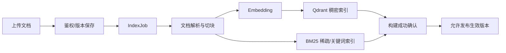

# AI/RAG 技术设计与安全契约

> **R1 对齐说明（2026-10-28）**：本文保留需求来源与历史设计；当前冻结规则以 [R1 实施规格](../specs/RELEASE-01.md) 为准，实际实现/验证状态见 [R1 交付清单](../DELIVERY-R1.md)。历史“下一批/待开发/已通过”描述不作为本次执行证据。

> 版本 v1.0 · 2026-10-26 · **历史设计稿。2026-10-29 现行商品召回以 [SDD-07](../specs/SDD-AI-RECALL-07.md) 为准：MySQL 关键词召回、Python BM25 和可选 LLM；商品 Qdrant 向量召回尚未实现。**  
> 本文件只记录本项目额外的 AI/RAG 技术决策；DDD Java 分层/命名仍以 `xfg-ddd-skills` 为准。相关 [ShoppingAI 领域](../domains/shoppingai.md) · [评测](evaluation-plan.md)。

## 1. 目标与非目标

目标：理解中文校园选购需求（预算、用途、口味、数量、规格、偏好），跨商户召回 SKU；结合真实价格、库存和授权知识给出可解释推荐，生成必须由用户确认的加购提案。非目标：模型自主下单、付款、修改库存或依赖模型回复做最终交易定价。

## 2. Java/Python 两侧职责

| Java Spring Boot | Python FastAPI |
|---|---|
| 认证、商户权限、会话归属、Proposal 状态 | 购物意图解析、查询改写、检索与重排 |
| Catalog/Inventory 实时报价和营业资格 | Embedding、Qdrant 混合检索、RRF 融合 |
| 交易命令与数据库事务 | 利用授权证据生成推荐文案、可解释答复 |
| 知识文档版本/发布的业务状态 | 文档解析、切块、索引任务的执行端 |
| AI 模型超时与错误映射、审计 | 评测指标计算与检索 trace |

通过 Domain `IShoppingIntentPort`/`IKnowledgeRetrievalPort` 和 Infrastructure Gateway 进行 HTTP 交互，不在 Domain 中出现 FastAPI/Pydantic/Qdrant 客户端类型。

## 3. 索引构建链路

- 建议支持 PDF/Markdown/TXT；先有明确的文档 owner、visibility、version 和来源链接，再运行切块。
- Chunk 记录 `documentId, version, chunkId, merchantId, visibility, sourceLocator, contentHash, indexedAt`；不要把内部原始文件路径直接暴露给消费者。
- 索引版本切换采用发布指针；仅 ACTIVE + PUBLISHED 且授权范围内可查询。构建失败保留上一个有效版本。
- 向量索引不更新商品价格、库存等实时业务事实；商品 SKU 搜索候选需要 Java 权威二次校验。

## 4. 检索与回答链路

1. 用户会话输入经 Java 校验归属；为 Python 传入最小必要上下文和不可扩权的服务端授权范围。
2. Python 解析意图，并基于最近有效对话做 Query 改写；保留原问题便于诊断和评测。
3. 检索候选：关键词/BM25 + 稠密向量（Qdrant 或配套关键词检索），使用 **RRF** 融合；可选 LLM 或 cross-encoder 重排 Top-N。
4. Java 再次筛选真实有效 SKU、商户状态、价格、可售量；预算约束以当前真实价格计算，不以向量库元数据为准。
5. 回答生成时只提供**已授权**证据及可信商品摘要，生成推荐理由、比较点与来源卡片。
6. 输出候选商品卡、说明与 Proposal（如适用），用户点击确认后才进入写事务。
7. 记录检索 trace 的 queryHash、候选数量、召回列表和重排版本；隐私敏感内容脱敏，设置保留期限。

## 5. 权限与提示注入防护

- `merchantId`、`visibility` 等权限过滤必须由 Java 服务端和 Python 可信服务层执行；不允许 LLM 生成/扩大授权范围。
- 知识库内部文档不是可信指令。把其内容当作证据而非系统指令；拒绝其中要求跳过鉴权、执行工具、披露其他文件的文字。
- 在检索前后做权限过滤；索引删除延迟时仍以 Java 有效文档版本和范围判定作最后一道门。
- 对公开引用只展示可公开访问的文档标题/出处；内部资料默认不显示真实内部 URL、存储路径或原文片段。
- 工具使用只读能力时仍按用户/商户范围授权；写操作始终通过 Java 业务命令 + 用户确认。

## 6. Java ↔ Python 接口草案

`POST /internal/ai/intent`：`{requestId, conversationId, userMessage, recentContext, scopeToken}` → `{intent:{budgetCent,categories,preferences,quantity}, confidence, warnings}`。

`POST /internal/ai/retrieve`：`{requestId, query, allowedVisibilities, allowedMerchantIds, limit}` → `{candidates:[{skuId,docId,documentVersion,chunkId,score}], traceId}`。此接口仅内部服务可调用，授权范围应来自 Java 认证、服务间鉴权，不接受来自浏览器的任意扩权字段。

`POST /internal/ai/explain`：`{requestId, trustedOfferSummaries, permittedEvidence}` → `{answer, cards, citations}`。

所有调用配置超时、重试上限、服务间认证、correlationId；LLM/Embedding 可通过端口替换实现。调用失败返回可理解的“AI 暂不可用”，**普通商品浏览/结算不能受影响**。

## 7. 流式响应和前端体验

消费者端建议 SSE：`message.delta`、`message.done`、`proposal.created`、`error`；事件字段包含 `conversationId/runId/sequence` 便于幂等客户端展示。服务端**不能在 SSE 的任意 token 输出中执行购物车写操作**。来源卡应简洁，不外显检索 prompt、内部路径或隐私字段。

## 8. 可靠性与隐私

- 文档解析/索引可后台任务重试，幂等键为 `docVersionId + indexVersion`；失败可见且可重试。
- Prompt、会话文本、文档内容默认不写入普通生产日志；记录受控 Trace 和最小指标即可。
- 模型 API Key 存于服务器环境变量/密钥管理，严禁提交 `.env` 或 README 明文密钥。
- 同一推荐提案的确认必须防重复；Python 失败不造成 Proposal 虚假“执行成功”。

## 9. 验收

固定测试集中验证意图解析、混检索召回、RRF 前后对比、来源正确率、预算约束、跨商户隔离、提示注入和系统降级。报告真实评测数据和模型/索引版本，未执行前不填写虚构指标。详见 [evaluation-plan.md](evaluation-plan.md)。
