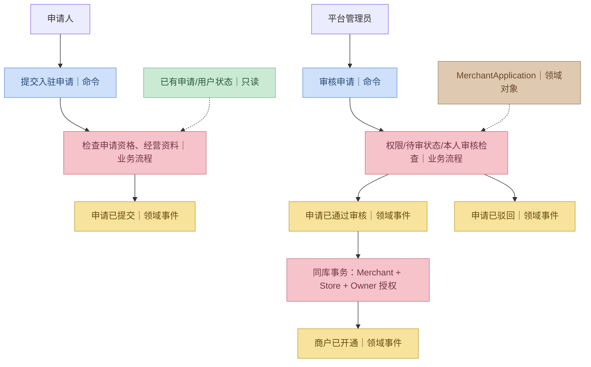
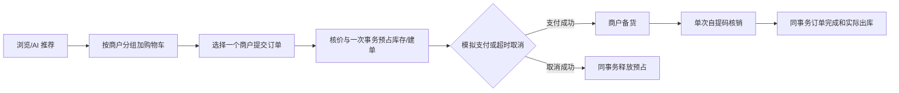
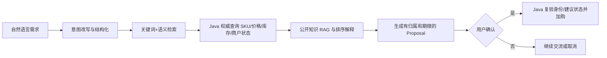
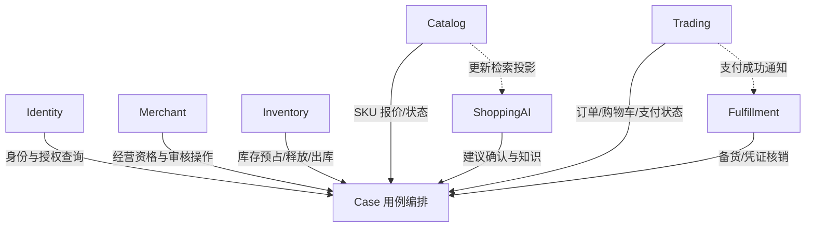

# Campus Shopping — 业务架构与上下文映射

> **R1 对齐说明（2026-10-28）**：本文保留需求来源与历史设计；当前冻结规则以 [R1 实施规格](../specs/RELEASE-01.md) 为准，实际实现/验证状态见 [R1 交付清单](../DELIVERY-R1.md)。历史“下一批/待开发/已通过”描述不作为本次执行证据。

> 版本：v1.0 · 2026-10-26  
> 状态：**业务架构基线**，并非代码或数据库已经实现。  
> 依据：[PRD](../requirements/PRD.md)、[xfg-ddd-skills](https://github.com/fuzhengwei/xfg-ddd-skills)。  
> 与 Skill 分工：本文件定义本项目**业务边界和约束**；DDD 包结构、Java 命名与注释遵循 Skill，不再复制一套重复的技术规范。

## 1. 产品边界及核心业务语言

**产品定位**：高校校园内多个商户独立经营，消费者在一个入口发现商品、使用 AI 辅助选购，并按商户完成模拟支付和到店自提。

| 术语 | 本项目唯一含义 | 易混淆点 |
|---|---|---|
| 用户 User | 系统登录主体，可具多种身份 | 用户不是商户，也不是互斥账号类型 |
| 商户 Merchant | 独立经营者和数据归属边界 | 一商户首版仅一家店，但商户 ID 不等于门店 ID |
| 门店 Store | 实体备货与自提地点 | 库存归属于 Store + SKU 维度 |
| 商品 ProductListing | 商户对外展示的商品集合 | 价格与销售规格落实在 SKU 上 |
| SKU | 可出售的具体规格单元 | 不等于商品 SPU；不能用整商品库存替代 SKU 库存 |
| 可售库存 Available | `onHand - reserved` | 购物车加购不预占库存，提交订单才预占 |
| 订单 Order | 同一个商户下的成交承诺 | 不能在一个订单中混入多个商户 |
| 自提任务 PickupTask | 商户备货及核销的履约记录 | 不负责支付事实，也不代表支付已成功 |
| 导购建议 Proposal | AI 推荐给特定用户的可确认操作提案 | 不等于订单、支付或直接工具执行指令 |
| 知识文档 KnowledgeDocument | 商品或平台政策的可管理版本化资料 | 非权威库存/实时报价来源 |

## 2. 用户、场景与事件风暴方法

参与者：消费者、商户 Owner、商户 Clerk、平台管理员、系统任务、AI 导购。一个人可同时持有消费者身份及不同商户的成员身份。

事件风暴使用小傅哥《DDD 建模方法》中的颜色约定，不与 Coad 四色原型法混用：

| 颜色 | 语义 | 例子 |
|---|---|---|
| 蓝色 | 决策命令 | 审核商户申请、创建订单 |
| 黄色 | 领域事件/既成事实 | 商户已开通、订单已支付 |
| 红色 | 业务流程/政策判断 | 经营资格与审核状态校验 |
| 绿色 | 只读模型 | 待审核申请列表、SKU 实时报价 |
| 棕色 | 领域对象 | MerchantApplication、Order |
| 粉色 | 外部系统 | Python LLM API、Qdrant、文件存储 |

> 事件风暴中的黄色节点只是用于分析业务事实，**不是要求每个节点都写 MQ 消息或 Outbox**。

## 3. 十个业务场景清单

| 场景 | 命令 | 关键事实 | 领域所有者 | 交付批次 |
|---|---|---|---|---|
| S01 入驻 | 提交、审核商户申请 | 申请已提交、通过/驳回、商户已开通 | Merchant + Identity | P1 |
| S02 商品 | 创建商品、SKU、调价、上下架 | SKU 已创建、商品已发布 | Catalog | P2 |
| S03 库存 | 补货、预占、释放、出库 | 库存已变更、预占已释放 | Inventory | P2–P4 |
| S04 AI 推荐 | 发起导购、确认加购建议 | 建议已生成/已确认 | ShoppingAI + Trading | P5 |
| S05 下单 | 选定商户提交订单 | 订单已创建、库存已预占 | Trading + Inventory | P3 |
| S06 支付与关闭 | 模拟支付、超时取消 | 已支付或已取消 | Trading + Inventory | P3 |
| S07 自提 | 备货、自提码核销 | 已备货、已核销、已出库 | Fulfillment + Trading + Inventory | P4 |
| S08 售后 | 退款申请、审核、平台介入 | 售后已申请、模拟退款已完成 | Trading | P4 |
| S09 知识 | 上传文档、构建索引、发布版本 | 索引已构建、知识版本已发布 | ShoppingAI | P5 |
| S10 员工权限 | 邀请、授权、撤销 | 成员已授权、授权已撤销 | Identity | P1 |

### 3.1 商户入驻流程

更详细的命令、聚合、接口、事务和验收见 [Merchant](../domains/merchant.md) 与 [Identity](../domains/identity.md)。

### 3.2 交易与履约流程

### 3.3 AI 导购流程

## 4. 七个限界上下文及数据所有权

| 上下文 | 拥有的业务事实/数据 | 候选聚合 | 不得直接修改 |
|---|---|---|---|
| **Identity** | 用户身份、平台角色、商户成员关系、授权撤销 | UserAccount、MerchantMembership | 商户经营状态、商品、订单 |
| **Merchant** | 入驻申请、审核记录、商户状态、门店信息 | MerchantApplication、Merchant（含首店） | 用户凭据、成员权限 |
| **Catalog** | 商品、SKU、售价、上架销售状态 | ProductListing | 真实库存、订单 |
| **Inventory** | 实物库存、预占状态、变更流水 | StockBalance | SKU 售价、订单状态 |
| **Trading** | 购物车、订单、模拟支付、未提货售后 | Cart、Order、AfterSaleRequest | 实物库存、自提核销记录 |
| **Fulfillment** | 备货、到店自提凭证与核销 | PickupTask | 价格、模拟支付事实 |
| **ShoppingAI** | 导购会话、建议 Proposal、知识版本和索引任务 | RecommendationProposal、KnowledgeDocument | 权威价格、库存、正式交易 |

这是业务上下文边界而非必须部署七个服务。采用**同一个 Spring Boot 后端和同一个 MySQL**，依赖方向由官方 Skill 约束。

## 5. 上下文映射与协作契约

| 领域公开能力（候选） | 提供者 | 调用者 | 契约边界 |
|---|---|---|---|
| `IIdentityAccessService` | Identity | 各写业务用例 | 返回可信用户主体与权限结论，不透露密码散列 |
| `IMerchantEligibilityService` | Merchant | Catalog/Trading Case | 返回经营资格及门店标识，不返回完整商户聚合 |
| `ICatalogQuoteService` | Catalog | CheckoutCase | 返回 SKU 当前可售/价格/版本快照 |
| `IInventoryService` | Inventory | Checkout/Expire/Pickup Case | 按业务引用、SKU 数量原子预占/释放/消耗 |
| `ITradingOrderService` | Trading | Checkout/Payment/Pickup Case | 合法订单状态转移，不允许外界直接改表 |
| `IPickupService` | Fulfillment | 履约 Case | 备货、验证凭证并单次核销 |
| `IRecommendationService` | ShoppingAI | AI/Confirm Case | 提案归属、状态、有效期与确认结果 |

**接口名是候选语义，不要求再创建一个自定义 `contract` Maven 模块。** 依据 xfg-ddd-skills，在 Domain 的 `service/` 声明领域能力，Repository/Port 抽象放在 `adapter/`；跨域编排放在实际需要的 Case 层，避免相互引用对方的 DAO 或聚合内部实现。

## 6. 核心聚合与业务不变量

| 聚合 | 关键规则 | 具体设计状态 |
|---|---|---|
| MerchantApplication | 待审申请一次且仅一次决定；审查人员不得是申请人；重复审核不重复开商户 | [P1 详细](../domains/merchant.md) |
| MerchantMembership | 平台角色与商户角色分离；授权按 merchantId；撤销后不得继续操作 | [P1 详细](../domains/identity.md) |
| ProductListing | 本商户管理 SKU、售价和上下架，SKU 规格组合不重复 | P2 前细化 |
| StockBalance | `available = onHand-reserved >= 0`；预占/释放/出库按业务键幂等 | P2/P3 前细化 |
| Order | 一笔订单一个商户；价格快照可信；模拟支付与关闭互斥 | P3 前细化 |
| PickupTask | 已支付才可交付；同一凭证核销最多一次 | P4 前细化 |
| RecommendationProposal | 建议所属用户、有效期、确认状态、推荐 SKU 不变 | P5 前细化 |
| KnowledgeDocument | 生效版本与可见范围检查，不能引用已撤回内部资料 | P5 前细化 |

## 7. 一致性等级与事件策略

| 流程 | 一致性边界 | 不可简化为异步消息的原因 |
|---|---|---|
| 商户审核通过 | 申请决定 + 商户 + 初始门店 + Owner 授权单库事务 | 避免通过后商户/负责人缺失 |
| 创建订单 | 订单 + 所有 SKU 预占 + 请求幂等记录单库事务 | 防止有订单无库存或库存预占孤儿 |
| 订单关闭 | 订单竞争状态 + 预占释放单库事务 | 避免已支付却释放库存 |
| 自提核销 | 凭证消费 + 订单完成 + 实物出库单库事务 | 避免重复交付或扣库 |
| AI 检索索引更新 | 事务提交后可靠异步投影 | 索引可以滞后，交易不能相信索引中的报价 |
| 通知和报表 | 异步/按需同步查询 | 不应阻塞主交易 |

本地事务跨聚合并不违背本项目的实际约束；此处是**一个 MySQL 的模块化单体**，而不是分布式最终一致性场景。若以后拆出独立数据库，需单独设计补偿与一致性边界。

**事件类型区分**：领域事实（OrderPaid）≠ 集成消息（SearchIndexUpdateRequested）≠ 中间计算结果（ShoppingIntent）。只有确实需要异步集成时才引入 Outbox、幂等消费者和重试 Worker，首版不要求 MQ。

## 8. AI 领域防腐与安全边界

- Spring Boot：身份授权、商品权威查询、建议归属及状态、购物车、订单、库存、交易事务。
- Python AI：Query 改写、意图抽取、Embedding、关键词/向量检索、融合排序、LLM 推理和评测。
- Qdrant：向量/检索投影，不拥有权威价格、库存或付款事实。
- 用户写动作：AI 生成提案 → 显示确认 → Java 校验用户及提案 → Java 执行受控写操作。
- 不允许把内部知识库全文、数据库凭证、跨商户后台查询权限直接交给 Python 模型执行器。
- 无法获得足够可信资料时，应明确说明不确定，不能伪造商品、价格、库存或交易成功。

## 9. 本架构的决策边界

**已确定**：多商户、单店首版、单商户订单、模拟支付、到店自提、同库交易强一致、AI 受控加购、Spring Boot + Python AI + Qdrant。

**仍需在相应迭代确认**：商户申请材料与重复申请策略、商户停用历史订单规则、支付超时时长、完整售后状态机、AI 评测集及指标。见 [PRD 待决策项](../requirements/PRD.md#10-待确认的具体规则不可偷偷视为已定稿)。

## 10. 文档与代码的对应关系

- P1：[Identity](../domains/identity.md)、[Merchant](../domains/merchant.md)、[P1 验收](../domains/P1-acceptance.md)
- P2–P5：按 [路线图](../ROADMAP.md) 逐域详细建模后再落地。
- DDD 技术规范：外部 [xfg-ddd-skills](https://github.com/fuzhengwei/xfg-ddd-skills)；项目特有偏差由 [ADR](decisions.md) 记录。
