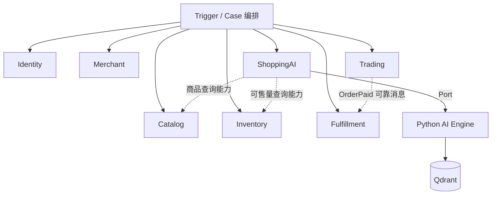

# DDD 上下文映射与公开能力契约

> **R1 对齐说明（2026-10-28）**：本文保留需求来源与历史设计；当前冻结规则以 [R1 实施规格](../specs/RELEASE-01.md) 为准，实际实现/验证状态见 [R1 交付清单](../DELIVERY-R1.md)。历史“下一批/待开发/已通过”描述不作为本次执行证据。

> 版本 v1.0 · 2026-10-26 · **业务边界设计，不代表 Java API 已存在**  
> 本文件只记录本项目的限界上下文协作；Java 包结构由 `xfg-ddd-skills` 决定。源业务约束：[PRD](../requirements/PRD.md)。

## 1. 七个上下文的业务边界

| 上下文 | 唯一主数据归属 | 不允许拥有的事实 | 对外提供的主要能力 |
|---|---|---|---|
| Identity | 用户、密码摘要、平台角色、商户成员身份 | 商户营业状态、订单 | 可信账号、平台角色、商户成员权限 |
| Merchant | 商户申请、审核、商户、首店、营业状态 | 用户密码、会员授权 | 入驻审核、营业资格、门店查询 |
| Catalog | 商品、SKU、规格、报价、上架 | 库存余额、订单成交价 | SKU 查询、可信报价、商品管理 |
| Inventory | 每店 SKU 库存余额、订单预占及流水 | 商品售价、订单支付 | 可售量、原子预占/释放/消耗 |
| Trading | 购物车、订单、支付、售后申请、模拟退款 | 实物库存、自提凭证 | 加购、创建/状态变更订单、售后 |
| Fulfillment | 备货、自提任务、单次核销 | 价格、资金、账号权限 | 自提任务与核销状态 |
| ShoppingAI | 导购会话、Proposal、知识版本与索引任务 | SKU 真实售价、库存、订单修改 | 导购问答、提案确认、知识访问 |

上下文不是微服务。当前全部 Java 上下文运行在一个 Spring Boot 进程中，并共享一个 MySQL；Python 是受控的外部 AI 技术服务。**同库不等于可以跨域写别人的数据。**

## 2. 上下文关系图

图中的虚线表示**业务协作/查询依赖**，不是 Domain 源码直接 import 另一领域 Repository；Case 的公开能力接口不应引发 Maven 依赖环。

## 3. 上下游协作矩阵

| 用例 | 发起/编排 | 依赖能力 | 强一致修改所有者 | 合法性来源 |
|---|---|---|---|---|
| 提交入驻申请 | Merchant Application | Identity 当前主体 | Merchant | Identity 验证账号；Merchant 申请规则 |
| 审核开通 | ApproveMerchantCase | Identity 授权与初始 Owner、Merchant | Merchant + Identity | 双方领域服务各自维护自身规则 |
| 商品创建/改价 | Catalog Application | Identity、Merchant | Catalog | 商品归属、营业许可、SKU 规则 |
| 商户补货 | Inventory Application | Identity、Merchant、Catalog SKU | Inventory | 成员权限、SKU 归属、数量 |
| 下单 | CheckoutCase | Merchant、Catalog、Inventory、Trading | Inventory + Trading | 当前报价、可售量、金额/状态 |
| 付款确认 | ConfirmPaymentCase | Trading | Trading | Order 支付状态与期限 |
| 超时关单 | ExpireOrderCase | Trading、Inventory | Trading + Inventory | 订单期限与预占状态 |
| 自提核销 | ConfirmPickupCase | Identity、Fulfillment、Trading、Inventory | 三域相关聚合 | 核销授权、一次性码、状态竞争 |
| 未提货退款 | RefundCase | Identity、Trading、Fulfillment、Inventory | 三域相关聚合 | 审核资格、订单/核销状态 |
| AI 推荐 | ShoppingAI Application | Catalog、Inventory、Knowledge Port | ShoppingAI 会话/Proposal | 当前商品事实与知识访问范围 |
| AI 确认加购 | ConfirmRecommendationCase | ShoppingAI、Trading、Catalog | ShoppingAI + Trading | 本人确认、版本/时限与 SKU 资格 |

## 4. 公开业务能力（候选接口）

| 上下文 | 公开 Domain 服务接口（名称候选） | 返回对象 |
|---|---|---|
| Identity | `IIdentityAccessService.requirePlatformAdmin`、`requireMerchantPermission`、`grantInitialOwner` | 权限/授权结果值对象 |
| Merchant | `IMerchantAdmissionService`、`IMerchantEligibilityService` | MerchantView/StoreView |
| Catalog | `ICatalogQueryService.quoteForCheckout`、`IProductService.publish` | CheckoutQuote/SkuInfo |
| Inventory | `IInventoryService.reserveBatch/releaseByOrder/consumeByOrder` | ReservationResult |
| Trading | `IOrderService.create/confirmPayment/cancel/complete`、`ICartService.add`、`IAfterSaleService` | OrderResult/CartResult |
| Fulfillment | `IPickupService.createOnce/markReady/verifyOnce/cancelForRefund` | PickupResult |
| ShoppingAI | `IRecommendationService.create/confirm/reject`、`IKnowledgeService` | ProposalResult/Evidence |

这些是**公开服务入口**，不代表 Domain 层允许彼此直接 import 和修改对方内部实体；跨域消费可通过 Case 层注入各上下文的应用/领域服务公开接口。接口定义位置以当前 Maven 依赖拓扑核对，杜绝循环依赖。若真正外置为 RPC 服务，才考虑通过 Port 做防腐适配。

## 5. 一致性与 ID 引用规则

- 跨聚合只引用稳定 ID、不可变交易快照或公开查询视图，不持有他域内部可变聚合对象。
- 事务需要同时修改不同域的聚合时，由 Case 的一个本地事务编排，但每项业务状态转换仍走原领域方法。
- 不能让 Domain Service 调用另一个域的 DAO、PO、Infrastructure Repository。
- 真正异步的索引和通知由 Outbox 发送集成事件。强一致流程完成后才能通知，不让异步消费者来补必要库存预占。
- 多商户所有权： `merchantId` 是隔离边界，`storeId` 是履约/库存的实体位置；同一个用户可以属于多个商户。

## 6. 上下文边界变更条件

出现大规模已提货退货、真实支付结算、知识库独立对外服务等需求时，可以重新评审是否拆售后、支付、知识上下文；但首版不机械拆分。变更必须更新 PRD、ADR、API、事务和迁移方案。

## 7. 实施核验

- ArchUnit：Domain 不引用 Infrastructure/Trigger/Case/MyBatis/HTTP SDK。
- 跨上下文入口不暴露 DAO/PO；以包公开性和静态规则验证。
- Integration：同库事务既能覆盖领域变更又不出现半提交；读取历史订单使用交易快照而非 Catalog 最新价。
- Security：任何商户敏感请求都由可信 userId + merchantId + permission 授权。
