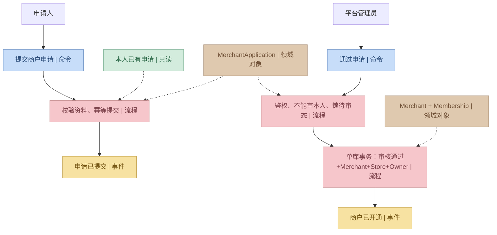
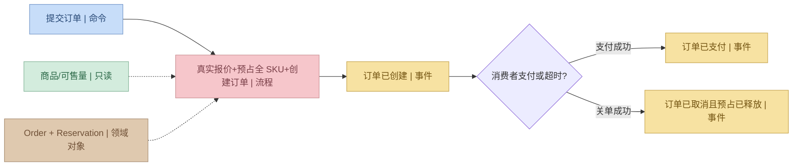
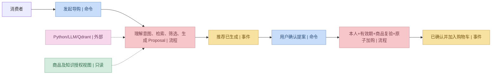

# 全系统事件风暴：用例、命令、流程、事件与领域对象

> **R1 对齐说明（2026-10-28）**：本文保留需求来源与历史设计；当前冻结规则以 [R1 实施规格](../specs/RELEASE-01.md) 为准，实际实现/验证状态见 [R1 交付清单](../DELIVERY-R1.md)。历史“下一批/待开发/已通过”描述不作为本次执行证据。

> 版本 v1.0 · 2026-10-26 · **建模草案，尚未经过线下业务人员工作坊评审**。  
> 以小傅哥 DDD 建模方法为参照。事件风暴便签不同于 Coad 四色原型分类；本文统一使用下列约定。

## 1. 图例

| 颜色 | 本文含义 | 例子 |
|---|---|---|
| 蓝 | 决策命令（祈使式） | `ConfirmMockPayment` |
| 黄 | 领域事件（过去式） | `OrderPaid` |
| 红 | 业务流程/决策策略 | 判断待付状态、截止时间 |
| 绿 | 只读模型 | 待审核申请列表、当前可售量 |
| 棕 | 领域对象（聚合、实体、值对象） | OrderAggregate、StockBalance |
| 粉 | 外部系统/能力 | Python LLM、Qdrant、文件存储 |

从**参与者和用户目标**开始，找已发生事件，再找引发它的命令、关键规则、读模型，最后圈定上下文。不因为画了事件就创建 MQ 或代码类。

## 2. 十个业务场景

| 场景 | Actor | 命令（蓝） | 业务流程/政策（红） | 事件（黄） | 读模型（绿） | 主要对象（棕） | 外部系统（粉） |
|---|---|---|---|---|---|---|---|
| S01 入驻 | 消费者/申请人 | 提交入驻 | 核资料、去重、创建申请 | ApplicationSubmitted | 本人申请列表 | MerchantApplication | 无 |
| S02 审核 | 平台管理员 | 通过/驳回申请 | 鉴权、非本人审核、状态竞争、原子开店与授权 | MerchantOpened/Rejected | 待审详情 | Merchant, Store, Membership | 无 |
| S03 商品 | Owner | 创建 SKU、发布商品 | 规格唯一、价格合法、经营资格 | ProductPublished | SKU 列表 | ProductListing | 文件/搜索投影 |
| S04 库存 | 店员/订单编排 | 补货/预占/释放 | 原子条件更新、按订单幂等 | StockReserved/Released | 可售量 | StockBalance, Reservation | 无 |
| S05 AI 导购 | 消费者 | 发起推荐问答 | 意图解析、混检索、可信商品数据重验、生成建议 | RecommendationGenerated | 商品报价/知识证据 | Proposal, Conversation | LLM/Qdrant |
| S06 结算 | 消费者 | 按商户提交订单 | 身份、经营资格、报价、全 SKU 原子预占 | OrderCreated | 购物车、报价 | Order, OrderItem | 无 |
| S07 支付与过期 | 消费者/Job | 模拟支付/关闭过期单 | 唯一合法状态竞争、释放预占 | OrderPaid/OrderCancelled | 到期单 | Order, PaymentRecord | 无 |
| S08 自提 | 商户店员 | 备货/核销 | 权限、凭证、出库和完结原子性 | PickupCompleted | 待备货任务 | PickupTask | 通知可选 |
| S09 售后 | 消费者/Owner | 申请/批准退款 | 资格校验、与核销互斥、全额模拟退款 | RefundCompleted | 订单/售后资料 | AfterSaleRequest | 无 |
| S10 知识 | 知识管理员/Job | 上传/发布版本 | 权限、索引成功、版本切换 | KnowledgeVersionPublished | 文档版本状态 | KnowledgeDocument | 文件存储/Embedding/Qdrant |

每个场景的详细状态机、规则和接口分别见 [七个领域](../domains/) 的 Markdown 设计。

## 3. P1 事件风暴：申请审核开店

**事件命名注意**：`MerchantOpened` 表示审核、开通、首店与 Owner 授权的事务完成事实，不应在只有 `Application.APPROVED` 一列被更新时提前发出。

## 4. P3 事件风暴：交易与库存

这里的领域事件是**已完成的强一致业务事实**；不允许订阅 `OrderCreated` 才异步尝试库存预占。

## 5. P5 事件风暴：导购与执行

## 6. 聚类与边界结论

- Identity：身份/授权事实；Merchant：入驻与经营事实；Catalog：可售商品定义；Inventory：库存数量；Trading：交易承诺；Fulfillment：交付凭证；ShoppingAI：购物建议与知识。
- 同一事件可能被别的上下文消费，但**业务事实由一个上下文拥有**；其他域不能自行重写它。
- 售后暂位于 Trading 子域，知识库暂位于 ShoppingAI 子域，是当前规模下的边界选择，未来可依据真实业务扩展重评。

## 7. 风险清单与后续评审

`ES-OPEN-01` 校园商户准入资质是否有学校业务限制；`ES-OPEN-02` 商品类目与经营者能力；`ES-OPEN-03` 退款与核销临界条件；`ES-OPEN-04` AI 证据可见级别。对应规则在各领域文档中标记为待确认，业务评审完成后应更新事件风暴与代码契约。
