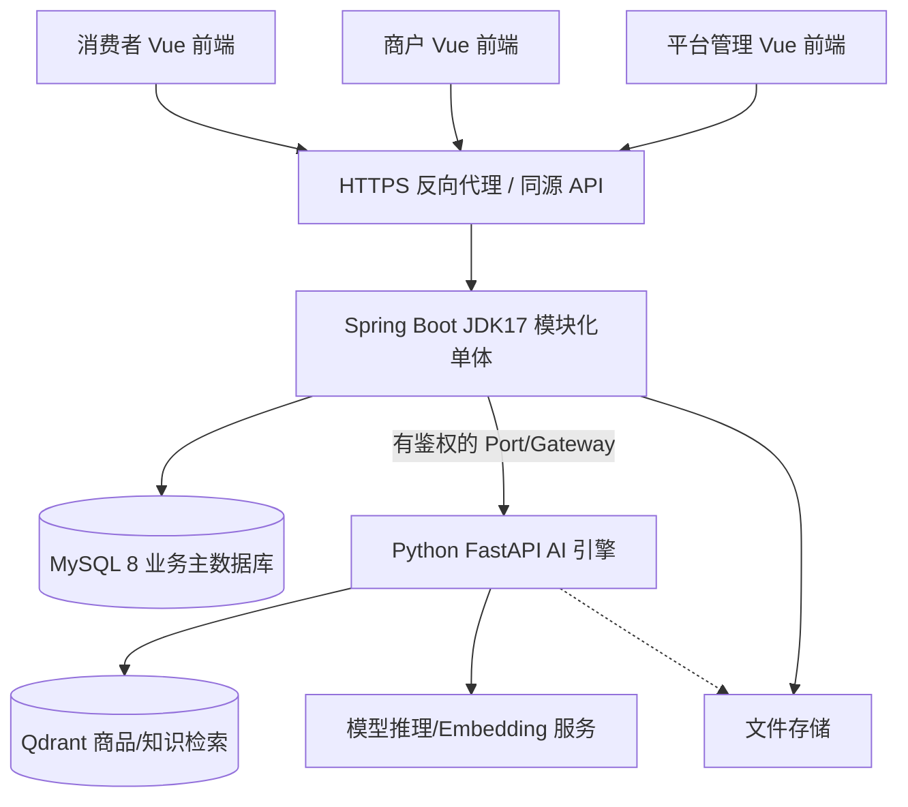
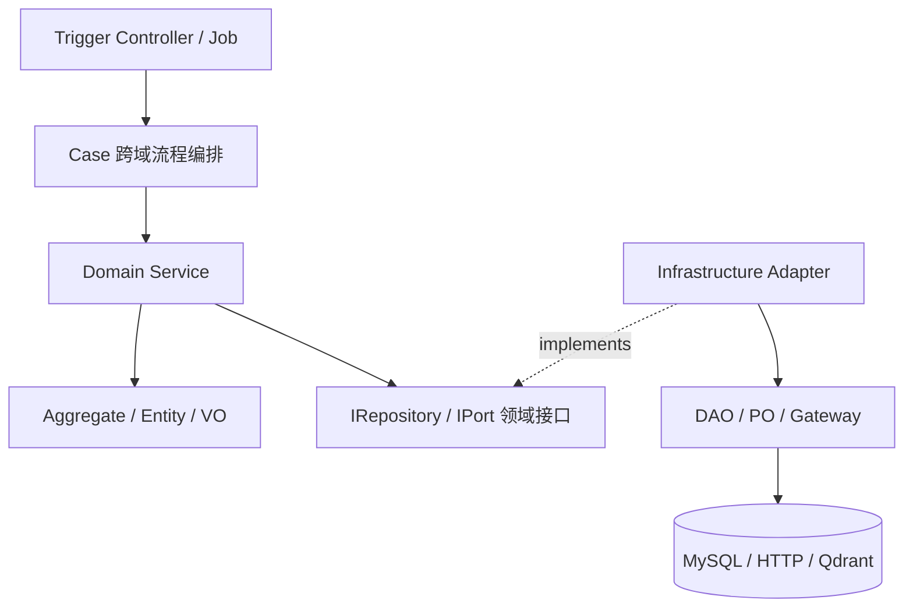

# 系统总体技术架构与部署分工

> **R1 对齐说明（2026-10-28）**：本文保留需求来源与历史设计；当前冻结规则以 [R1 实施规格](../specs/RELEASE-01.md) 为准，实际实现/验证状态见 [R1 交付清单](../DELIVERY-R1.md)。历史“下一批/待开发/已通过”描述不作为本次执行证据。

> 版本 v1.0 · 2026-10-26 · **目标架构设计，未代表所有组件已部署**。  
> Java DDD 实现细节服从 `xfg-ddd-skills`；系统业务约束来自 [PRD](../requirements/PRD.md)、[业务架构](business-architecture.md)。

## 1. 总体系统边界

**关键原则：** 交易权威在 Java + MySQL；AI 只读候选和生成建议；实际状态改变走可信 Java 应用入口。全站所有用户、商户权限在服务端判定，不因请求来自管理员前端就默认放行。

## 2. Java 六模块（官方脚手架）

| 模块 | 源码职责 | 典型类/目录 |
|---|---|---|
| `campus-shopping-api` | 对外 Java 接口、DTO 与 `Response<T>` | `IxxxApi`, `XxxRequestDTO`, `XxxResponseDTO` |
| `campus-shopping-app` | Spring Boot 启动、配置、MyBatis XML | `Application`, `application-*.yml` |
| `campus-shopping-domain` | 各领域聚合、VO、领域服务、Repository/Port 接口 | `domain/{context}/model/...`, `adapter/repository`, `adapter/port` |
| `campus-shopping-infrastructure` | Repo/Port 实现、DAO、PO、HTTP Gateway | `adapter/repository`, `adapter/port`, `dao/po`, `gateway` |
| `campus-shopping-trigger` | REST、定时任务、事件入口；HTTP Controller 实现 API 接口 | `trigger/http`, `trigger/job` |
| `campus-shopping-types` | 必要公共异常、结果码、基础类型 | `exception`, `enums` |

新增 `campus-shopping-case` **不是必选 P0 动作**。仅在审核开通、下单、核销、退款等真实跨域复杂流程开始时，按官方 Skill 建立 Case 编排并校验 POM 依赖无环。

## 3. 依赖倒置与六边形调用链

**API 契约与实现**：`campus-shopping-api` 中定义 `IMerchantApplicationApi`，`campus-shopping-trigger` 中的 `MerchantApplicationController implements IMerchantApplicationApi`；Trigger 用 `@RestController` 暴露路由。该接口定义不等同 Domain Service 接口。

依赖倒置的**编译时方向**是 `Infrastructure → Domain`。运行时调用从领域服务通过接口落到具体适配器，但 Domain 源码从不 import 基础设施实现。HTTP DTO 与数据库 PO 不进入领域聚合。

## 4. 数据与一致性设计

- 一个 MySQL 业务库，按上下文拥有自己的表和持久化职责。
- 订单创建/库存预占、关单/释放、核销/出库、未提货退款采用本地事务强一致性。
- 对外可靠异步通知可使用 MySQL Outbox + Worker，不预设消息队列。
- 商品搜索、知识向量、运营报表是可重建的**读模型或投影**；不能用它们判断最终可支付/可售。
- 库存不可负、单订单唯一商户、商户数据隔离、Proposal 必须用户确认是全项目硬约束。

## 5. Python AI 体系

Python FastAPI 承担 Query 改写、关键词+向量检索、RRF、Rerank 和 LLM 回答生成。Java 维持 AI 会话权限、可信 SKU/库存报价和 Proposal 状态。知识库上传、索引、发布具备业务版本管理，不因外部 Embedding 失败损坏知识主数据。

## 6. 非功能设计

| 质量属性 | 架构措施 | 验证 |
|---|---|---|
| 安全 | 权限以身份+商户范围校验，Secrets 环境隔离，防提示注入 | 越权和资料泄露测试 |
| 正确性 | 强一致事务、条件库存更新、唯一键、幂等请求 | MySQL 并发/回滚集成测试 |
| 可维护性 | 上下文数据所有权、依赖倒置、Skill 注释和命名 | ArchUnit/代码审查 |
| 可扩展 | 单体先闭环；外部 LLM 通过 Port 替换 | Gateway 契约测试 |
| 可观测性 | correlationId、审计、失败状态与必要 Trace | 故障注入/日志核对 |
| 体验 | SSE、可解释推荐卡、明确确认/重试状态 | 前端 E2E 测试 |

## 7. 重要限制与实施事实

本仓库当前只有官方脚手架和设计文件；此文档未声称 Spring Boot 已能构建、Python/Qdrant 已部署或全站业务功能可用。架构约束的可执行验证应在实现时通过测试与运行证据补足。
