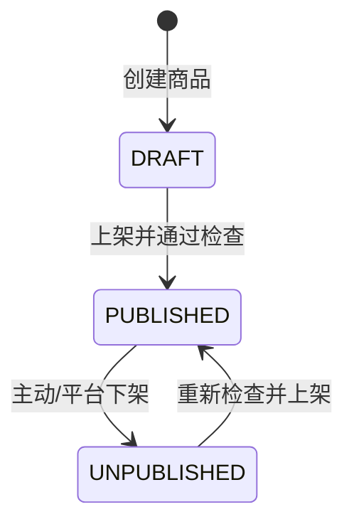

# Catalog 商品目录领域详细设计

> **R1 对齐说明（2026-10-28）**：本文保留需求来源与历史设计；当前冻结规则以 [R1 实施规格](../specs/RELEASE-01.md) 为准，实际实现/验证状态见 [R1 交付清单](../DELIVERY-R1.md)。历史“下一批/待开发/已通过”描述不作为本次执行证据。

> 版本 v1.0 · 2026-10-26 · **设计稿，未实现/未验收**  
> 依据：[PRD FR-009/010](../requirements/PRD.md) · [上下文映射](../architecture/context-map.md) · [数据模型](../database/logical-data-model.md)  
> 实施批次：P2；目录/命名及 Java 注释以 `xfg-ddd-skills` 为准。

## 1. 领域职责和所有权

Catalog 负责 **商户商品、SKU、属性规格、当前售价、上架状态和商品公开查询**。不拥有门店经营资格、实物库存、购物车、订单成交价快照或搜索索引内部数据。首版一商户一家门店，但商品仍保留 `merchantId`，销售库存按 `storeId + skuId` 归 Inventory。

统一语言：`ProductListing` 商品展示主体；`Sku` 可交易规格；`SkuSpecification` 规格键值；`Money` 以分为最小单位的价格值对象；`Published` 已上架；`Quote` 实时销售报价。无需先搭建全局 SPU 管理平台。

## 2. 参与者、命令、事件、读模型

| 发起者 | 命令（蓝） | 业务流程（红） | 已发生事件（黄） | 只读模型（绿） | 领域对象（棕） |
|---|---|---|---|---|---|
| Owner/有权员工 | `CreateProduct` | 校验经营资格、商户权限、字段 | `ProductCreated` | 类目列表 | `ProductListing` |
| Owner/有权员工 | `CreateSku` | 核对规格组合唯一、价格合法 | `SkuCreated` | 商品已有 SKU | `ProductSku` |
| Owner/有权员工 | `ChangeSkuPrice` | 校验上架资格、更新版本 | `SkuPriceChanged` | 现行价格 | `MoneyVO` |
| Owner/有权员工 | `PublishProduct` | 校验完整信息、至少一个在售 SKU | `ProductPublished` | 完整性检查视图 | `ProductListing` |
| 平台管理员 | `ForceUnpublish` | 审计违规理由，强制下架 | `ProductUnpublished` | 违规详情 | `ProductListing` |
| 消费者/AI | 查询商品 | 商户/状态筛选、分页、只读投影 | 无需事件 | `ProductCardView`、`CheckoutQuote` | 不加载完整聚合 |

商品图片文件存储、搜索索引、对象存储是外部技术能力（粉色），不是 Catalog 交易事实来源。

## 3. 聚合边界与行为

**聚合根：`ProductListingAggregate`（实现时命名遵循 Skill）。** 字段：`productId, merchantId, title, categoryId, description, status, version, createdAt`。聚合内 `ProductSkuEntity`：`skuId, specKey, specValues, unitPriceCent, status, version`。规格值对象不可变，金额禁止用 `double`；选择 `long priceCent` 或 `BigDecimal` 并统一舍入。

| 行为 | 前置条件 | 聚合内效果 | 失败语义 |
|---|---|---|---|
| `addSku` | 规格有效、组合在商品内唯一 | 增加 SKU | `CAT_SKU_SPEC_DUPLICATE` |
| `changePrice` | SKU 属于本商品、价格 >= 0.01 元 | 改价格、增版本 | `CAT_INVALID_PRICE` |
| `publish` | 商品信息完整、存在有效在售 SKU | DRAFT/UNPUBLISHED → PUBLISHED | `CAT_NOT_PUBLISHABLE` |
| `unpublish` | 允许下架，记录触发主体 | → UNPUBLISHED | 非法转换 |
| `rename` | 标题合法、长度限制 | 更新标题 | 字段校验失败 |

**重要不变量：** 每个 SKU 只归属一个 Product、一个 Merchant；同一商品规格组合唯一；对外可售必须同时满足 Merchant.ACTIVE、Product.PUBLISHED、Sku.ACTIVE 和 Inventory.available>0（经营资格/库存是跨域组合条件，**不保存在本聚合里**）。

`ProductSku` 在业务量增大时可独立聚合，但当前商品管理需要商品内规格唯一性，先纳入商品聚合。不把整个 Merchant 聚合嵌入商品。

## 4. 查询与跨领域契约

- `ICatalogService`（Domain）负责单域商品写业务；`IProductRepository`（Domain adapter/repository）负责聚合持久化。
- `ICatalogQueryService` 负责列表/详情，只返回只读投影，允许专用 SQL。
- 提供给 CheckoutCase 的 `quoteForCheckout(merchantId, List<SkuQuantity>) → CheckoutQuote`：包含 `skuId, productId, merchantId, storeId, titleSnapshot, specSnapshot, unitPriceCent, skuVersion, saleStatus`；服务器计算总价。
- 提供给 AI 的 `searchPublishedProducts(query, merchantScope)` 和 `getTrustedOffers(skuIds)`；搜索索引上的候选必须回查主库报价。
- `IMerchantEligibilityService` 只作为经营资格调用，Catalog 不查 Merchant DAO。

不允许跨领域向 Catalog Repository 直接传订单聚合，也不允许给前端返回基础设施 `ProductPO`。

## 5. 持久化候选及约束

| 表 | 主字段 | 关键约束 |
|---|---|---|
| `cat_product` | id, merchant_id, title, category_id, description, status, version | 主键、按 merchant_id/status 索引 |
| `cat_sku` | id, product_id, merchant_id, spec_key, price_cent, status, version | `UNIQUE(product_id,spec_key)`、`price_cent > 0` |
| `cat_category`（已实现） | code, name, active | 主键 code |

可采用单一业务库 MySQL 8；商品发布后如启动异步搜索，需版本号防止旧索引覆盖新数据。**当前数据库已实现**，字段应以 `campus-shopping-app/src/main/resources/schema.sql` 为准；本表为领域对象摘要，不是可执行 DDL。

## 6. 当前 HTTP API（v1.1）

| 方法 | 路径 | 规则 |
|---|---|---|
| POST | `/api/v1/merchants/{merchantId}/products` | 商户授权创建商品，支持 1–20 SKU |
| POST | `/api/v1/merchants/{merchantId}/products/{productId}/skus` | 本商户新增 SKU |
| PUT | `/api/v1/merchants/{merchantId}/products/{productId}/skus/{skuId}/price` | `priceCent + expectedVersion` 乐观锁改价 |
| PUT | `/api/v1/merchants/{merchantId}/products/{productId}` | 编辑基础信息、主图，含 `expectedVersion` |
| POST | `/api/v1/merchants/{merchantId}/products/{productId}/publish` | Body `{ "published": true/false }` 控制上下架 |
| GET | `/api/v1/products/page` | 匿名公开、支持 `merchantId,q,category,page,size` |
| GET | `/api/v1/products/{productId}` | 公开营业商品详情；未上架不可访问 |

请以 [v1.1 当前 HTTP 契约](../api/http-api.md) 和 [行为说明](../api/behavior-v1.1.md) 为准，旧路由不再使用。Path 中 `merchantId` 不能替代后端成员授权。

## 7. 一致性、失败与测试

- 同一 SKU 并发改价：乐观锁或条件更新，过时版本收到 `PRICE_CHANGED`（或 `STATE_CONFLICT`，依实际业务检查）。
- 旧购物车展示价并不构成成交价承诺；CheckoutCase 下单时重新取权威报价与报价快照。
- 下架的商品不能新下单；已有成交单仍按 OrderItem 快照履约。
- 索引更新失败只影响搜索新鲜度，不能回滚已成功提交的商品主数据。
- 测试：规格唯一；价格非负；无有效 SKU 不上架；商户跨租户修改拒绝；两人同时改价版本竞争；索引旧事件不覆盖新版本；下单变价二次报价。

## 8. 开工前需确认

`CAT-OPEN-01` 类目是否平台统一维护（建议是）；`CAT-OPEN-02` 规格组合使用标准 JSON 规范化键还是商户自定义字符串；`CAT-OPEN-03` 已按首版落地：服务器本地存储、单商品主图、客户端最多 2,000,000 字节、JPG/PNG/GIF 输入、Java 重新编码 PNG（详见 [IMG-01](../specs/UI-PRODUCT-IMAGES.md)）；`CAT-OPEN-04` 售价下限和零元商品政策。本文件默认不允许 0 元可售商品。
