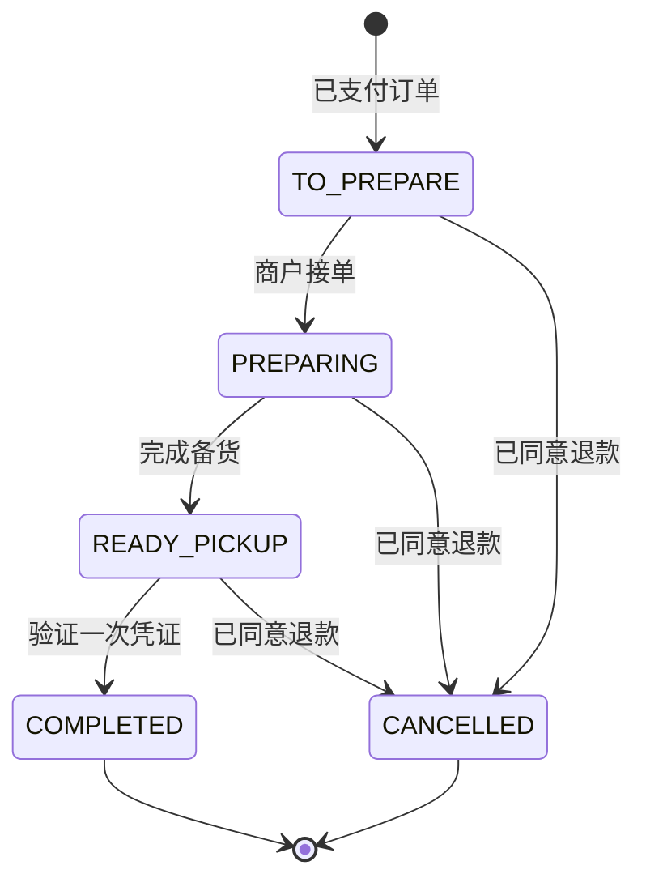
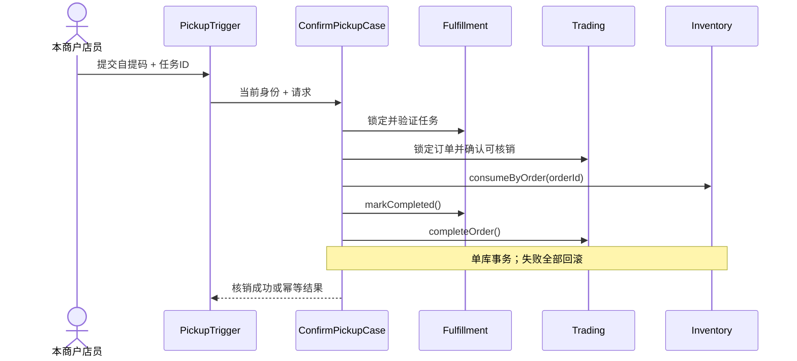

# Fulfillment 履约领域详细设计（备货 / 自提 / 核销）

> **R1 对齐说明（2026-10-28）**：本文保留需求来源与历史设计；当前冻结规则以 [R1 实施规格](../specs/RELEASE-01.md) 为准，实际实现/验证状态见 [R1 交付清单](../DELIVERY-R1.md)。历史“下一批/待开发/已通过”描述不作为本次执行证据。

> 版本 v1.0 · 2026-10-26 · **设计稿，未开发/未实际核销验证**  
> 依据：FR-016 · [交易](trading.md) · [库存](inventory.md) · [事务与事件](../architecture/transactions-and-events.md)。开发批次 P4。

## 1. 领域所有权

Fulfillment 只拥有**已支付订单的备货任务、自提凭证、核销事实及履约状态**。不拥有订单成交金额、用户密码、商品 SKU 定义或实时库存。首版没有骑手配送，也不提供货物跨店调拨。

术语：`PickupTask` 一个订单唯一对应一张自提任务；`PickupCredential` 一次性证明；`PickupVerification` 核销事件；`PickupStaff` 具有该商户权限的店员或 Owner。

## 2. 事件风暴

| Actor | 命令（蓝） | 业务流程（红） | 事件（黄） | 只读模型（绿） |
|---|---|---|---|---|
| `OrderPaid` 可靠投递 | `OpenPickupTask` | 按 orderId 幂等创建任务 | `PickupTaskCreated` | 已付款订单摘要 |
| 商户员工 | `MarkPreparing` | 校验商户成员和任务状态 | `PickupPreparing` | 待备货列表 |
| 商户员工 | `MarkReady` | 核对备货，签发安全凭证 | `PickupReady` | 商品/自提信息 |
| 商户员工 + 顾客到店 | `VerifyPickup` | 证书校验、订单状态争用、消耗库存 | `PickupCompleted` | 待核销任务 |
| RefundCase | `CancelPickup` | 未核销才允许取消 | `PickupCancelled` | 当前任务状态 |

业务对象（棕色）是 PickupTask/Verification；外部系统（粉色）仅通知或短信可选能力，不是核销成功的必要外部依赖。

## 3. 聚合与状态机

`PickupTaskAggregate`：`pickupId, orderId, merchantId, storeId, buyerId, status, credentialHash, credentialExpiresAt, preparedBy, verifiedBy, version`。一次性凭证原文只在必要的出示渠道暴露；数据库仅存安全摘要，不在日志里打印明文。

聚合方法：`startPreparing(staffId)`、`markReady(staffId, credentialHash, expiresAt)`、`verify(staffId, presentedCredentialDigest, now)`、`cancelForRefund()`。

不变量：同 orderId 唯一任务；仅有权限的店员能备货和核销；仅 READY_PICKUP 且凭证有效时允许核销；已 COMPLETED/CANCELLED 不可再次核销；凭证不得跨商户或跨订单使用。

## 4. 与 Trading、Inventory 的 Case 协作

`IConfirmPickupCase` 负责 **授权 → 订单支付状态和归属核对 → PickupTask 验码 → 订单完结 → StockReservation 消耗 → 审计提交**。核销所有关键变更与退款竞争通过同一 MySQL 事务、统一锁顺序达成唯一结果。

交易订单/库存与 PickupTask 锁顺序在实际实现中要统一，并与 RefundCase 一致，以减少死锁；上图是业务步骤，不代表确定的 SQL 锁顺序。外部短信/通知在事务提交后执行。

## 5. 公开契约和数据表

- `IPickupService.createTaskOnce(orderSnapshot)` 幂等创建；`startPreparing`、`markReady`、`requireUnconsumed`、`verifyOnce`、`cancelForRefund`；仅发布业务能力，禁止外部 Case 直接修改 `PickupPO`。
- `IPickupQueryService`：待备货列表、本人自提凭证状态、商户任务详情；避免暴露凭证哈希。
- `IPickupRepository`：Domain `fulfillment/adapter/repository/`，Infrastructure 适配实现。

| 表 | 字段候选 | 约束 |
|---|---|---|
| `ful_pickup_task` | id,order_id,merchant_id,store_id,buyer_id,status,credential_hash,expires_at,version | UNIQUE(order_id)，索引 merchant_id/status |
| `ful_pickup_verification` | id,pickup_id,operator_user_id,verified_at,request_key | UNIQUE(pickup_id)，避免重复核销记录 |

当前 HTTP：商户 `POST /api/v1/merchants/{merchantId}/orders/{orderId}/prepare`、`POST /api/v1/merchants/{merchantId}/orders/{orderId}/ready`、`POST /api/v1/merchants/{merchantId}/orders/{orderId}/verify`；消费者 `POST /api/v1/orders/{orderId}/pickup-token` 申请/重签自提令牌。进度在订单详情读模型中返回，**当前无独立 `GET pickup-tasks` 或 `GET pickup-credential` 接口**。详情见 [v1.1 HTTP 契约](../api/http-api.md)。

## 6. 失败、权限和测试

- 无效/过期凭证返回统一失败，不通过错误细节泄露凭证是否属于他人商户；加入频率限制与审计。
- 生产条件下安全自提凭证应具足够随机性、有限有效期以及过期重签机制；二维码本身不是授权依据。
- 重复相同核销请求最多执行一次库存扣减；相同订单已取消/退款不得核销。
- 当前付款与自提任务创建在同库事务完成；若未来拆成异步事件，才需要另行设计 Outbox/幂等对账，不属于当前 R1 代码。
- MySQL 测试并发核销/退款、有效期边界、跨商户店员核销、重复支付请求、同库任务创建原子性。

## 7. 待决策

`FUL-OPEN-01` 自提码使用 6～8 位数字还是高熵二维码令牌（建议后者或两者组合）；`FUL-OPEN-02` 过期后重签策略；`FUL-OPEN-03` 商户关闭后已付订单的核销权限；`FUL-OPEN-04` 备货时需要扫描 SKU 还是人工确认（首版人工确认即可）。
