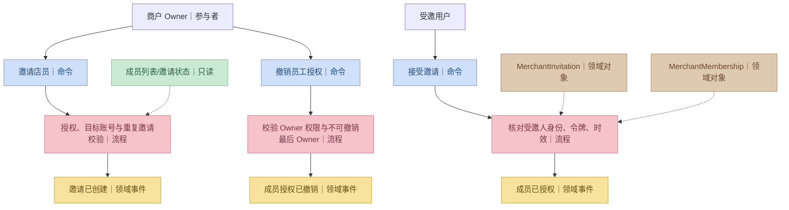
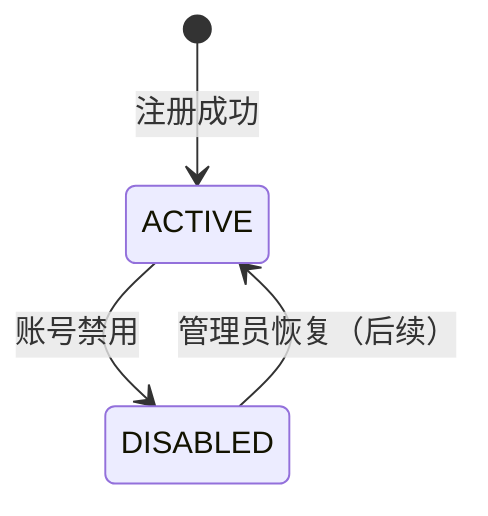
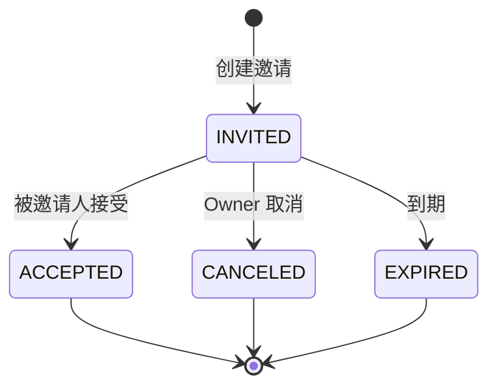

# P1 · Identity 身份权限领域详细设计

> **R1 对齐说明（2026-10-28）**：本文保留需求来源与历史设计；当前冻结规则以 [R1 实施规格](../specs/RELEASE-01.md) 为准，实际实现/验证状态见 [R1 交付清单](../DELIVERY-R1.md)。历史“下一批/待开发/已通过”描述不作为本次执行证据。

> 实现进度：[身份闭环 P1-01](../iterations/P1-01-auth-session.md)。账号功能与商户成员功能分开验收，不以前者代替后者。
> 状态：账号认证代码已实现、完整验证待执行；平台角色、商户成员与授权仍是待实现设计。  
> 对应需求：FR-001、FR-002、FR-003、FR-008；[PRD](../requirements/PRD.md)。  
> 建模方法：参与者 → 命令/只读模型 → 领域事件 → 业务对象 → 聚合与服务 → 公开接口与测试。

## 1. 业务边界和通用语言

**Identity 只回答三个问题**：调用者是谁？是否是有效平台管理员？对给定商户具有什么权限？

| 术语 | 业务含义 |
|---|---|
| UserAccount | 唯一登录主体；聚合拥有身份与状态，凭据摘要只存在本地存储记录中 |
| PlatformRole | 平台级后台权限；普通注册不会得到该角色 |
| MerchantMembership | 用户与某商户之间的成员关系及角色 |
| OWNER | 经营者，能管理该商户的经营信息、员工和业务操作 |
| CLERK | 店员，仅能执行授权备货、核销及库存操作 |
| Subject | 已被可信认证机制验证的当前登录主体，不是请求体自填的 userId |
| Permission | 具体业务操作能力，例如 `merchant.member.invite` |

Identity **不维护**商户是否营业、商户审核结果、商品或订单。商户业务是否允许操作由 Merchant 与对应业务域负责，不能把商户 `ACTIVE/SUSPENDED` 复制为权限表状态。

## 2. P1 能力与时序范围

**P1a 必须完成**：注册、登录、退出、获取当前账号、平台管理员受控初始化、商户 Owner 初始授权、按用户+商户检查有效授权、撤销后立即禁止后续业务写操作。

**P1b 完成**：Owner 邀请现有注册用户成为 Clerk、被邀请人同意、Owner 撤销 Clerk、查询本商户成员。不要求学校 SSO、短信通知或跨校园组织身份同步。

P1-01 依据 ADR-005 的候选方案采用 Spring Security 服务端 Session，详见 [ADR-014](../architecture/decisions.md)。本批不引入 JWT，生产会话存储及部署仍需评审。

## 3. 参与者、命令、事件及只读模型

| 场景 | Actor | 决策命令（蓝） | 已发生事实（黄） | 只读模型（绿） |
|---|---|---|---|---|
| 注册 | 访客 | RegisterAccount | AccountRegistered | 用户名是否占用 |
| 登录 | 已注册用户 | Login | UserAuthenticated（安全审计） | 账号状态、凭据摘要 |
| 退出 | 登录用户 | Logout | SessionInvalidated（安全审计） | 当前会话 |
| 初始化平台权限 | 受控运维操作 | GrantPlatformAdmin | PlatformRoleGranted | 平台管理员列表 |
| 商户开通授予 Owner | ApproveMerchantCase | GrantMerchantOwner | MerchantMembershipGranted | 用户与商户成员关系 |
| 邀请店员 | Merchant OWNER | InviteMerchantClerk | MerchantInvitationCreated | 成员与邀请状态 |
| 接受邀请 | 被邀请人 | AcceptInvitation | MerchantMembershipGranted | 待接收邀请 |
| 撤销店员 | Merchant OWNER | RevokeMerchantMember | MerchantMembershipRevoked | 已授权成员列表 |



## 4. 聚合、实体、值对象与行为

| 类型 | 模型 | 核心状态 | 关键行为及约束 |
|---|---|---|---|
| 聚合根 | `UserAccount` | userId、username、status（ACTIVE/DISABLED） | `register()`、`disable()`、`ensureActive()`；唯一用户名，密码不得明文入库 |
| 聚合根 | `MerchantMembership` | membershipId、userId、merchantId、role、status | `grantOwner()`、`activateClerk()`、`revoke()`；一个用户在同一商户只有一个有效成员关系 |
| 聚合根候选 | `MerchantInvitation` | invitationId、merchantId、targetUserId、status、expiresAt | `issue()`、`accept()`、`cancel()`、`expire()`；仅目标用户可接受，不能重复接受 |
| 值对象 | `PermissionKey` | 操作权限编码 | 权限编码集合不由客户端决定 |
| 值对象 | `AuthenticatedSubject` | userId、认证来源 | 必须由认证适配器生成，不能使用 HTTP 请求体身份字段 |
| 领域服务 | `IIdentityAccessService` | 无 | 平台权限与商户成员范围校验，提供对其他业务域的只读可信结果 |

注意：Merchant 实体和商户经营状态不属于这个聚合；成员关系只持有 `merchantId`，不得引入可变的 `Merchant` 聚合引用。

### 4.1 状态机





**成员关系单独有 `ACTIVE / REVOKED` 状态**。邀请的终态不等于成员自动删除；一个被撤销的成员可以在授权策略允许时重新建立授权，但必须留下历史记录。

## 5. 权限矩阵（服务端最终判断）

| 权限 | 平台管理员 | 商户 OWNER | 商户 CLERK | 普通消费者 |
|---|---|---|---|---|
| `platform.merchant.review` | ✔ | — | — | — |
| `platform.merchant.suspend` | ✔ | — | — | — |
| `merchant.profile.manage` | 仅平台管理规则允许时 | ✔ 本商户 | — | — |
| `merchant.member.invite` | — | ✔ 本商户 | — | — |
| `merchant.member.revoke` | — | ✔ 本商户 | — | — |
| `catalog.product.write` | — | ✔ 本商户 | — | — |
| `inventory.stock.replenish` | — | ✔ 本商户 | ✔ 本商户 | — |
| `fulfillment.order.prepare` | — | ✔ 本商户 | ✔ 本商户 | — |
| `fulfillment.pickup.verify` | — | ✔ 本商户 | ✔ 本商户 | — |
| `trading.aftersale.review` | 独立平台争议权限 | ✔ 本商户 | — | — |
| 本人下单与查单 | ✔ 作为本人消费者 | ✔ 作为本人消费者 | ✔ 作为本人消费者 | ✔ 本人 |

“平台管理员”不意味着可以不受审计地扮演任意商户 Owner。跨商户平台监管与商户日常操作是不同授权能力。

### 5.1 授权判定顺序

1. 从 Spring Security 的当前认证上下文提取 `userId`，禁止信任请求体中的操作人 ID。
2. 验证 UserAccount 仍为 ACTIVE；会话已退出或账号已禁用则拒绝。
3. 平台操作：查询真实平台角色；商户操作：查询 `(userId, merchantId)` 的有效成员关系与允许权限。
4. 某些操作还需要 Merchant 检查经营状态；这一步不由 Identity 代办。
5. 写入操作中的目标商户、订单与 SKU 均需验证实际归属；**仅有路径中一个 merchantId 不够**。

## 6. 公开领域服务、Repository 与 Port 契约

本节方法名为**初步建议接口**，实现时以 xfg-ddd-skills 的 `domain/{context}/service/` 与 `adapter/repository/`、`adapter/port/` 为准。

```java
/** 身份与商户权限领域能力；不读取 Spring SecurityContext。 */
public interface IIdentityAccessService {
    void requireActiveUser(String userId);
    void requirePlatformPermission(String userId, String permission);
    void requireMerchantPermission(String userId, String merchantId, String permission);
}

/** 商户成员授权领域能力；由受控用例调用。 */
public interface IMerchantMembershipService {
    void grantInitialOwner(String merchantId, String applicantUserId, String applicationId);
    void revokeClerk(String merchantId, String targetUserId, String operatorUserId);
}
```

Domain Repository 抽象：`IUserAccountRepository`、`IMerchantMembershipRepository`、`IPlatformRoleRepository`；邀请 P1b 增加 `IMerchantInvitationRepository`。

IAM-01 已采用的方案（ADR-013）：`IUserAccountRepository.save(account, rawPassword)` 是本地账号持久化契约。Infrastructure Repository 使用注入的 `PasswordEncoder`，在执行 MyBatis INSERT **之前**将临时密码转换为安全摘要。`UserAccountAggregate` 不暴露明文密码或密码摘要字段。由于 BCrypt 不是远程 HTTP/RPC 调用，移除了不符合本套 Skill 分类的 `IPasswordHasherPort` 和 `BCryptPasswordHasherPort`。P1-01 已实现数据库凭据校验、会话登录、查询与退出；完整 Maven/MySQL 集成验证仍待执行。Spring Security 会话持久化属于基础设施技术职责，不属于聚合本身。

## 7. P1 关键用例契约

### 7.1 账号注册（P1a）

**输入**：username、password、displayName；申请人身份来自此注册账号。  
**条件**：用户名规范合法且唯一，密码满足最低安全策略。  
**成功**：创建 ACTIVE 用户，密码只以安全哈希持久化，不赋予平台管理员或任何商户角色。  
**失败**：重复用户名返回冲突；不泄露其他用户隐私；数据库唯一约束防并发重复注册。

### 7.2 平台管理员引导创建（P1a）

**机制**：受控部署/运维引导命令或一次性初始化任务；读取秘密环境变量或交互式安全输入，**不允许以默认管理员密码写入 Git、SQL 或 README**。  
**结果**：初始平台权限进入可审计记录，公开注册接口永远不能自行授予平台角色。

### 7.3 审核通过后授予 Owner（P1a）

由 Merchant 的 `ApproveMerchantCase` 调用 `grantInitialOwner(merchantId, applicantUserId, applicationId)`。必须与审核状态、商户和门店创建在**同一个 MySQL 本地事务**提交。 `(merchantId,userId)` 具有唯一约束；同一个 applicationId 的重试不重复授权。

### 7.4 邀请 Clerk（P1b）

Owner 在本商户发出邀请，目标必须是已存在且 ACTIVE 的账号；目标登录后接受，方建立 ACTIVE Clerk 成员。邀请属于商户且有到期限制；邀请码只保存安全摘要，当前首版为 24 小时，以实际领域配置为准。撤销时原成员不能继续操作。禁止 Owner 通过普通邀请接口授予 `PLATFORM_ADMIN` 或其他商户 Owner。

## 8. 当前 HTTP API（v1.1）

| 方法 | 路径 | 说明 | 登录/权限 |
|---|---|---|---|
| POST | `/api/v1/auth/register` | 注册 | 匿名 |
| POST | `/api/v1/auth/login` | 登录并建立会话 | 匿名 |
| POST | `/api/v1/auth/logout` | 注销会话 | 已登录 |
| GET | `/api/v1/auth/me` | 当前用户基本信息（成员范围从 `/api/v1/workspace` 获取） | 已登录 |
| GET | `/api/v1/merchants/{merchantId}/members` | 查询本商户成员 | OWNER |
| POST | `/api/v1/merchants/{merchantId}/invitations` | 邀请已注册店员 | OWNER，P1b |
| POST | `/api/v1/invitations/{id}/accept` | 接受邀请 | 被邀请人，P1b |
| DELETE | `/api/v1/merchants/{merchantId}/members/{userId}` | 撤销 Clerk | OWNER，P1b |

HTTP 输入仅包含业务必要资料；`operatorUserId`、`applicantUserId` 从可信认证主体获取。

## 9. 持久化模型草案

| 表 | 核心列 | 唯一索引 / 约束 |
|---|---|---|
| `iam_user` | id、username、password_hash、status、display_name、created_at | `UNIQUE(username)` |
| `iam_platform_role` | id、user_id、role、created_at | `UNIQUE(user_id, role)` |
| `iam_merchant_membership` | id、merchant_id、user_id、role、status、granted_by、source_application_id、version | `UNIQUE(merchant_id,user_id)` |
| `iam_merchant_invitation` | id、merchant_id、target_user_id、token_digest、status、expires_at | 唯一邀请 ID、token 摘要；P1b |
| `iam_auth_audit` | id、actor_user_id、action、scope、target_id、occurred_at、correlation_id | 按时间/主体索引，不把审计当可修改聚合 |

索引和字段在写 Migration 时定稿；避免在账户 API 中直接返回 `password_hash` 等持久化字段。

## 10. 错误结果语义

| 错误语义（设计草案） | 当前项目约定 / 安全层 | 说明 |
|---|---|---|
| `AUTH_UNAUTHENTICATED` | 401 | 未登录或会话失效 |
| `AUTH_ACCOUNT_DISABLED` | 403 | 账号被停用 |
| `AUTH_PERMISSION_DENIED` | 403 | 无指定平台/商户权限 |
| `AUTH_USERNAME_EXISTS` | 业务冲突码（按 Controller 参考风格通常 HTTP 200） | 重复用户名 |
| `MEMBERSHIP_ALREADY_ACTIVE` | 幂等返回已有结果，或业务冲突码 | 重复授权；初始化 Owner 用例保持幂等 |
| `INVITATION_INVALID` | 无效邀请码用业务码；无权查看可由安全/隐私策略返回 404 | 邀请码不合法、过期或非本人 |

**本表除已冻结安全语义外均是未来 Identity 设计候选，不代表当前 `ResponseCode` 已包含这些名字。** 认证/授权过滤器返回的 HTTP 401/403 不受 Controller 内 `AppException` 捕获逻辑控制。

不得向前端公开完整异常栈、密码摘要、Session 标识或数据库实现细节。

## 11. 验收条件（完整清单见 P1 Acceptance）

- 已注册用户可以登录、退出；匿名不能调用受保护接口。
- 普通注册不产生平台管理员角色。
- 用户可同时属于不同商户，A 商户的 Owner 权限不会蔓延到 B 商户。
- 同一申请的 Owner 授权重复调用不产生重复成员。
- 禁用账号、撤销成员权限后，下一次敏感业务操作被服务端拒绝。
- 领域单元测试不启动 Spring/MySQL；集成测试覆盖唯一约束与事务回滚。

## 12. 本领域待决策

- 登录身份字段与密码策略（PRD OPEN-01）和会话实现（ADR-005）。
- 邀请生效期限、被邀请对象能否同时拥有其他商户角色；默认允许多商户，但必须保持不同范围。
- Owner 是否允许邀请另一个 Owner；首版建议不开放，以免出现所有权转移与“最后 Owner”问题。


## 当前练习进度（2026-10-27）

- IAM-01 已提供 dev 用户注册纵切的可对照代码与手写教程：[`../tutorial/06-iam01-register-handwrite.md`](../tutorial/06-iam01-register-handwrite.md)。
- P1-01 已替换内存 Basic 认证，注册账号可通过数据库凭据登录。实际 MySQL 运行及完整 P1 验收仍未完成；历史教程不再作为安全配置基线。
- 本次增加 `iam_user.display_name` 的新库建表；如果之前执行过缺少该列的 P1 草案，需先完成数据表迁移。
