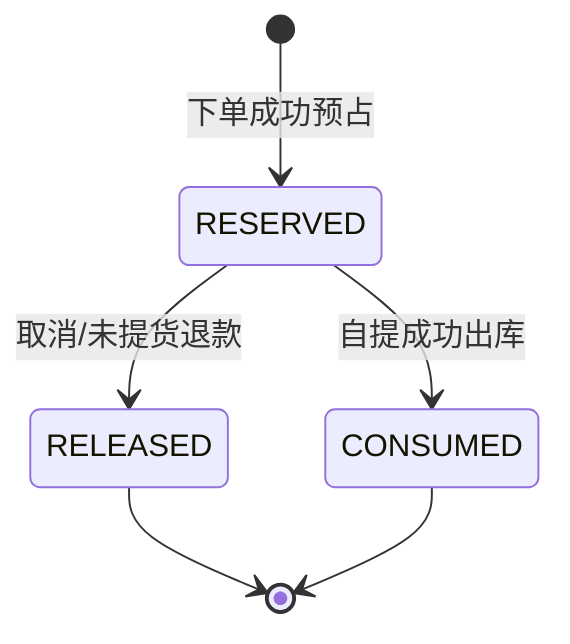

# Inventory 库存领域详细设计

> **R1 对齐说明（2026-10-28）**：本文保留需求来源与历史设计；当前冻结规则以 [R1 实施规格](../specs/RELEASE-01.md) 为准，实际实现/验证状态见 [R1 交付清单](../DELIVERY-R1.md)。历史“下一批/待开发/已通过”描述不作为本次执行证据。

> 版本 v1.0 · 2026-10-26 · **设计稿，数据库事务与并发实现尚未测试**  
> 依据：[PRD FR-011/012](../requirements/PRD.md) · [交易领域](trading.md) · [事务矩阵](../architecture/transactions-and-events.md)。开发批次：P2 基础 + P3/P4 核心。

## 1. 职责与统一语言

Inventory 拥有门店 SKU 的实物库存 `onHand`、已预占 `reserved`、可售 `available`、订单预占记录及库存流水。**不拥有商品售价、订单支付状态和自提凭证**。本域接受可信业务编排发起的“预占、释放、实际出库”命令，不信任模型生成的原始数量或客户端直接写库存。

术语：`StockBalance` 某 `storeId + skuId` 的库存账户；`StockReservation` 对 `orderId + skuId` 的订单预占；`StockMovement` 不可篡改的库存变化流水。

## 2. 命令与事件（事件风暴）

| Actor | 命令（蓝） | 流程/政策（红） | 事件（黄） | 只读模型（绿） | 领域对象（棕） |
|---|---|---|---|---|---|
| 商户有权员工 | `ReplenishStock` | 权限和 SKU/Store 归属、数量合法 | `StockReplenished` | 当前库存 | StockBalance |
| CheckoutCase | `ReserveForOrder` | 依 SKU ID 排序，条件原子预占 | `StockReserved` | 商品库存视图 | StockReservation |
| Cancel/RefundCase | `ReleaseReservation` | 状态可释放且未曾释放 | `ReservationReleased` | 预占记录 | StockReservation |
| PickupCase | `ConsumeReservation` | 状态可出库；实物扣减与预占消耗 | `StockConsumed` | 有效预占 | StockBalance |

## 3. 聚合与存储边界

`StockBalanceAggregate`：`merchantId, storeId, skuId, onHand, reserved, version`；实例唯一键 `(storeId,skuId)`。`StockReservationEntity`：`reservationId, orderId, merchantId, storeId, skuId, quantity, status, createdAt, releasedAt/consumedAt`。`StockMovement`：`movementId, skuId, operation, quantity, referenceType, referenceId, createdAt`。

为了避免把一个 SKU 下所有历史预占装进大聚合，持久化时 **StockBalance 和 Reservation 分开查询/持久化，但在一次库存命令事务中共同维护不变量**；Reservation 可以独立持久化为幂等记录。不要误以为“一张表就是一个聚合”。

### 数量不变量

\[
\text{onHand} \ge 0,\quad 0 \le \text{reserved} \le \text{onHand},\quad \text{available}=\text{onHand}-\text{reserved}
\]

| 操作 | onHand | reserved | Reservation 状态 |
|---|---:|---:|---|
| 初次补货 +q | +q | 不变 | 不产生预占 |
| 订单预占 q | 不变 | +q | `RESERVED` |
| 取消释放 q | 不变 | -q | `RELEASED` |
| 自提出库 q | -q | -q | `CONSUMED` |

**加购物车不预占；只有成功提交订单才预占。**

## 4. 并发与幂等算法契约

### 4.1 预占

- CheckoutCase 事先有服务端生成的 `orderId`，按 SKU ID 排序处理一单所有 SKU，降低死锁概率。
- 每条库存行必须使用 **数据库条件原子 UPDATE**，而不是 Java 先查 available 再无条件写入。
- 逻辑示意：`UPDATE inv_stock_balance SET reserved=reserved+:q,version=version+1 WHERE store_id=:store AND sku_id=:sku AND on_hand-reserved >= :q`；影响行数必须为 1。不存在的余额行视为 0 可售。
- 成功后插入 `UNIQUE(order_id,sku_id)` 的预占记录。同 `orderId` 且相同 SKU/数量重试不得重复预占；同业务键不同数量应返回冲突。
- 一笔订单多个 SKU 必须 **同一个本地事务全成功或全回滚**，不能部分预占。

### 4.2 释放

- 先条件转换预占 `RESERVED → RELEASED`（或加行锁），仅转换成功一次才 `reserved -= quantity`；更新库存余额必须检查数量合法。
- 已 RELEASED 的同请求重试返回幂等成功；CONSUMED 不能释放。
- 释放使用原始预占数量，不信任退款请求客户端传来的数量。

### 4.3 实际出库

- 仅 `RESERVED → CONSUMED` 一次成功；同事务执行 `onHand -= q` 和 `reserved -= q`。
- 消费库存时库存余额不可为负；CONSUMED 重试不二次扣减。
- 核销与退款竞争必须通过同库事务、行锁/版本控制及固定锁顺序保证最终唯一结果；不可只依靠 Redis 分布式锁。

## 5. 公开业务能力

| 公开能力 | 入参（业务命令） | 输出/幂等键 |
|---|---|---|
| `IInventoryService.reserveBatch` | orderId, merchantId, storeId, List<SkuQty> | reservationRefs; 按 orderId+skuId 幂等 |
| `IInventoryService.releaseByOrder` | orderId, reason | release result, 不二次释放 |
| `IInventoryService.consumeByOrder` | orderId, pickupId | consume result, 不二次出库 |
| `IInventoryQueryService.availableForSkus` | merchantId, storeId, skuIds | Map<skuId,available> |
| `IInventoryService.replenish` | merchantId, storeId, skuId, qty, requestId | movementId |

Domain 仅定义 `IStockRepository` 和业务服务接口；Infrastructure 在 `adapter/repository` 实现并调用 MyBatis DAO。其他域只能通过公开 Service，由 Case 编排。

## 6. 表候选及约束

| 表 | 关键字段 | 必须约束 |
|---|---|---|
| `inv_stock_balance` | merchant_id,store_id,sku_id,on_hand,reserved,version | `UNIQUE(store_id,sku_id)`；`on_hand>=reserved>=0` |
| `inv_reservation` | order_id,store_id,sku_id,qty,status | `UNIQUE(order_id,sku_id)`；qty>0 |
| `inv_stock_movement` | id,sku_id,type,quantity,biz_key,created_at | 同操作业务键唯一、追加记录 |

库存历史账本应能与当前余额核对。库存流水不替代当前余额表；强并发以权威余额条件更新决胜。

## 7. API 与错误

商户补货 `POST /api/v1/merchants/{id}/stocks/replenishments`；库存列表 `GET /api/v1/merchants/{id}/stocks`。内部预占/释放/出库能力**不向公网消费者暴露裸接口**，通过经授权的 Checkout/Cancel/Pickup/Refund Case 调用。

错误语义候选：`INV_INSUFFICIENT_AVAILABLE`（库存不足）、`INV_RESERVATION_CONFLICT`（预占冲突）、`INV_INVALID_QUANTITY`（数量非法）、`INV_RESERVATION_ALREADY_CONSUMED`（已出库）、`INV_STOCK_SCOPE_DENIED`（范围越权）。**这里是未来领域的语义标签，并非 Java 已存在枚举或 HTTP 409 固定映射**；业务异常按当前工程参考风格返回非 `0000` 业务码，鉴权过滤器拒绝时仍按安全协议处理 401/403/404。详细约定见 [错误码](../api/error-codes.md)。

## 8. 验收测试

1. 可售 1 件时 2 个并发下单请求，最终最多 1 个预占成功；余额与记录一致。
2. 订单包含 3 个 SKU，最后一个不足，前两个预占回滚。
3. 同 `orderId+skuId` 重试不会重复增加 reserved；不同数量产生冲突。
4. 重复取消不重复释放；已出库订单不能释放原预占。
5. 相同自提码重复核销不二次减少 onHand。
6. 商户 A 不能补货商户 B；门店 SKU 归属必须一致。
7. MySQL 8 真实隔离级别和死锁重试测试；H2 不能代替这些测试。

## 9. 待决策

`INV-OPEN-01` 补货是否允许库存初始为 0（建议是）；`INV-OPEN-02` 盘点与损耗不在首版；`INV-OPEN-03` 预占最长存续与订单超时同步；`INV-OPEN-04` 卖家停业如何处理历史预占由 Trading/Fulfillment 跨域决策，不在库存域自行取消交易。
