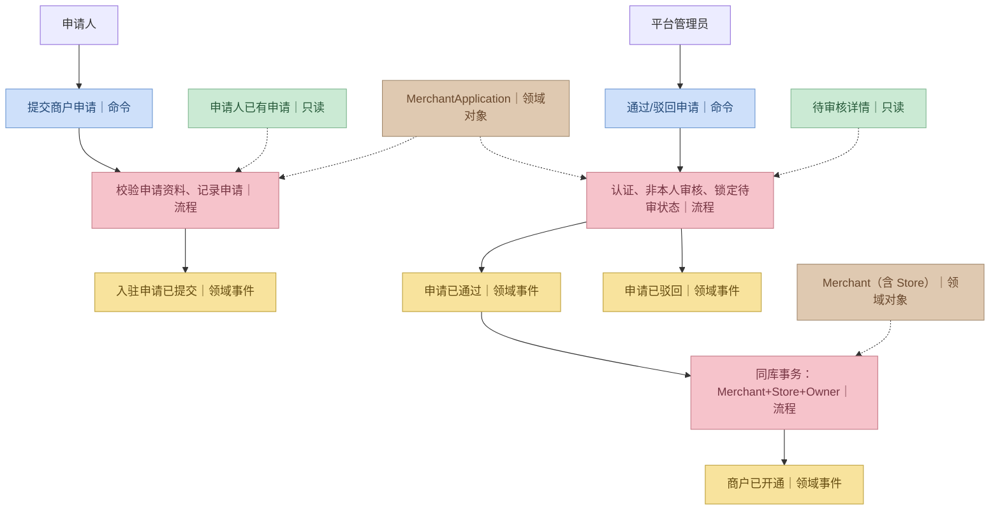
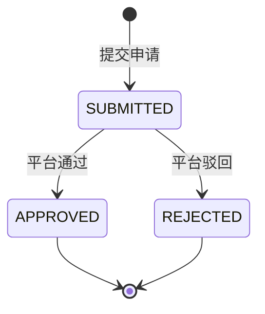
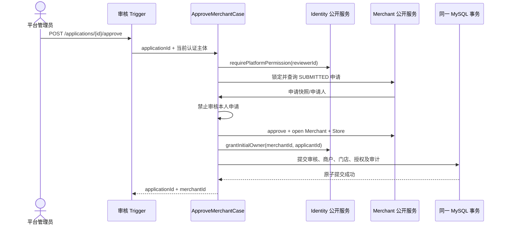

# P1 · Merchant 商户经营领域详细设计

> **R1 对齐说明（2026-10-28）**：本文保留需求来源与历史设计；当前冻结规则以 [R1 实施规格](../specs/RELEASE-01.md) 为准，实际实现/验证状态见 [R1 交付清单](../DELIVERY-R1.md)。历史“下一批/待开发/已通过”描述不作为本次执行证据。

> 版本：v1.0 · 2026-10-26  
> 状态：**P1 完整流程仍是设计候选**；仅 `merchantName` 的独立 dev 提交申请练习已形成示例代码，不能等同完成本文件要求的入驻资料/平台审核/门店与 Owner 开通。  
> 需求：FR-004、FR-005、FR-006、FR-007；协作：[Identity](identity.md)；验收：[P1 Acceptance](P1-acceptance.md)。

## 1. 领域范围与业务语言

Merchant 拥有**申请、审核事实、经营主体、首家门店、经营状态**。不拥有用户密码、平台角色、成员授权、商品售价或订单。

| 术语 | 业务含义 |
|---|---|
| MerchantApplication | 申请人提交的一次入驻申请，具有独立审核生命周期 |
| Applicant | 当前登录并发起申请的用户 |
| Reviewer | 被可信身份层确认为平台管理员的审核人 |
| Merchant | 通过审核后建立的经营主体，业务数据隔离的归属 |
| Store | 该商户下的实体自提地点；首版仅一店 |
| ReviewDecision | 审核通过/驳回的不可变业务事实与意见 |
| Suspend | 管理端暂停新的经营活动，不等于删除历史数据 |

## 2. 业务参与者与事件风暴

| 场景 | 发起人 | 蓝色命令 | 黄色领域事件 | 绿色只读模型 |
|---|---|---|---|---|
| 提交入驻 | 登录用户 | SubmitMerchantApplication | MerchantApplicationSubmitted | 本人的已有申请 |
| 查询审核 | 申请人、平台管理员 | — | — | 本人申请列表 / 待审列表 |
| 审核通过 | 平台管理员 | ApproveMerchantApplication | MerchantApplicationApproved、MerchantOpened | 待审申请详情 |
| 审核驳回 | 平台管理员 | RejectMerchantApplication | MerchantApplicationRejected | 申请详情、历史审核 |
| 商户停用 | 平台管理员 | SuspendMerchant | MerchantSuspended | 当前经营状态 |
| 商户经营查询 | Owner/Clerk | — | — | 本人获授权商户 / 门店信息 |



## 3. 聚合设计

### 3.1 MerchantApplication 聚合根

**标识**：`applicationId`。属性建议：

- `applicantUserId`：由服务端认证主体确定；不可由客户端冒充。
- `merchantProfileSnapshot`：申请时拟使用的经营名称、品类、联系人、经营简介。
- `storeProposal`：拟经营门店名称、校园或地点说明。
- `status`：`SUBMITTED / APPROVED / REJECTED`。
- `submittedAt / decidedAt / reviewerUserId / rejectReason / openedMerchantId`。
- `requestId / version`：用于提交幂等及审核竞争控制。

**领域方法及不变量**：

| 方法 | 前置条件 | 状态变化 | 异常 |
|---|---|---|---|
| `submit()` | 申请信息完整且校验合法 | 建立 `SUBMITTED` | 无效资料 |
| `approve(reviewerId, merchantId)` | `SUBMITTED`，reviewerId != applicantUserId，权限已由用例验证 | `APPROVED`，固化商户关联 | 非法状态、本人审核 |
| `reject(reviewerId, reason)` | `SUBMITTED`，审核人不是申请人，非空驳回原因 | `REJECTED`，记录原因 | 非法状态、缺失原因 |
| `result()` | 任意 | 返回当前审核事实/已开通 merchantId | 不修改数据 |



**重要**：不将 `APPROVED` 解释为“只更新审核列即可”。批准时还必须在同一事务开通 Merchant + Store 并授予 Owner；若任何一步失败，审核通过状态一并回滚。

### 3.2 Merchant 聚合根（首版含 Store 实体）

| 类型 | 对象 | 职责 |
|---|---|---|
| 聚合根 | `Merchant` | 经营身份、经营状态、首店集合、来源申请关联 |
| 聚合内实体 | `Store` | storeId、门店名称、校园地点、自提说明 |
| 值对象 | `MerchantProfile` | 对外经营名称、品类、联系方式等 |
| 值对象 | `MerchantStatus` | `ACTIVE / SUSPENDED` |
| 值对象 | `ReviewDecision` | 审核者、决定、理由、时间 |

聚合行为候选：`openFromApprovedApplication()`、`suspend()`、`resume()`、`changeProfile()`、`requireActiveForNewTrade()`。

**不变量**：

1. 商户只有在审核通过后才能建立，`sourceApplicationId` 必须唯一。
2. 首版每个商户恰好一个有效自提门店，Store ID 与 Merchant ID 不混用。
3. 商户暂停时不能创建新的可售商品或接受新订单；保留历史订单查询及**受控**完成原有已支付订单/退款的途径（细节 P4 决策）。
4. 商户的 OWNER 不是 Merchant 聚合内字段，而是 Identity 中独立的 Membership；通过同库用例协调二者。
5. 商户名称不自动作为全局唯一标识；校园不同经营者可以有相似显示名称。

## 4. 核心 Use Case 与事务契约

### 4.1 UC-M01 提交入驻申请

**输入**：当前已登录用户；经营名称、分类、联系人、门店名称、校园地点；请求幂等键。  
**前置条件**：账号有效；字段格式/长度合法；P1 不强制对接工商登记或学校经营许可接口。  
**业务过程**：Identity 验证账号；Merchant 聚合构造 SUBMITTED 申请；保存申请及申请事件事实。  
**成功结果**：返回 applicationId、SUBMITTED；申请人可查询。  
**失败**：资料非法、用户无效、请求冲突；相同请求幂等键的重试不重复创建。

重复申请政策（同一申请人能否同时申请两个不同商户）属于 PRD `OPEN-04`；**不能在未确认前写一个全局唯一 `applicant_user_id` 约束，阻止其管理多个商户**。

### 4.2 UC-M02 审核通过（P1 核心纵切）

**触发人**：真实平台管理员。  
**输入**：applicationId、审核意见（允许为空）、幂等请求键；reviewerId 来自认证上下文。



**原子操作集合**：审核状态更新、商户及门店创建、Owner Membership 授权、审核审计、必要的持久化事件记录。全部在一个 JDBC/MySQL 事务里，**禁止在此事务中调用外部 LLM、发送不可撤销 HTTP 消息或依赖 Qdrant**。

**审核竞争**：锁定 application 行或通过条件更新+版本号，只有一个 `SUBMITTED → APPROVED/REJECTED` 转换获胜。`merchant.source_application_id` 唯一；重试 `APPROVED` 时返回已存在 merchantId，不重复建店/授权；若已驳回则返回冲突。

**事务异常**：例如 Identity 授权写入失败，必须回滚 Merchant 创建与 Application 审核，仍保持可重新审批状态。领域与持久化层不能各自 `REQUIRES_NEW` 提前提交。

### 4.3 UC-M03 审核驳回

平台管理员验证权限与非本人审核；检查 SUBMITTED；记录非空拒绝原因与审核者；同事务保存审计。后续申请人可以查看自己的历史。再次申请应**创建新申请记录**，不能把 REJECTED 历史记录直接改回 SUBMITTED。

### 4.4 UC-M04 查看商户与停用

已授权用户可以查询自己所属商户，平台管理员可以查询所有商户。停用由平台管理员触发，转换 `ACTIVE → SUSPENDED`；同状态重复停用不重复产生副作用。商户停用不删除历史库存、订单和成员记录。已有订单如何受控履约见 PRD OPEN-05，P1 只实现经营资格读取与禁止新增交易的能力。

## 5. Domain Service / Repository / Case 依赖边界

依据 xfg-ddd-skills，约定如下：

- Merchant 聚合和业务校验放在 `campus-shopping-domain` 的 `domain/merchant/model/`、`domain/merchant/service/`。
- Merchant Repository 接口放在 `domain/merchant/adapter/repository/`，由 `campus-shopping-infrastructure` 的 `adapter/repository/` 实现；MyBatis DAO/PO 位于 Infrastructure 内。
- Identity Repository 归属于 Identity，Merchant 不直接查询 Identity DAO。
- `ApproveMerchantCase` 归属于**跨领域编排层**：按 ADR-001，在 P1 实装时增加 `campus-shopping-case` 模块。它依赖 Domain 的公开业务服务接口，不依赖底层 Mapper/PO。
- API 模块定义 `IMerchantApplicationApi`，Trigger 的 `MerchantApplicationController` 实现；仅处理请求、可信身份、映射到 Case 或单域领域服务。没有 Session/平台权限认证的 `POST /approve` 不可暴露。
- 当前商户提交练习采用 `@Slf4j/@RestController/@RequestMapping`、`@Resource` 注入，Controller 内 `catch(AppException)` 和 `catch(Exception)` 后构建 `Response<T>`。领域聚合/服务只负责业务规则；错误码使用 Types `ResponseCode`，**不新增业务错误码 EnumVO 或 GlobalExceptionHandler**。

建议公开领域接口（签名是设计草案，不是当前已存在类）：

```java
/** 商户入驻及审核的领域业务能力。 */
public interface IMerchantAdmissionService {
    MerchantApplicationView submit(SubmitMerchantApplicationCommand command);
    MerchantApplicationForReview loadForReview(String applicationId);
    OpenedMerchantResult approveAndOpen(String applicationId, String reviewerId);
    void reject(String applicationId, String reviewerId, String reason);
}

/** 商户当前经营资格的只读能力。 */
public interface IMerchantEligibilityService {
    MerchantOperatingView getOperatingStatus(String merchantId);
}
```

`approveAndOpen` 只负责 Merchant 域内部“合法审核+开商户门店”；**成员授权由 Case 组合 Identity 公开服务完成**。领域内部不得引用 Identity 聚合实现。最终方法拆分应保证 Case 事务原子性，不能由接口名称推导隐含独立提交。

Repository 接口候选：`IMerchantApplicationRepository`、`IMerchantRepository`。读模型可用专门查询服务，没必要为了列表把所有聚合完整加载。

## 6. API 草案（HTTP 接口与领域模型隔离）

| 方法 | 路径 | 调用者 | 返回/作用 |
|---|---|---|---|
| POST | `/api/v1/merchant-applications` | 登录用户 | 创建申请、返回 applicationId |
| GET | `/api/v1/merchant-applications/mine` | 申请人 | 自己的申请历史与审核状态 |
| GET | `/api/v1/admin/merchant-applications` | 平台管理员 | 分页待审核/历史列表，允许状态过滤 |
| GET | `/api/v1/admin/merchant-applications/{id}` | 平台管理员 | 申请详情 |
| POST | `/api/v1/admin/merchant-applications/{id}/approve` | 平台管理员 | 原子审核通过，返回 merchantId |
| POST | `/api/v1/admin/merchant-applications/{id}/reject` | 平台管理员 | 驳回并记录原因 |
| GET | `/api/v1/merchants/mine` | Owner/Clerk | 当前用户获授权的商户 |
| GET | `/api/v1/admin/merchants` | 平台管理员 | 查询商户与经营状态 |
| POST | `/api/v1/admin/merchants/{merchantId}/suspend` | 平台管理员 | 停用商户 |

**现有练习**已支持申请 `Idempotency-Key`，仅有 `{merchantName}` 请求体与 `SUBMITTED` 状态；本节其他接口和完整入驻资料仍待实施。提交和审核建议支持幂等头，其作用域和数据库唯一键实现时明确定义。当前 Controller 捕获业务错误后返回 HTTP 200、`code != 0000`；不能只靠前端隐藏按钮认为安全。

## 7. 数据持久化模型草案

| 表 | 核心字段 | 必要数据库约束 |
|---|---|---|
| `mer_application` | id、applicant_user_id、merchant_name、category、contact、store_name、campus_location、status、reviewer_user_id、reason、opened_merchant_id、request_key、version、created_at、decided_at | 主键、`UNIQUE(applicant_user_id,request_key)`（在要求幂等键时） |
| `mer_merchant` | id、source_application_id、display_name、category、status、version、created_at | `UNIQUE(source_application_id)` |
| `mer_store` | id、merchant_id、display_name、campus_location、pickup_instruction、status | `UNIQUE(merchant_id)`（首版一商户一店） |
| `mer_review_audit` | id、application_id、reviewer_user_id、decision、reason、decided_at、correlation_id | 按申请/审核时间索引；拒绝或通过留痕 |

审批时 Identity 的 `iam_merchant_membership` 与本域表参与同一事务；**这是一个单库事务跨上下文的明确例外，不意味着商户领域拥有成员表的修改权**。

优先保证 `applicationId` 和 `merchantId` 的稳定映射，避免创建商户之后重试发生重复经营主体。所有写入带事务与版本/行锁约束。

## 8. 错误结果与授权

**当前代码已有的商户相关业务码**：`ResponseCode.MERCHANT_REQUEST_CONFLICT(M0001)`、`MERCHANT_ALREADY_REVIEWED(M0002)`、`MERCHANT_SELF_REVIEW_FORBIDDEN(M0003)`；入参错误复用通用 `ILLEGAL_PARAMETER(0002)`。业务失败由 `AppException` 表达，当前 HTTP Controller 捕获后通常返回 **HTTP 200 + 非 0000 code**。其中 M0002/M0003 目前主要由聚合审核方法表达，**不是审核接口已实现的证据**。

下表是 P1 的**错误语义草案**，不是全部已经写在 Java `ResponseCode` 中的枚举名：

| 设计语义 | 当前对应或后续计划 | 场景 |
|---|---|---|
| `MER_APPLICATION_INVALID` | 当前 `0002`；完整 P1 再细化 | 申请资料非法 |
| `MER_APPLICATION_NOT_FOUND` | 未来定义；按权限考虑隐藏资源存在性 | 无权查询或不存在 |
| `MER_REVIEW_PERMISSION_DENIED` | 未来平台权限过滤器；拒绝一般 HTTP 403 | 非平台管理员 |
| `MER_SELF_REVIEW_FORBIDDEN` | 当前 `M0003` 聚合规则 | 本人审核 |
| `MER_APPLICATION_ALREADY_REJECTED` / `MER_APPLICATION_ALREADY_DECIDED` | 当前 `M0002`；完整审核时明确幂等/竞争分支 | 重复审核或对抗决定 |
| `MER_MERCHANT_SUSPENDED` | 未来定义 | 停业后禁止经营 |

安全过滤器中的 401/403 和私有对象隐藏策略（可能 404）不等价于 Controller 内捕获的业务冲突。具体授权/响应契约以 `docs/api/error-codes.md` 为准。不得暴露跨商户申请与联系资料。

## 9. 业务验收规则

- 普通消费者和商户 Owner 不得调用平台审核接口。
- 平台管理员审核本人申请被拒绝（即使拥有平台角色）。
- 同一申请重复审批只有一条 Merchant 和一条 Store，Owner 授权不重复。
- 平台审核通过后的事务若在 Owner 授权步骤失败，所有新增业务数据回滚。
- 两名管理员同时对同一申请做“通过”和“驳回”，最终只能保留一个决定。
- 申请人只能查询自己的申请和驳回意见，不能读取他人敏感联系信息。
- 商户停用后禁止创建新经营行为，但原有数据不被删除。
- Domain 单测无需 Spring/MySQL，集成测试在 MySQL 验证唯一约束与事务竞争。

## 10. P1 待确认项

- 入驻资料是否需要校园经营证明（PRD OPEN-02）。
- 同用户同时申请多个不同商户的政策（OPEN-04）：当前设计**允许多条历史，至少保证同请求幂等**。
- 商户停用后已付款订单的具体履约/退款流向（OPEN-05），在 P4 状态机落地前不得自造“直接删除订单”流程。
