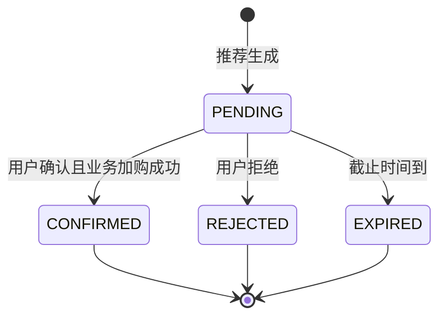
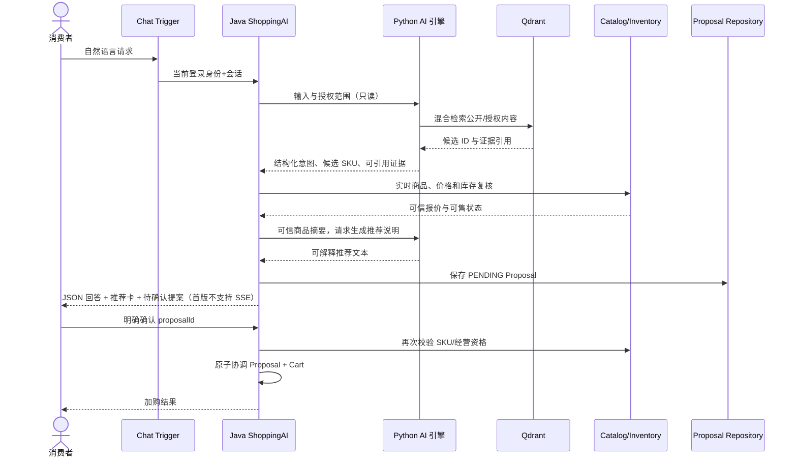

# ShoppingAI 智能导购与知识领域详细设计

> **R1 对齐说明（2026-10-28）**：本文保留需求来源与历史设计；当前冻结规则以 [R1 实施规格](../specs/RELEASE-01.md) 为准，实际实现/验证状态见 [R1 交付清单](../DELIVERY-R1.md)。历史“下一批/待开发/已通过”描述不作为本次执行证据。

> 版本 v1.0 · 2026-10-26 · **设计稿，不代表 AI 服务已联通或评测已完成**  
> 范围：PRD FR-019~023；开发批次 P5；详见 [AI/RAG 技术设计](../ai/rag-design.md) 与 [评测计划](../ai/evaluation-plan.md)。

## 1. 领域定位与所有权

ShoppingAI 拥有**用户导购会话、结构化购物意图、推荐建议 Proposal、知识库/文档/版本/索引任务的业务生命周期**。不拥有商品售价、商户经营资格、订单、购物车真实修改或库存余额。Python AI 引擎是本上下文的**技术能力提供者**，不是另一个可绕过 Java 鉴权的业务管理员。

术语：`ShoppingIntent` 预算/偏好/品类/限制条件；`ProductCandidate` 检索候选；`RecommendationProposal` 只属于指定消费者的加购提议；`KnowledgeDocument` 可审计的知识主数据；`DocumentVersion` 被索引和发布的版本；`Evidence` 可授权引用证据。

## 2. 事件风暴

| Actor | 命令（蓝） | 决策流程（红） | 事件（黄） | 只读模型（绿） | 领域对象（棕） | 外部（粉） |
|---|---|---|---|---|---|---|
| 消费者 | `AskShoppingAssistant` | 会话授权→解析需求→检索→复核→推荐 | `RecommendationGenerated` | 商品报价、库存 | ShoppingConversation, Proposal | Python AI/LLM/Qdrant |
| 消费者 | `ConfirmRecommendation` | 校验本人/有效期/一次性确认→重验 SKU→加购 | `RecommendationConfirmed`, `CartItemAdded` | 商品状态、购物车 | Proposal | 无直接外部写 |
| 消费者 | `RejectRecommendation` | 拒绝未完成建议 | `RecommendationRejected` | 会话本人建议 | Proposal | 无 |
| 知识管理员 | `UploadKnowledge` | 商户归属/可见性验证→文件解析 | `KnowledgeUploaded` | 自己知识库 | KnowledgeDocument | 文件存储 |
| 索引任务 | `BuildIndex` | 解析、切块、Embedding、混检索引 | `IndexBuilt` | 版本状态 | IndexJob | Python/Qdrant |
| 知识管理员 | `PublishKnowledgeVersion` | 校验索引已可用、原子切换生效版本 | `KnowledgeVersionPublished` | 有效版本 | KnowledgeDocument | 无 |

## 3. 聚合和核心行为

| 聚合 | 关键属性 | 行为 | 不变量 |
|---|---|---|---|
| `ShoppingConversationAggregate` | id,userId,createdAt,status | open/appendMessage/close | 用户只能读取本人会话 |
| `RecommendationProposalAggregate` | id,userId,conversationId,items,status,expiresAt,confirmedAt | create/confirm/reject/expire | 仅本人、期限内、一次性执行 |
| `KnowledgeBaseAggregate` | id,ownerType,ownerMerchantId,visibility | create/changeVisibility/archive | 变更权限必须留痕 |
| `KnowledgeDocumentAggregate` | id,knowledgeBaseId,versions,activeVersion | addVersion/publish/retire | 活跃版本已索引、来源归属不变 |
| `IndexJob`（单独任务实体/聚合候选） | id,versionId,status,attempts,lastError | start/succeed/fail/retry | 版本-索引状态转换合法 |

`ProductCandidate`、`RetrievalEvidence`、`ShoppingIntent` 是临时查询值对象，不必为每一次搜索建立持久化聚合。Tool Trace 用于审计/评测，可设有限保留期。

**注意：Proposal 的 CONFIRMED 与 Cart.add 必须形成可恢复的一次性动作结果**。如果两个上下文同库，建议一个本地事务：锁 Proposal → 检查用户/状态/期限 → 使用 Trading 公开能力加购 → 标记 CONFIRMED 与记录执行关联；若任一步失败，完整回滚。不能先标记已确认再调用不受控的远程 Cart API。

## 4. AI 商品推荐调用流程

此图是候选设计，推荐管线可优化调用次数，但**必须维持可信价格/权限校验和用户确认**；外部模型调用不放在修改购物车的事务中。

## 5. 公开业务契约与 Port

- `IShoppingAssistantService.ask(AskCommand)`：验证会话所有者，返回一次性 JSON 回答及 Proposal；首版不实现 SSE，模型输出不触发购物车写入。
- `IRecommendationService.confirm(proposalId, currentUserId, requestKey)`：负责 Proposal 状态，跨 Trading 使用 `IConfirmRecommendationCase`。
- `IKnowledgeService.upload/publish/retire`：版本管理业务。
- `IShoppingIntentPort`、`IProductRetrievalPort`、`IKnowledgeRetrievalPort` 由 Domain 定义，在 Infrastructure `adapter/port/` 实现，通过 `gateway/` 调用 Python HTTP/RAG。
- `IRecommendationRepository`、`IKnowledgeDocumentRepository` 等由 Domain 定义，在 Infrastructure `adapter/repository/` 实现数据库操作。
- 只读 SKU 的商业数据来自 Catalog/Inventory 公开查询服务，**不是 Python 直连业务 MySQL**。

## 6. 知识可见性和引用规则

| 资料 | 可见主体 | 检索规则 | 前端展示 |
|---|---|---|---|
| 公开商品说明 | 消费者、商户、平台 | `PUBLIC` 且已发布 | 可显示来源标题与可访问公开 URL |
| 平台公开售后政策 | 消费者 | `PUBLIC` 且已发布 | 可展示公开政策页面 |
| 商户内部经营资料 | 本商户具授权人员 | `MERCHANT_INTERNAL + merchantId` | 不给普通消费者展示来源或片段 |
| 平台运营内部文件 | 平台管理员 | `PLATFORM_INTERNAL` | 仅有权限时显示授权摘要 |

向量库的 `visibility/merchant_id/doc_version/status` 过滤要服务端强制执行；前端传来的范围不能直接作为查询授权。撤回知识版本时，权威版本状态必须即刻禁止返回旧文档，即使向量删除滞后。

## 7. 持久化候选

`ai_conversation`（user_id, status），`ai_message`（conversation_id, role, content_ref/text, created_at），`ai_proposal`（user_id,conversation_id,status,expires_at,executed_request_key,version），`ai_proposal_item`（proposal_id,sku_id,quantity,reasons），`ai_knowledge_base`（owner_type,owner_id,visibility），`ai_document`（knowledge_base_id,title,source_ref,status），`ai_document_version`（document_id,version,index_status,published_at），`ai_index_job`（version_id,status,attempts,error_code）。相关表及唯一键见 [数据模型](../database/logical-data-model.md)。

## 8. 当前 API、错误、验收

| 方法 | 当前 URI | 权限 |
|---|---|---|
| POST | `/api/v1/ai/chat` | 本人会话，返回完整 JSON，不是 SSE |
| GET | `/api/v1/ai/conversations` | 本人历史会话 |
| GET | `/api/v1/ai/conversations/{conversationId}/messages` | 本人消息 |
| GET | `/api/v1/ai/conversations/{conversationId}/proposals` | 本人待确认提案 |
| POST | `/api/v1/ai/proposals/{proposalId}/confirm` | 本人确认，Java 二次校验和幂等加购 |
| POST | `/api/v1/ai/proposals/{proposalId}/reject` | 本人拒绝 |
| POST | `/api/v1/knowledge/bases/{baseId}/documents` | 授权知识库上传者 |
| POST | `/api/v1/knowledge/documents/{documentId}/publish` | 授权知识库管理员 |

当前错误码：`AI_UNAVAILABLE`、`PROPOSAL_EXPIRED`、`KNOWLEDGE_NOT_READY`、`UPLOAD_INVALID`，另有共享的 `AUTH_FORBIDDEN`、`STATE_CONFLICT`、`PRODUCT_UNAVAILABLE` 等。以 [错误码表](../api/error-codes.md) 为准。

验收：过期提案拒绝；他人提案无权限；重复确认不重复加购；商品变价/下架后拒绝过时提案；内部知识按权限过滤；仅引用已授权已发布版本。真正大模型与 MySQL 的端到端验收仍须执行。**SSE、断线重连属于未来可选设计，不是当前支持能力。**

## 9. 待决策

`AI-OPEN-01` Proposal 有效期建议 5–15 分钟（最终配置）；`AI-OPEN-02` 推荐时是否允许多个商户混合方案（允许推荐跨商户，但结算仍分商户）；`AI-OPEN-03` 会话历史与证据保留期限；`KB-OPEN-01` 知识文件的格式及上传上限；`KB-OPEN-02` 首版是否开放商户内部知识录入（若开放必须有授权 UI）；`AI-OPEN-04` SSE 断线重连与会话回放策略（未来增强，未实现）。
