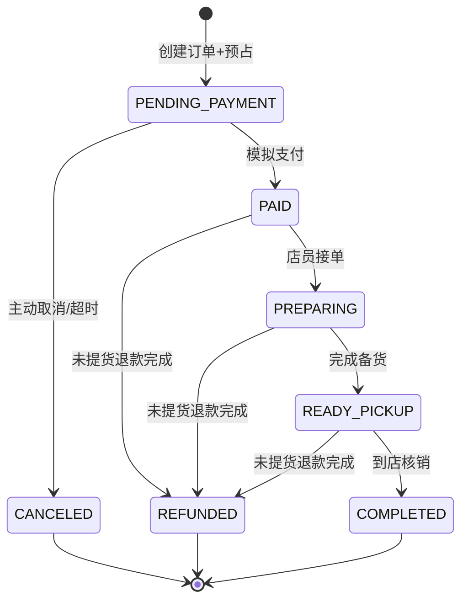
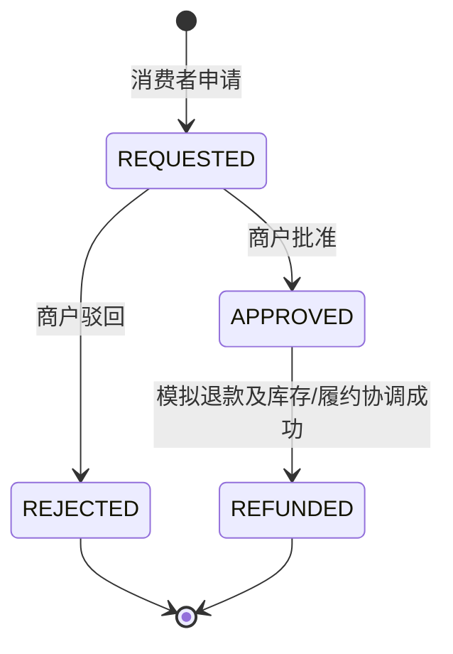

# Trading 交易领域详细设计（购物车 / 订单 / 模拟支付 / 售后）

> **R1 对齐说明（2026-10-28）**：本文保留需求来源与历史设计；当前冻结规则以 [R1 实施规格](../specs/RELEASE-01.md) 为准，实际实现/验证状态见 [R1 交付清单](../DELIVERY-R1.md)。历史“下一批/待开发/已通过”描述不作为本次执行证据。

> 版本 v1.0 · 2026-10-26 · **设计稿，尚未实现**  
> 依据：PRD FR-013~015、FR-017~018 · [库存](inventory.md) · [履约](fulfillment.md) · [事务与事件](../architecture/transactions-and-events.md)。开发批次 P3/P4。

## 1. 业务所有权与边界

Trading 拥有购物车、正式订单、订单项成交快照、模拟支付结果、售后申请与模拟退款事实。**不拥有真实库存余额、商品实时价格、商户经营状态、核销凭证**。这些信息从其他上下文公开能力查询或由 Case 协调。

定义统一语言：`Cart` 用户尚未结算的意图集合；`Order` 单商户成交单；`OrderItemSnapshot` 提交瞬间的商品名称/规格/售价；`PaymentRecord` 模拟付款确认记录；`AfterSaleRequest` 已付未提货订单的售后申请；`RefundRecord` 模拟退款完成事实。

## 2. 业务事件风暴

| Actor | 命令（蓝） | 流程（红） | 事件（黄） | 只读模型（绿） | 领域对象（棕） |
|---|---|---|---|---|---|
| 消费者 | `AddCartItem` | 校验用户/SKU/数量，合并购物车 | `CartItemAdded` | 商品简版 | Cart |
| 消费者 | `CheckoutMerchant` | 核验资格/报价 → 全 SKU 预占 → 建单 | `OrderCreated` | 购物车、报价、可售量 | Order |
| 消费者 | `ConfirmMockPayment` | 合法状态竞争、保存模拟支付结果 | `OrderPaid` | 订单应付额 | PaymentRecord |
| 消费者/定时任务 | `CancelUnpaidOrder` | 状态竞争 + 预占释放 | `OrderCancelled` | 到期订单列表 | Order |
| 消费者 | `RequestRefund` | 校验已付、未核销、全额申请 | `RefundRequested` | 订单+履约资格 | AfterSaleRequest |
| 商户 Owner | `ApproveRefund` | 审核有效性，协调取消履约、释放预占、退款 | `RefundCompleted` | 待处理售后单 | RefundRecord |
| 商户 Owner | `RejectRefund` | 记录拒绝原因 | `RefundRejected` | 售后详情 | AfterSaleRequest |
| 平台管理员 | `AdjudicateDispute`（P4 可选） | 纠纷判断、审计 | `DisputeResolved` | 证据视图 | DisputeCase（可选） |

外部支付网关（粉色）首版**不存在**；模拟支付不产生真实资金转移。HTTP 入口属于 Trigger 而非领域事件。

## 3. 聚合、实体、值对象

| 类型 | 候选对象 | 关键字段/行为 | 核心不变量 |
|---|---|---|---|
| 聚合 | `CartAggregate` | userId、CartItem 列表；`add/remove/changeQuantity` | 只能修改自己购物车，加购不预占 |
| 聚合 | `OrderAggregate` | orderId,buyerId,merchantId,storeId,totalCent,status,deadline,version | 一单一商户/一店；价格快照不可被事后改价覆盖 |
| 内部实体 | `OrderItemEntity` | skuId,productSnapshot,unitPriceCent,quantity | 数量>0，金额服务端算 |
| 值对象 | `MoneyVO`、`OrderStatusEnumVO`、`OrderSnapshotVO` | 金额与状态 | 不可变、金额无浮点误差 |
| 聚合/记录 | `PaymentRecord` | orderId,amountCent,method=MOCK,status | 一订单只确认一次模拟付款 |
| 聚合 | `AfterSaleRequestAggregate` | afterSaleId,orderId,reason,status,decision | 同订单同一时间最多一个有效全额申请 |
| 记录 | `RefundRecord` | refundId,orderId,amountCent,status | 同一订单全额模拟退款最多一次 |

不要把 Catalog.ProductListing、Merchant.Merchant、Inventory.StockBalance 作为 Order 聚合成员，只保留聚合 ID 和成交快照。

## 4. 订单与售后状态机

`PAID / PREPARING / READY_PICKUP → REFUNDED` 必须经 RefundCase 检查 Fulfillment 未核销；不是前端能够直接指定的状态。

若退款的审核与执行在一个事务完成，`APPROVED` 是审计流程中的逻辑过渡，数据库可只保留 `REFUNDED` 结果和审核记录；禁止留下已批准但无恢复策略的永久中间态。退款与核销竞争时一方必须失败，不能双成功。

## 5. 核心流程契约

### 5.1 购物车

- 加购来自普通商品页或已确认的 `RecommendationProposal`。先查询商品仍存在且可售，但**加购不会对库存作保障**。
- 购物车可混合商户，提交时必须选择一个 `merchantId + storeId`，只读取对应分组；服务端从 SKU 验证归属。
- 购物车数量必须为正整数且受配置上限限制；同一用户/SKU 合并时按锁/唯一索引处理并发。

### 5.2 创建订单 `CheckoutCase`

1. 从可信身份上下文读取 buyerId，校验选定 merchant/store 的可交易资格。
2. 从 Catalog 获取所有 SKU 的最新状态与报价；任一 SKU 不可售时整体失败。订单总额由服务端计算，订单项固化价钱、名称、规格快照。
3. 先生成稳定 `orderId`，获取请求幂等键，检查同用户同键同请求指纹是否已创建订单。
4. 在 **一个 MySQL 本地事务** 中，依固定 SKU 排序执行库存条件预占；创建订单/明细/请求幂等记录。任一失败全部回滚。
5. 成功返回订单和模拟支付截止时间；购物车相应商品按已提交订单清理（清理失败不影响成交事实，可在同事务做条件删除）。

**冲突解决**：同一幂等键不同购物车/商品集合必须报 `TRD_IDEMPOTENCY_CONFLICT`，不能返回旧订单冒充新结果；需要有请求哈希和唯一索引。

### 5.3 模拟支付 `ConfirmPaymentCase`

- 前置：订单 `PENDING_PAYMENT`、尚未到截止时刻、付款金额与订单总额完全一致；支付成功后只写 `MOCK` 模拟支付记录。
- 竞争：与关闭订单在同一锁或带版本条件更新下竞争，只有一种状态成功。后者获胜时模拟支付不能再把订单复活。
- 订单已 PAID 的相同付款重试，返回既有结果；不同金额报冲突。
- 若支付后创建 PickupTask 采用可靠异步事件，则事件投递失败不能丢失；应使用事务 Outbox 或可重复扫表自愈。**不把自提任务创建失败误判为支付失败**。

### 5.4 关闭待付款订单 `ExpireOrderCase`

- 定时任务只选择符合 `PENDING_PAYMENT AND deadline <= now` 的单；再次锁定并确认状态。
- 在同一事务中执行 `cancel` 并通过 Inventory 释放该单的所有预占；已支付订单不能进入此分支。
- 允许任务重复触发，无负库存、无二次释放、无重复关闭事件。

### 5.5 未提货全额退款 `RefundCase`

- `AfterSaleRequest` 仅能引用 buyer 本人已付、未完成核销的订单；首版只允许整单全额模拟退款。
- 商户审核人必须属于订单 merchant，拒绝时需原因；申请人不应通过接口伪造 merchantId。
- 批准时在一个本地事务内锁定订单、核销任务、预占记录，取消待核销履约、释放预占、写退款记录、订单变 REFUNDED。**严禁先发“退款成功”通知再完成业务写入。**
- 已经完成核销/出库则不能使用“释放库存预占”退款；已提货退货另起业务范围。

## 6. 公开能力与工程分层

- Domain：`ITradingOrderService`、`ICartService`、`IAfterSaleService`；仓储接口 `IOrderRepository`、`ICartRepository`、`IAfterSaleRepository` 位于本域 `adapter/repository/`。
- 复杂跨领域场景：`ICheckoutCase`、`IConfirmPaymentCase`、`ICancelOrderCase`、`IRefundCase`；先依赖 Domain 的公开业务接口，不跨域操作 DAO/PO。
- 同域只读：`IOrderQueryService` 返回只读视图，不需要将所有订单完整重建成聚合。
- Infrastructure：`adapter/repository/`、`dao/`、`dao/po/`；缓存和 SDK 不进入 Domain。

## 7. 数据模型与 HTTP 草案

| 表 | 重要唯一约束/索引 |
|---|---|
| `trd_cart_item` | `(user_id,sku_id)` 唯一；按 user_id/merchant_id 查 |
| `trd_order` | order_id 主键、`(buyer_id,request_key)` 唯一（需请求指纹）；status/version/deadline 索引 |
| `trd_order_item` | `(order_id,sku_id)` 唯一；冻结商品与价钱快照 |
| `trd_payment` | order_id 唯一，amount_cent=order.amount_cent |
| `trd_after_sale` | afterSaleId 主键、order_id 关联；活跃申请互斥需要显式事务或约束设计 |
| `trd_refund` | order_id 唯一；金额与订单已付额一致 |

| 方法 | 当前 URI | 权限 / 说明 |
|---|---|---|
| GET / PUT | `/api/v1/cart` | 本人购物车，PUT 更新 SKU 数量 |
| DELETE | `/api/v1/cart/{skuId}` | 本人移除 SKU |
| POST | `/api/v1/orders` | 一次一个商户，`Idempotency-Key` 业务必填 |
| GET | `/api/v1/orders/page`、`/api/v1/orders/{orderId}` | 买家可查自己的订单；详情允许受控商户与平台角色 |
| GET | `/api/v1/merchants/{merchantId}/orders/page` | 商户成员受控读，支持 `state,q,page,size` |
| GET | `/api/v1/admin/orders/page` | 平台管理员，支持 `state,q,page,size` |
| POST | `/api/v1/orders/{orderId}/pay` | 本人模拟支付；不发生真实资金流转 |
| POST | `/api/v1/orders/{orderId}/cancel` | 本人取消未付款 |
| POST | `/api/v1/orders/{orderId}/refunds` | 买家申请售后退款 |
| POST | `/api/v1/merchants/{merchantId}/orders/{orderId}/refund-decision` | 商户审核 |
| POST | `/api/v1/admin/orders/{orderId}/refund-decision` | 平台处理争议 |

商户搜索 `q` 由数据库在分页之前按订单号及订单商品标题过滤，`total` 使用同样的条件。详见 [v1.1 当前 HTTP 契约](../api/http-api.md)。

## 8. 错误语义与验收

- `ILLEGAL_PARAMETER`、`ORDER_MIXED_MERCHANT`、`PRICE_CHANGED`、`ORDER_STATE_INVALID`、`ORDER_EXPIRED`、`REFUND_STATE_INVALID`、`REQUEST_CONFLICT`；以 `ResponseCode.java` 为准。
- 测试 1：并发最后 1 件仅一人建单成功；任何部分预占失败后数据库无订单残留。
- 测试 2：支付与到期取消竞争只有一种结果，库存状态和支付记录一致。
- 测试 3：同幂等键重试同单返回既有订单；同键不同商品返回冲突。
- 测试 4：商品下架或改价后不能使用旧购物车价强行成交。
- 测试 5：退款与核销并发最多一方成功，不能双扣/双退。
- 测试 6：跨商户 Owner 不得访问或操作别人的订单/售后；买家不能查他人订单。

## 9. 开工前待决策

`TRD-OPEN-01` 待付款超时暂定 15min；`TRD-OPEN-02` 购物车数量上限；`TRD-OPEN-03` 退款申请时机与商户超时不响应处理；`TRD-OPEN-04` 交易支付模拟是否允许支付失败模拟测试；`TRD-OPEN-05` 已决策：首版付款与创建自提任务在同库事务内完成；不采用异步消息补偿作为当前代码路径。
