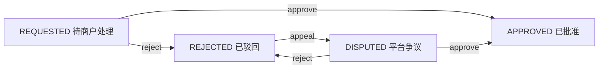

# PR2：Trading 上下文职责划分与售后聚合

> 目标：保留原有交易一致性与外部契约，把购物车、订单、售后规则放回相应领域职责。遵循小傅哥 DDD 聚合/领域服务与 Repository/Adapter 规范，避免机械制造策略/责任链。

## 1. 变更前后对照

| 旧结构 | 新结构 | 领域职责 |
| --- | --- | --- |
| `ITradingService` + `TradingServiceImpl`（单一大服务） | `ICartService/CartServiceImpl` | 购物车加减/锁定/清理，不拥有库存 |
| 同上 | `IOrderService/OrderServiceImpl` | 幂等建单闸门、订单聚合存取、模拟支付及经营统计 |
| 同上 | `IAfterSaleService/AfterSaleServiceImpl` | 售后聚合重建、状态转换及申请幂等 |
| `ITradingRepository` + `TradingRepository` | `ICartRepository/CartRepository` | 只访问购物车数据 |
| 同上 | `IOrderRepository/OrderRepository` | 订单、结算请求和模拟支付记录 |
| 同上 | `IAfterSaleRepository/AfterSaleRepository` | 退款申请及裁决事实 |
| `AfterSaleVO` + Service 中的状态分支 | `AfterSaleAggregate` + `AfterSaleVO` | 聚合负责合法状态转移，VO 为只读快照 |

这三个 Service 仍属于 **Trading 限界上下文**，不拆微服务。已有 `ITradingDao` / MyBatis XML 暂时保留单个 SQL 映射接口：它位于 Infrastructure，不参与业务决策。若未来 SQL 映射显著膨胀，再独立评估 DAO/mapper 分包；本批不改变 SQL namespace。

## 2. 售后领域状态机



- 只有已支付且属于该用户的订单可以首次申请；同订单同原因且 `REQUESTED` 可幂等重试。
- 驳回需审核理由；同一个 `REJECTED` 再驳回不覆盖原理由；申诉只由买家发起，重复申诉安全。
- 商户不能审核争议中的申请；平台有权限审理争议。
- **售后批准不是退款实际完成**：批准状态写入、取消自提、释放预占、记录模拟退款、标记订单退款，均由 `OrderLifecycleCase` 的单事务完成。
- 不允许售后服务直接注入库存、订单仓储或 Fulfillment DAO；外部权限从 Case/Trigger 校验。

## 3. 依赖与锁

```text
Controller / Job / ShoppingAiCase
             |
           Case (单事务)
        /      |       \
  ICartService IOrderService IAfterSaleService
        |      |        |
      Domain 各自业务规则与 Aggregate
        |      |        |
  ICartRepository IOrderRepository IAfterSaleRepository
        |      |        |
  Infrastructure/adapter/repository (分别实现)
        \      |       /
                ITradingDao / MyBatis / MySQL
```

- 下单：幂等闸门 → 购物车锁 → 商户锁 → SKU 锁 → 有序库存锁；订单创建与库存预占原子提交。
- 支付/关单/退款/核销以订单行锁序列化；对售后记录的访问使用同一用例事务。
- 保留 `@Transactional(rollbackFor=Exception.class)` 在 Case；领域写操作使用 `Propagation.MANDATORY`，不允许无事务调用。
- 原购物车逻辑不预占库存；AI 确认加购也必须调用 `ICartService` 并在 Case 事务内复验 SKU/价格/库存。

## 4. 对外兼容性与验收

- **数据库**：无 DDL、迁移或表名变化；继续使用 `trd_order`、`trd_cart_item`、`trd_after_sale` 等原表。
- **API**：Controller 公开 URL、DTO、HTTP 业务码和字符串状态不变；现有前端不需要适配。
- **测试**：`AfterSaleAggregateTest` 验证退款状态机；`CommerceMySqlIntegrationTest` 新增驳回→申诉→平台裁决及审核失败原子回滚；继续跑现有并发扣库存、支付/关单竞争、重复核销、幂等、真实 HTTP/Chromium 回归。
- 构建命令：`mvn -B -ntp clean verify`；真实环境验收由 GitHub Actions `Campus Shopping - Real Acceptance` 报告，不把源码修改视为 CI 已通过。
- 无真实资金扣款；外部 LLM/Milvus 的独立验收不属于本批。

## 5. 明确未扩展的功能

本批不引入真实支付网关、支付回调分布式事务、退款部分金额、实际门店结算、多单跨商户合并支付，也不新增无必要的策略工厂或决策树。
