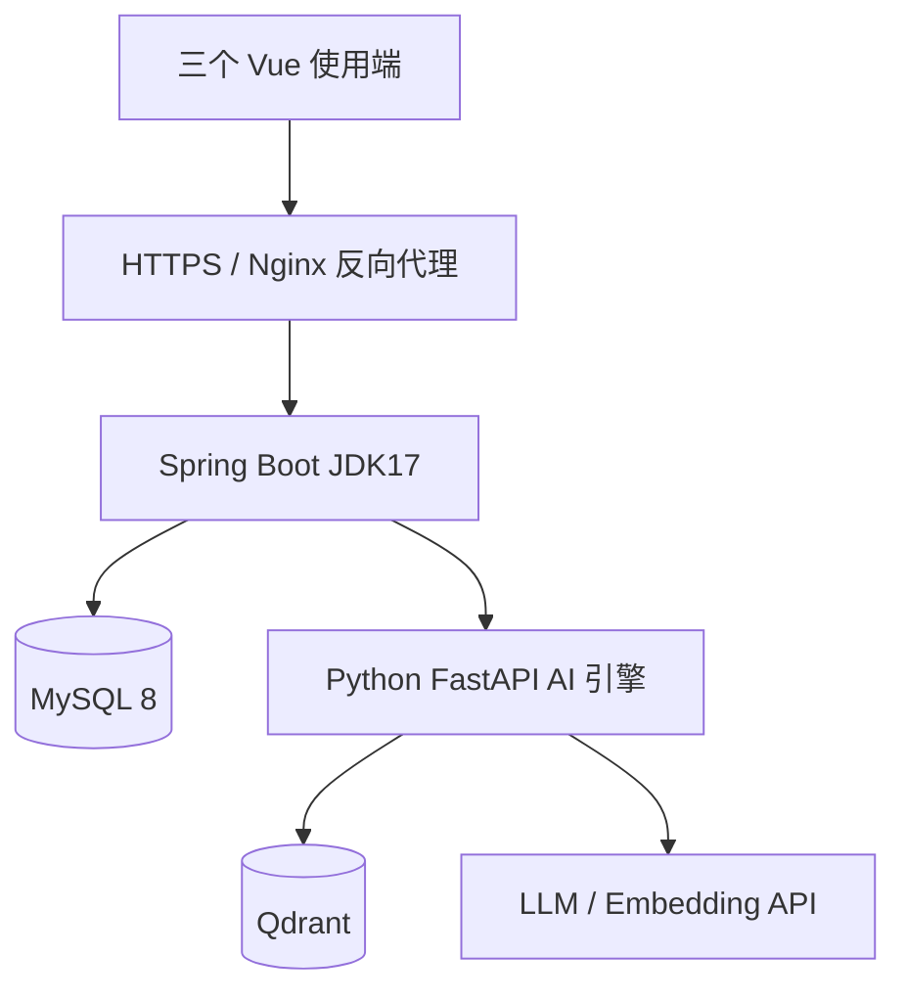

# 本地演示、测试和上线验收检查单

> 版本 v1.0 · 2026-10-26 · **部署计划/核验要求，尚无完成记录**。保留原脚手架 `docs/dev-ops/`，此处不新增强制 Kubernetes/MQ。

## 1. 建议部署拓扑

可以在一台开发机或 VPS Docker Compose 演示，但持久化卷、权限和公网访问规则需分别处理。Java 是唯一业务写操作权威；Python 不连业务库执行交易写入。

## 2. 环境变量与 Secret

| 名称（示例） | 用途 | 规则 |
|---|---|---|
| `DB_URL / DB_USER / DB_PASSWORD` | MySQL 连接 | 最小权限，绝不提交明文 |
| `SPRING_PROFILES_ACTIVE` | 环境配置 | dev/test/prod 分开 |
| `AI_SERVICE_BASE_URL` | Java → Python | 内网地址+服务间认证 |
| `AI_SERVICE_TOKEN` | 服务间鉴权 | 不暴露给浏览器 |
| `QDRANT_URL / QDRANT_API_KEY` | Python → Qdrant | 使用 HTTPS/内网，API Key 保密 |
| `LLM_API_KEY` | 模型服务 | 仅 Python 服务环境变量 |
| `PUBLIC_BASE_URL` | 浏览器公开 API | 必须 HTTPS 上线 |

## 3. 上线前必须检查

- [ ] 备份现有数据库，版本化迁移已在空库和已有演示数据上验证。
- [ ] `mvn clean verify`、安全测试、关键 MySQL 并发测试通过；AI 评测报告有真实数据。
- [ ] root/默认模板密码、示例管理员账号已清除；服务端日志不输出敏感值。
- [ ] MySQL/Redis/Qdrant/管理面板不直接暴露到互联网；只开放反向代理所需端口。
- [ ] HTTPS、Cookie/Session/CSRF 或 JWT 授权方案已选择并测试；跨商户隔离已验证。
- [ ] 商品索引与知识索引的初始化和失败恢复有验证办法；源主数据可恢复。
- [ ] 启动脚本、健康检查、业务准备度（MySQL 可连，AI 不必阻塞普通交易）已验证。
- [ ] 已确认模拟支付的显著标识，不接真实资金，不做对外真实支付承诺。
- [ ] 明确每种文件/数据库数据的备份路径、留存策略和还原演练步骤。
- [ ] 按脱敏规范配置日志、请求 ID、管理员审计与 AI 故障监控。

## 4. 验收演示顺序

平台管理员审核两个不同商户 → Owner 分别上架 SKU 并补货 → 消费者跨商户浏览/AI 搜索 → 按一家商户下单并模拟付款 → 店员备货 → 消费者自提核销 → 查看订单和库存变化 → 演示未付超时取消、售后/退款、RAG 内部资料访问被拒绝。

## 5. 常见故障与恢复

| 故障 | 观察点 | 处理原则 |
|---|---|---|
| Spring Boot 起不来 | Profile、端口、DB、Bean 装配 | 不直接改生产数据凑状态 |
| DB 连接失败 | 网络/凭据/连接池 | 停止新交易、报告可用性 |
| Outbox 积压 | 重试队列、最后错误、业务版本 | 安全重放，幂等消费 |
| Python/LLM 故障 | 超时/状态/速率限制 | 降级 AI，普通交易继续 |
| Qdrant 数据丢失 | 存储卷/索引状态 | 由权威知识版本重建索引 |
| 自提码核销异常 | 任务、订单、库存预占事务日志 | 先对账再恢复，不盲目重复扣库存 |

## 6. 发布记录模板

`版本/Commit SHA｜迁移版本｜MySQL 版本｜AI 模型/索引版本｜上线日期｜验证人｜测试链接｜已知缺陷｜回滚步骤`。本文件尚未填写任何生产部署成功记录。
