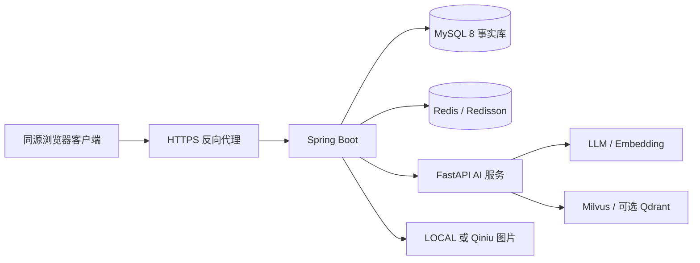

# 生产部署核验清单

> 当前状态：清单，不代表已有生产部署验收。实际部署须按目标版本、环境和明确授权执行，并保留对应证据。

## 1. 拓扑

Java/MySQL 是交易事实唯一权威；Python、模型和向量库只提供建议/检索投影。当前支持多个 Java 实例共享 MySQL/Redis 和单 Python 服务，不支持多 Python 副本。

## 2. 配置与密钥

- 使用 `.env.example` 作为字段清单，由私有密钥系统注入；不得提交、打印或截图真实 `.env`。
- 数据库使用最小权限账号与可信 CA；Redis 安全实例和缓存实例独立，生产命名空间不可复用。
- `SESSION_COOKIE_SECURE=true`，入口必须 HTTPS；CSRF、同源策略和安全响应头保持启用。
- `AI_SERVICE_KEY`、LLM/Embedding 凭据、Milvus/Qdrant 凭据只注入对应服务。
- 七牛 provider 必须显式配置完整；证书、域名和公有/私有桶策略在私有环境核对。

## 3. 上线前门禁

- [ ] 目标提交的 Quick quality gates 和同日完整 MySQL/Redis/HTTP/浏览器/镜像验收通过。
- [ ] 新库初始化、旧库迁移、重复重放、校验和拒绝和回滚边界均在隔离库验证。
- [ ] 备份、恢复演练、维护窗口和迁移责任人明确；应用启动只读校验，不执行 DDL。
- [ ] 已复核 120 例评测数据/人工结论，或明确标记为 `DRAFT` 且不对外宣称正式质量。
- [ ] 真实模型、Embedding、Milvus/Qdrant 的授权、预算、超时、429、故障降级和清理已验证。
- [ ] 多 Java 共享会话、限流、RBAC 撤权、缓存版本隔离和单 Redis 故障边界已验证。
- [ ] 反向代理、TLS、网络 ACL、管理端口隔离、日志脱敏和密钥轮换方案已审查。
- [ ] 备份恢复、HA、SLO、容量和持续负载已按独立测试记录；不把短时 smoke 当生产结论。
- [ ] 页面明确显示“模拟支付”，不宣传真实资金流转、结算或退款。

## 4. 业务验收

平台审核两个商户 → Owner 上架/补货 → 消费者浏览与 AI 导购 → 用户确认提案加购 → 单商户结算与模拟支付 → 商户备货 → 自提核销；另验未付关单、未提货退款、平台争议、越权拒绝和 AI 降级。

## 5. 发布记录

记录：版本/Commit、迁移版本与指纹、MySQL/Redis/Python/模型/向量库版本、环境、测试链接、已知缺陷、回滚步骤、操作人和时间。未执行的项明确写 `NOT_RUN`。
