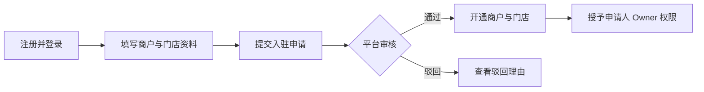
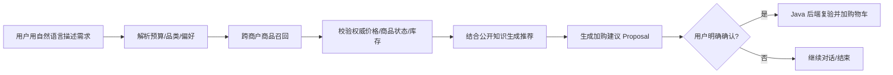

# 校园智能导购及商品交易平台 — 产品需求文档（PRD）

> **R1 对齐说明（2026-10-28）**：本文保留需求来源与历史设计；当前冻结规则以 [R1 实施规格](../specs/RELEASE-01.md) 为准，实际实现/验证状态见 [R1 交付清单](../DELIVERY-R1.md)。历史“下一批/待开发/已通过”描述不作为本次执行证据。

> 文档版本：1.0 · 2026-10-26  
> 状态：**首版产品范围已确定**；本文件中标注「暂定 / 待决策」的细节不是最终产品规则。  
> 用途：需求评审、DDD 领域建模、开发任务分解、测试验收和毕业设计材料。  
> 衍生设计：[业务架构](../architecture/business-architecture.md) · [角色与流程](roles-and-flows.md) · [待决策清单](open-questions.md) · [追踪矩阵](../TRACEABILITY.md) · [开发路线](../ROADMAP.md)

## 1. 背景与目标

在同一个校园内，便利店、文具店、水果店等经营者分别管理自己的商品。消费者需要跨商户发现商品、比较选择，并完成到店自提。传统关键词搜索很难处理“预算 30 元、想买适合熬夜复习的零食，尽量高蛋白”这样的复合需求。

本项目实现一个 **轻量多商户校园交易平台**，在正常商品交易闭环上引入**基于真实商品信息、RAG 证据和受控工具调用的 AI 导购**。

### 1.1 产品目标

- 消费者：发现不同商户的商品，明确价格和可售情况，按商户下单、模拟支付、到店自提。
- 商户：入驻、管理商品 SKU/价格/库存、接单备货、核销、处理限定售后。
- 平台：审核商户、管控经营状态、处理争议、查看必要的运营统计。
- AI：理解用户需求，展示有依据的商品推荐；用户确认后才执行加购，不替用户自动付款。

### 1.2 首版成功条件（验收要求而非已测指标）

1. 至少两个独立商户完成入驻、上架商品、补货、接单；商户数据互相不可见。
2. 一名消费者能够从浏览到完成模拟支付、商户备货及自提核销。
3. 价格或库存变化、支付/关单竞争、重复核销等关键异常不会破坏业务一致性。
4. AI 能针对自然语言需求，从真实商品中给出可解释建议；用户确认后可加购；真实库存/价格由 Java 业务后端重验。
5. 普通消费者无法通过 RAG 检索或引用访问商户内部知识文档。

## 2. 范围与产品约束

| 范围 | 确定的规则 |
|---|---|
| 商户模式 | 多个独立商户入驻一个平台；首版每商户一家实体门店，保留 `storeId` 用于后续扩展 |
| 用户范围 | 学生、教师、教职工等校园用户；首版不接学校统一身份认证 |
| 购物车 | 可以跨商户收藏商品，并按商户分组查看 |
| 结算 | **一次提交只生成一个商户的订单**，不做跨商户合并支付 |
| 支付 | 模拟支付；**不接真实资金、分账、抽佣、提现** |
| 履约 | 商户备货、消费者到店自提、一次性凭证核销；不做物流配送 |
| 库存 | 下单预占、取消释放、自提成功实际出库；无负库存、无重复释放 |
| AI 操作 | 意图理解、检索、推荐、解释、提出加购建议；**用户确认后**执行加购，不自动付款 |
| RAG | 商户公开商品资料及平台公开政策；内部资料必须受权限限制 |
| 商户治理 | 商户自主维护商品，平台具有商户审核、停用和必要的违规下架能力 |

### 2.1 明确不在首版

真实支付回调与清结算、营销优惠券、跨门店调拨、骑手物流、跨商户合并支付、自动代购和自主付款、复杂部分退款、已提货后的退货重入库、多 Agent 自主经营规划、学校教务/门禁系统对接。若后续加入，先做变更评审。

## 3. 参与者及权限

| 角色 | 主要能力 | 权限限制 |
|---|---|---|
| 消费者 | 浏览、搜索、导购、购物车、下单、查单、申请售后 | 仅本人私有订单、会话、售后 |
| 商户经营者 Owner | 维护本商户资料、商品、库存、员工、备货与售后 | 仅已授权的商户 |
| 商户店员 Clerk | 备货、核销；可按授权补货 | 不可审批入驻、转授平台权限、管理其他商户 |
| 平台管理员 | 商户审核、停用、必要的全局监管与纠纷处理 | 必须是真实平台授权身份，操作记录审计 |
| 系统任务 | 订单超时关闭、事件重试、索引任务 | 使用最小所需权限，不能冒充用户 |
| AI 导购 | 查询与推荐、生成可确认加购建议 | 不可直接写订单、库存或付款；不允许绕过用户权限 |

**SDD-05 授权扩展**：商户 Owner 可以创建本商户专属自定义角色，按商品、库存、订单、售后与知识库操作授权，并分配给已加入的成员；默认 OWNER/CLERK 保留且不可编辑。角色治理、成员邀请/撤销与店铺设置为 Owner 保留权限，不能通过自定义角色再授权。平台管理员由独立平台身份授予，不开放商户侧配置。权限由后端按当前用户与商户再次检查。

同一用户可以是消费者，同时在商户 A 具有 Owner 身份、商户 B 具有 Clerk 身份。平台身份与商户成员权限不是账号的互斥枚举。

## 4. 典型用户旅程

### 4.1 商户入驻

验收关键点：非平台管理员不得审批；重复审批不会重复生成商户；审批开通与 Owner 授权保持一致。

### 4.2 消费者交易

关键点：提交订单与库存预占在同库事务内；支付与过期关单争用合法状态；核销只能一次成功。

### 4.3 AI 导购

关键点：RAG 只提供可授权的证据；LLM 的文字不是执行凭据；加购不预占库存，结算再次复核。

## 5. 功能需求清单

**优先级解释**：P0=首版必须；P1=首版完成闭环所需但可在后批交付；P2=有余力增强。与开发阶段 P0~P6 的命名不是一回事。

| 编号 | 所属域 | 功能与可观察结果 | 优先级 | 开发批次 |
|---|---|---|---|---|
| FR-001 | Identity | 用户可注册、登录、退出；未登录不可写入私人数据 | P0 | 开发 P1 |
| FR-002 | Identity | 平台管理员身份由受控初始化产生，普通注册不能获得 | P0 | 开发 P1 |
| FR-003 | Identity | 一个账号可关联多个商户与不同角色，授权按商户校验 | P0 | 开发 P1 |
| FR-004 | Merchant | 申请人提交入驻申请，查看自己的审核状态和原因 | P0 | 开发 P1 |
| FR-005 | Merchant | 平台管理员查看待审申请并通过/驳回 | P0 | 开发 P1 |
| FR-006 | Merchant | 审核通过创建商户、初始门店、Owner 成员授权 | P0 | 开发 P1 |
| FR-007 | Merchant | 商户停用时阻止新交易，保留历史记录和受控售后 | P1 | 开发 P1/P4 |
| FR-008 | Identity | Owner 可邀请、撤销本商户员工的授权 | P1 | 开发 P1 |
| FR-009 | Catalog | 商户创建商品，管理单/多规格 SKU、售价、上下架 | P0 | 开发 P2 |
| FR-010 | Catalog | 消费者按商户、分类、关键词浏览商品和 SKU | P0 | 开发 P2 |
| FR-011 | Inventory | 商户对 SKU 补货，查看实物/预占/可售数量 | P0 | 开发 P2 |
| FR-012 | Inventory | 订单批量预占、取消释放、自提出库，幂等且不超卖 | P0 | 开发 P3/P4 |
| FR-013 | Trading | 购物车支持跨商户分组，一次仅结算一个商户 | P0 | 开发 P3 |
| FR-014 | Trading | 服务器报价、创建待支付订单、保存价格快照 | P0 | 开发 P3 |
| FR-015 | Trading | 模拟支付、超时关单、主动取消，状态竞争安全 | P0 | 开发 P3 |
| FR-016 | Fulfillment | 商户备货、自提凭证生成与单次核销 | P0 | 开发 P4 |
| FR-017 | Trading | 已支付未提货订单可申请全额模拟退款 | P1 | 开发 P4 |
| FR-018 | Trading | 商户审核售后，平台可对争议进行干预 | P1 | 开发 P4 |
| FR-019 | ShoppingAI | 用户自然语言描述购物需求，提取预算、数量、偏好 | P0 | 开发 P5 |
| FR-020 | ShoppingAI | 跨商户候选检索、真实数据校验、商品解释与排序 | P0 | 开发 P5 |
| FR-021 | ShoppingAI | AI 生成建议，用户确认后通过可信 Java 业务接口加购 | P0 | 开发 P5 |
| FR-022 | ShoppingAI | 上传公开知识文档、构建索引、按权限引用回答 | P0 | 开发 P5 |
| FR-023 | ShoppingAI | 评测集和召回/约束指标可重复运行并留存结果 | P1 | 开发 P5/P6 |
| FR-024 | Platform | 平台查看必要商户经营数据和异常处理结果 | P1 | 开发 P6 |
| FR-025 | All | 三个使用端完成核心业务入口与反馈交互 | P0 | 开发 P1-P6 |

## 6. 页面/入口与交互验收

### 消费者端
首页与商户入口、商品列表/详情、搜索、AI 会话与推荐卡、购物车、单商户结算、订单列表/详情、自提凭证、售后入口。商品卡展示商户、SKU、价格、必要可售状态；数据变更应明确提示刷新或重新报价。

### 商户端
商户资料、员工授权、商品/SKU 编辑、库存补货、订单列表、备货任务、自提核销、售后处理。店员页面只展示其授权范围内的操作；禁用按钮不是服务端授权的替代。

### 平台端
待审商户、审核详情与意见、商户列表和停用、必要经营统计、争议处理。管理员关键操作有确认和结果反馈。

### AI 交互
消费者看到自然语言回答和真实商品推荐卡，推荐卡可查看商户与 SKU；生成建议与执行动作区别展示。用户未确认时不得加购；确认后应得到明确成功或失败结果。

## 7. 全局业务规则（按领域详设继续展开）

- BR-CORE-01：所有交易订单只属于一个商户、一个门店。购物车可以有不同商户商品。
- BR-CORE-02：价格、销售状态、经营资格、库存由 Java 权威业务数据判定，不能信任 LLM、Qdrant、前端缓存。
- BR-CORE-03：库存 `available = onHand - reserved`，不允许负库存；预占/释放/消耗要求按业务键幂等。
- BR-CORE-04：创建订单与其全部 SKU 预占必须原子；超时关闭与付款不可同时生效。
- BR-CORE-05：自提凭证不得重复核销；退款与核销不能同时成功交付与退款。
- BR-CORE-06：商户权限按用户 + 商户范围校验；任何 API 不得仅依赖用户传入的商户 ID 判断权限。
- BR-CORE-07：AI 只能提议写操作，必须有用户明确确认并经过可信 Java 校验。
- BR-CORE-08：内部知识文档不得通过检索结果、引用 URL 或回答泄露给无权限用户。

## 8. 非功能要求与评测

| 类别 | 要求 | 验证方式 |
|---|---|---|
| 安全 | 密码不可明文存储；平台管理员不能自助注册；商户及用户数据隔离 | 安全配置审查、越权接口测试 |
| 正确性 | 库存不超卖、交易状态单调合法、重复回调幂等 | MySQL 并发集成测试 |
| 可维护性 | 遵循 xfg-ddd-skills 的 Domain/Infrastructure 依赖倒置 | 模块构建、静态依赖测试 |
| 故障隔离 | AI 服务不可用不影响普通购物交易；Qdrant 错误不改真实库存和报价 | AI 故障注入测试 |
| 可观测性 | 核心命令记录 `requestId`/`correlationId`；管理员审核有审计 | 日志与审计记录验证 |
| 可测试性 | 主要业务行为有纯领域单测和数据库集成测试 | CI `mvn verify` 与测试报告 |
| AI 质量 | 使用固定评测集评估商品召回、约束满足率和引用正确性 | 报告实际指标；不虚构改进幅度 |
| 性能 | 在完成业务闭环后定义代表性负载，记录延迟/吞吐/错误率 | 实际压测报告；当前不承诺未测数值 |

## 9. 需求验收示例

| ID | 前置条件 | 操作 | 期望结果 |
|---|---|---|---|
| AC-01 | 普通已登录用户 | 调用平台审核接口 | 403，申请与商户数据无变化 |
| AC-02 | 同一申请已审核通过 | 再次提交相同审核请求 | 不重复创建商户或 Owner 成员授权 |
| AC-03 | 店员属于商户 A | 尝试编辑商户 B 商品 | 403 或资源不可见；无写入 |
| AC-04 | SKU 最后库存 1 件 | 两名用户同时下单各买 1 件 | 最多一笔预占成功 |
| AC-05 | 订单处于待支付临界点 | 支付与超时关闭同时执行 | 最多一种终态成功，库存一致 |
| AC-06 | 自提码已核销 | 再提交同一个自提码 | 不能二次完成或二次扣减实物库存 |
| AC-07 | AI 建议已过期 | 用户确认加购 | 操作拒绝并允许重新生成建议 |
| AC-08 | 商户内部知识文档 | 普通消费者提出相关问题 | 不返回内部内容或可直接访问的文档链接 |

## 10. 待确认的具体规则（不可偷偷视为已定稿）

| 编号 | 问题 | 建议默认值 | 最迟决策阶段 |
|---|---|---|---|
| OPEN-01 | 注册凭证与身份验证形式 | 用户名+密码，平台管理员独立引导创建，不要求学校统一认证 | P1 |
| OPEN-02 | 商户入驻申请是否要求校园经营证明 | 首版只录入经营名称、品类、联系方式和门店地点，平台人工审核 | P1 |
| OPEN-03 | 驳回后重新申请方式 | 新建申请保留原历史，不改旧审核事实 | P1 |
| OPEN-04 | 同一申请人能否有多份待审申请 | 建议限制相同商户名称的重复待审申请；须明确唯一性策略 | P1 |
| OPEN-05 | 商户被停用后已付订单处理 | 禁止新订单，受控完成既有履约和退款 | P1/P4 |
| OPEN-06 | 待支付超时关闭 | 暂定 15 分钟，可配置 | P3 |
| OPEN-07 | 部分退款、已提货退货 | 首版不做，仅已支付未提货全额模拟退款 | P4 |
| OPEN-08 | AI 评测基线与样本 | 先制定固定样本集再测，不预设达到某个分数 | P5 |

## 11. 需求变更控制

业务规则变化应同步更新本 PRD、[业务架构](../architecture/business-architecture.md)、对应领域设计、接口契约和测试。新增业务不自动转化为新增微服务、消息队列或专用 Agent；必须证明有明确业务收益或工程必要性。

## SDD-02 接口与界面验收补充（2026-10-28）

本节是原 FR-009、FR-010、FR-013、FR-014、FR-021、FR-022、FR-025 的**细化验收**，不增加额外产品范围，也不修改首版规则。

- 商品列表与公开商户目录支持后端分页、跨页搜索；一个商品可有多 SKU，商户可新增规格。商品详情能进入真实商户页面。
- 商品主图由商户可控上传；消费者购物车、AI 推荐显示可信图片；已下单的订单明细须保留**成交时**主图快照，旧订单无图则占位。
- 平台商品/订单监管显示真实商户名称；名称不可得才按 ID 降级，不将平台权限交给 UI 判断。
- 知识库中的文档能创建新版本并保持 `rootId`，查询文档列表可分页。
- 前端演示数据与后端业务结果严格分离；后端总数与真实数据库运行必须经测试后才能宣称通过。

验收与实现映射：[SDD-02 规格](../specs/SDD-INTEGRATION-02.md)。
