# 产品需求收束与核心功能架构说明（2026-11-18）

> 状态：已落地对齐（基于 [PRD.md](PRD.md)、[RELEASE-01.md](../specs/RELEASE-01.md) 与 [已接受 ADR](../architecture/decisions.md) 收束整理，不改变既有后端契约与领域不变量）

## 1. 产品核心定位与收束原则

本项目定位于 **高校校内门店自提零售与智能导购平台**，解决学生在校园封闭/半封闭场景下“不知道哪家店有现货、按预算怎么凑单、几点去哪自提”的高频即时消费痛点。

从产品交付标准出发，对整体需求做如下三项收束：

1. **守住“到店自提”主干，砍掉泛电商冗余**
   - **保留主干**：校内门店浏览、全量在售商品检索与筛选、多规格加购、单商户结算、模拟支付、备货流转、动态自提码签发与到店核销、未提货全额退款及争议裁决。
   - **明确不做**：跨商户合并支付拆单、快递配送与骑手履约、优惠券/秒杀/满减/积分体系、评价晒单社区、买卖双方即时聊天、真实第三方资金清算。
2. **明确 AI 边界：AI 只做“导购参谋”，不做“越权下单”**
   - 导购助手聚焦两件事：**按自然语言需求（预算、品类、场景）跨店召回可售现货**，以及**基于已发布知识库回答营业时间、自提地点与售后规则**。
   - 导购产出的商品组合仅作为待确认提案，必须由用户勾选确认并经交易服务实时复核价格、库存和商户资格后才写入购物车，杜绝“幻觉价格”或自动扣款。
3. **体验去工程化：前台零学习成本，后台按待办驱动**
   - 隐藏技术实现词汇（如“RAG 调试”“自提令牌”“UTF-8 72字节”“全局排序枚举”及裸露的内部 UUID），全部转化为符合日常直觉的业务表达。
   - 将低频工程验证能力（问答检索测试）从后台一级侧栏移入“知识库”内部二级工具栏，让主导航只保留高频经营与监管动作。

---

## 2. 收束后的三端核心功能架构

| 端侧 | 一级模块 | 核心交付能力 | 明确收束/裁剪项 |
| --- | --- | --- | --- |
| **消费者端（H5）** | 首页逛集市 | 关键词搜索、5 大高频分类、校内门店筛选与一键进店、价格区间与库存/价格排序、底栏快速选规格加购 | 去掉浮夸装饰符号与预览跳转干扰；价格筛选沉入商品列表区，首屏直达搜索与好物 |
| | AI 导购 | 场景化快捷提问、多轮历史会话、引用门店公开知识回答、推荐卡片勾选确认加购、加购后一键直达购物车 | 去掉英文假营销角标（如 HOT PICK）与流式字节计数；未配置大模型时诚实展示检索模式 |
| | 购物车与结算 | 按门店自动分组、切换结算店铺、库存/上下架异常提示、结算前实时复核报价与自提点确认弹窗 | 坚持单商户结算，不混单；显著提示当前为模拟支付 |
| | 订单与自提 | 订单状态流转（待付款/备货中/待自提/已完成/售后）、动态自提码签发与一键复制、未提货退款与平台申诉 | 已完成自提订单不可线上发起退款；重发自提码后旧码立即作废 |
| | 个人中心 | 登录注册、管理工作台快捷切换（具备商户/平台身份时展示）、商户入驻申请、店员邀请接受 | 不设复杂等级、余额钱包或冗余设置项 |
| **商户工作台** | 经营概览 | 近 7/30 天核心指标（订单数、支付数、退款数、成交额、退款率）、趋势与热销排行、近期订单 | 去掉每行重复口径小字与内部商品 ID，聚焦经营结果 |
| | 商品与库存 | 多图商品创建编辑、上下架、多规格调价与启停、低可售预警筛选、行内点选规格快速补货、库存流水 | 库存锁定与扣减由订单生命周期自动驱动，人工仅执行正向补货 |
| | 订单与自提核销 | 按履约阶段（待备货/备货中/待核销/已核销）筛选、开始备货、备货完成、输入买家自提码核销 | 自提核销页隐藏次要订单状态干扰，核销框收敛为单行快捷输入 |
| | 售后与团队设置 | 未提货退款同意/驳回、门店资料与头图维护、邀请店员、自定义角色权限矩阵、门店知识库维护与检索测试 | 店长（OWNER）权限受保护不可自锁；“问答检索测试”收归知识库页内入口 |
| **平台管理端** | 经营与入驻监管 | 全平台近 7/30 天交易概览、商户入驻资料审核（通过自动开通门店与店长身份，驳回必填原因） | 保持轻量准入闭环，不引入多级复杂审批流 |
| | 商品订单与争议 | 商户停用/恢复、违规商品强制下架、全平台订单巡检、已驳回退款申诉的平台终审裁决、分类字典与平台规则知识库 | 平台只做违规处置与争议裁决，不直接代改商户商品价格与库存 |

---

## 3. 核心功能架构与业务闭环流程图（Mermaid）

### 3.1 整体功能架构图

```mermaid
flowchart TB
  subgraph Consumer["消费者端（移动端 H5）"]
    C_Home["首页与门店主页：搜索 / 分类 / 门店筛选 / 选规格"]
    C_AI["AI 智能导购：自然语言找货 / 规则问答 / 确认加购"]
    C_Cart["购物车与单店结算：按店分组 / 实时核价 / 确认下单"]
    C_Order["订单与到店自提：模拟支付 / 领取与复制自提码 / 未提货退款"]
    C_Me["个人中心与入驻：账号认证 / 入驻申请 / 店员受邀 / 工作台入口"]
  end

  subgraph Merchant["商户工作台（店主 / 店员 RBAC）"]
    M_Dash["经营概览：7天与30天成交及退款指标"]
    M_Catalog["商品与库存管理：多规格上下架 / 低库存预警 / 幂等补货"]
    M_Fulfill["备货与自提核销：开始备货 / 备货完成 / 自提码核销"]
    M_After["售后与门店运营：退款审核 / 门店设置 / 角色权限 / 知识库"]
  end

  subgraph Admin["平台管理端（平台管理员）"]
    A_Overview["平台经营总览：全局交易趋势与状态分布"]
    A_Audit["准入与经营监管：入驻审核 / 商户启停 / 违规商品强下架"]
    A_Dispute["争议裁决与规则库：退款申诉终审 / 分类管理 / 平台知识库"]
  end

  subgraph Core["交易与导购底座（读写职责分离）"]
    JavaCore["Java 交易核心（MySQL 事实源）：实时核价 / 库存预占释放 / 状态机 / 权限复验"]
    AIService["AI 导购检索服务（只读建议投影）：跨店商品召回 / 知识检索 / 提案生成"]
  end

  C_Home --> JavaCore
  C_AI --> AIService
  AIService -. "生成待确认提案（不直接写库）" .-> C_AI
  C_AI -- "用户勾选确认加购" --> JavaCore
  C_Cart --> JavaCore
  C_Order --> JavaCore
  C_Me --> JavaCore

  M_Dash --> JavaCore
  M_Catalog --> JavaCore
  M_Fulfill --> JavaCore
  M_After --> JavaCore
  M_Catalog -. "异步同步商品索引" .-> AIService
  M_After -. "发布门店公开知识" .-> AIService

  A_Overview --> JavaCore
  A_Audit --> JavaCore
  A_Dispute --> JavaCore
  A_Dispute -. "发布平台公共规则" .-> AIService
```

### 3.2 核心交易与自提履约闭环流程图

```mermaid
flowchart LR
  Start(["学生进入平台"]) --> Discover{"找货方式"}

  Discover -- "自主逛店 / 搜索筛选" --> PickSKU["选择商品规格与数量"]
  Discover -- "向 AI 导购提需求" --> AIChat["AI 结合公开知识与实时现货生成推荐"]
  AIChat --> ConfirmProposal["用户勾选商品并点击确认加购"]

  PickSKU --> Cart["加入购物车（按门店自动分组）"]
  ConfirmProposal --> Cart

  Cart --> CheckQuote["选择单家门店结算：实时复验价格、库存与营业状态"]
  CheckQuote --> CreateOrder["提交订单并锁定可售库存（待付款）"]

  CreateOrder -- "超时未付 / 主动取消" --> CancelOrder["释放预占库存（已取消）"]
  CreateOrder -- "完成模拟支付" --> Paid["进入门店履约队列（已支付 · 待备货）"]

  Paid --> Prepare["商户开始备货 → 备货完成（待自提）"]
  Prepare --> Token["买家领取并复制动态自提码"]
  Token --> Verify["到店出示自提码核销：扣减实物库存（已完成）"]

  Paid -. "取货前无法自提" .-> RefundReq["买家提交退款申请"]
  Prepare -. "取货前无法自提" .-> RefundReq
  RefundReq --> MerchantReview{"商户审核"}
  MerchantReview -- "同意退款" --> Refunded["回滚预占库存（已退款）"]
  MerchantReview -- "驳回申请" --> Appeal{"买家是否申请平台介入"}
  Appeal -- "发起申诉" --> AdminJudge{"平台管理员终审裁决"}
  AdminJudge -- "批准退款" --> Refunded
  AdminJudge -- "维持驳回" --> ContinuePickup["恢复原自提履约流程"]
```

---

## 4. UI / UX “去 AI 味”与交互极简化落地要点

1. **清除模板化 AI 视觉噪音**
   - 移除首页与导购页悬浮装饰星标（`✦` / `✧`），压缩首屏冗余横幅高度，让商品卡片与真实对话区域在手机首屏第一时间露出。
   - 将 AI 推荐卡片上无业务含义的英文假标签（`HOT PICK` / `DAILY` / `GOOD VALUE`）替换为真实**门店名称**，帮助学生判断自提距离。
2. **全面改写生硬工程术语**
   - 注册提示由“密码须为8~64字符，且UTF-8编码不超过72字节”简化为“密码 8~64 位”；知识库上传说明由“最多2,000,000字节”改为“不超过 2MB”。
   - 排序标签由“全局库存 / 全局价格”简化为“库存 / 价格”；详情页去掉 B2B 味道的“含税售价”，改为“门店自提”。
   - 商户与买家侧统一将晦涩的“自提令牌”口语化为“自提码 / 自提凭证”；流式等待文案去掉“已读取 X 字节”，改为“正在为你挑选合适商品…”。
   - 后台商品列表、经营概览、平台监管列表全面隐藏冗长的内部 `skuId` / `productId` / `merchantId` 标识，优先展示名称、分类与中文状态。
3. **打通高频操作“最后一公里”**
   - **首页**：再次点击已选门店即可取消筛选；门店筛选条新增“进店逛逛”一键进店；选规格弹窗直接展示当前规格剩余库存件数。
   - **AI 导购**：提案确认加购后，原位出现“去购物车”按钮，省去返回再切底栏的多余步骤；点击推荐商品图片即可切换勾选。
   - **订单与个人中心**：订单卡片直接区分“备货中”与“待自提”；签发自提码后支持“复制自提码”；个人中心为具备商户/管理员权限的账号提供一键进入工作台卡片，并修复个人中心顶栏返回首页逻辑。
   - **后台工作台**：修复 5 项核心指标卡片在桌面端第 5 项掉行的问题（改为 5 列等宽响应式网格）；库存页点击行内“补货”自动选中规格并聚焦数量输入框；知识库顶栏内置“检索测试”与一键返回闭环。
