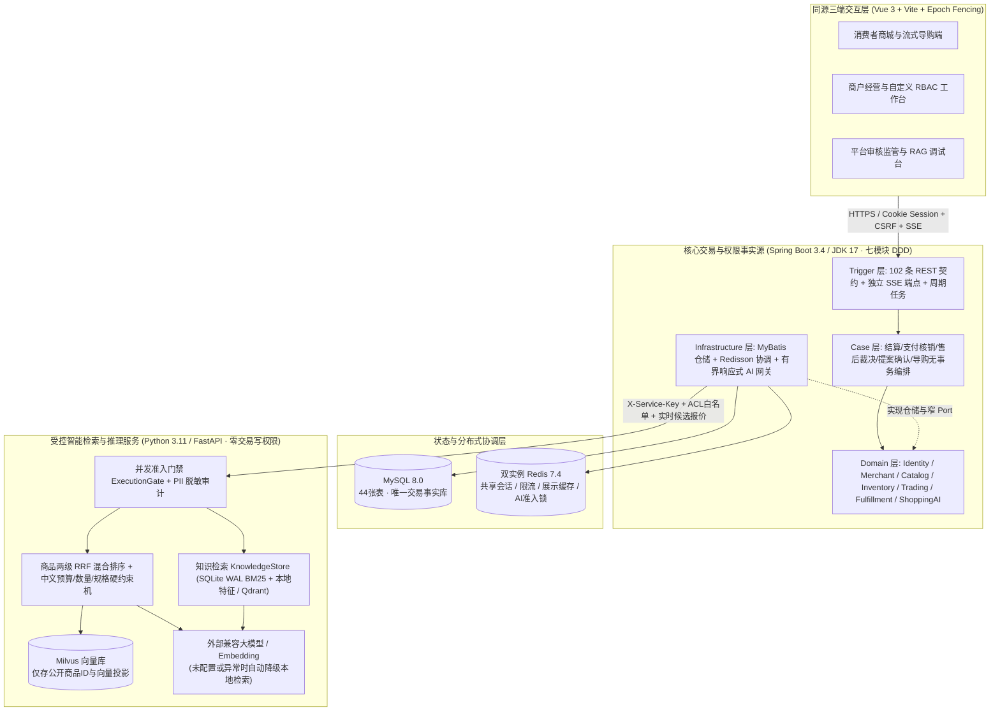

# 开题报告撰写与开题答辩全攻略

本文档提供可直接用于《基于 Spring Boot 的校园智能导购商品交易系统设计与实现》**开题报告各模块的核心学术表述、技术路线图、12 页开题答辩 PPT 逐页讲稿**，以及针对开题评委老师最常追问的 **10 个尖锐问题标准回答**。若需对照既有 Word 开题报告逐段修订，请先阅读 [05-OPENING-REPORT-REVISION-AND-ALIGNMENT.md](05-OPENING-REPORT-REVISION-AND-ALIGNMENT.md)。

---

## 一、开题报告核心章节写作素材

### 1.1 选题背景与研究意义（痛点提炼）

1. **传统校园电商与校内自提场景的业务痛点**：
   - 高校校内商超、文印、饮品与生活物资具有**多商户自治、多规格（SKU）库存变动快、集中课间自提履约、店员流动性高（需细粒度权限隔离）**的特点。传统单层 CRUD 商城在高并发结算时易发生**超卖、死锁、改价与库存状态不一致**，且关键词搜索无法理解学生模糊场景需求（如“期末熬夜备考无糖提神饮品”、“百元以内宿舍合规收纳好物”）。
2. **大语言模型（LLM）直接介入电商交易的安全与可信痛点**：
   - 若直接将通用大模型接入商城，面临三大致命工程风险：
     - **商业事实幻觉（Hallucination）**：模型可能编造已下架商品、过期低价或虚构库存，甚至在对话中谎称“已为您下单付款”；
     - **内部知识越权与隐私泄漏**：平台治理规范或商户内部备货手册一旦不加区分送入外部公有云大模型或统一向量库，会导致跨商户商业机密泄漏及权限撤回滞后（TOCTOU 漏洞）；
     - **慢 I/O 拖垮核心交易库**：大模型单轮推理耗时数秒至数十秒，若与关系型数据库事务耦合，将迅速耗尽数据库连接池并引发大面积锁等待。
3. **本课题的研究意义**：
   - **理论与方法层面**：探索**领域驱动设计（DDD 六边形架构）确定性事务系统**与**概率性生成式 AI（混合 RAG）**的安全协同范式，提出“模型仅持建议权（Proposal）、交易库独占事实裁决权”的双栈隔离架构。
   - **工程应用层面**：构建覆盖消费者、商户工作台与平台监管的三端闭环系统，并建立可复现的导购检索与硬约束评测基准，为中小型垂直电商低成本、高安全落地智能导购提供参考样板。

---

### 1.2 国内外研究现状综述切入角度（文献综述三大支柱）

撰写开题报告文献综述时，建议按以下三个维度组织（每块引用 5～8 篇近五年国内外高水平文献/标准）：

1. **基于 DDD 与模块化单体的高一致交易系统架构研究**：
   - 对比微服务分布式事务（Saga / TCC / 2PC）与 DDD 模块化单体（Modular Monolith）在中小型高一致交易场景下的复杂度权衡（引用 Vernon《实现领域驱动设计》、Fowler/Newman 架构演进观点）；阐述限界上下文隔离、CQRS 读写分离投影与数据库悲观锁/乐观版本号协同机制。
2. **检索增强生成（RAG）与混合信息检索（Hybrid Search）研究**：
   - 梳理稀疏词法检索（BM25）在精确型号/专有名词匹配上的优势，以及稠密向量检索（Dense Passage Retrieval、HNSW/Milvus/Qdrant）在跨词面语义理解上的优势；重点引出 **倒数秩融合（Reciprocal Rank Fusion, RRF, Cormack et al.）** 在无需复杂跨模态分数校准条件下融合多路召回的有效性。
3. **垂直领域大模型安全护栏、权限感知 RAG 与人机协同（Human-in-the-Loop）研究**：
   - 综述大模型幻觉抑制、Prompt 注入防御、RAG 细粒度访问控制（ACL-aware Retrieval）及受控工具调用（Tool Calling）现状，指出当前多数研究停留在问答准确率，缺乏与真实电商**实时价格版本、动态预占库存及动态撤权复验**结合的端到端工程闭环——**这正是本课题的核心切入点**。

---

### 1.3 主要研究内容与拟解决的 4 大关键问题（开题核心得分点）

> **提示**：开题评委最忌讳看到“研究内容 = 登录模块 + 商品模块 + 订单模块”这种功能罗列。请务必上升到以下 **4 个关键技术问题**：

1. **关键问题一：概率性 AI 导购与确定性电商交易的权责边界与两阶段确认机制**
   - **研究内容**：设计“AI 导购提案（Proposal）→ 用户显式勾选 → Java 同库事务实时复核加购”机制。Python 服务仅输出候选 SKU 与推荐依据；Java 端在确认与结算时按严格全局锁序（`幂等闸门 → 购物车 → 商户资格 → 升序商品/SKU → 排序库存`）复验上架状态、`priceCent` 与 `quoteVersion`，彻底消除价格幻觉与并发死锁。
2. **关键问题二：面向全量商品目录的词面—语义两级混合召回与硬约束过滤算法**
   - **研究内容**：摒弃“截取最新 N 件商品塞入 Prompt”的短视做法，设计 MySQL 全表上架商品加权词面召回（Top 200）与 Milvus 语义向量召回（Top 80 + 实时状态反查）的商品级 RRF 融合，结合跨商品 SKU Round-Robin 均衡采样、中文口语预算/数量状态机与正负向规格硬约束过滤，解决多规格商品挤压与负向需求误推问题。
3. **关键问题三：多租户知识库的四重防泄漏检索与零锁长连接会话控制**
   - **研究内容**：针对公开知识、商户内部知识与平台内部知识分级，设计外发双白名单策略（内部知识强制走本地 256 维哈希向量与 SQLite 检索，零外部 API 外发）、外发 PII 脱敏、生成前后三次权限快照指纹比对（防御生成期撤稿/撤权的 TOCTOU 漏洞）及分块 SHA-256 内容核验；同时采用 MySQL `turn_token` 600 秒租约 + Spring `Propagation.NEVER` + 独立 SSE 协议，实现长耗时流式交互期间**零数据库连接与行锁占用**。
4. **关键问题四：智能导购检索质量、硬约束合规率与安全零泄漏的量化评测体系**
   - **研究内容**：构建包含精确规格、模糊用途、预算约束、负向排除、多轮指代与越权诱导的校园导购评测集，设计涵盖 `Recall@K`、`MRR`、`nDCG@K`、`ConstraintPass`（预算/库存/规格硬约束通过率）与 `UnauthorizedDisclosure`（越权披露率）的离线与跨栈受控评测实验，量化验证混合检索相对单一路径的增益。

---

### 1.4 技术路线与总体架构图（可直接放入开题报告与 PPT）

---

## 二、开题答辩 12 页 PPT 逐页结构与演讲提纲（控制在 8～10 分钟）

| 页码 | PPT 标题 | 页面核心视觉元素 | 演讲要点（每页约 40～50 秒） |
| :---: | :--- | :--- | :--- |
| **P1** | 封面页 | 论文题目、姓名、学号、指导教师、日期 | 简明自报家门，点明课题定位：**面向校园自提零售场景的高一致交易与可信 AI 导购系统**。 |
| **P2** | 选题背景与核心痛点 | 左图：校园多商户自提痛点；右图：大模型幻觉/越权/慢连接三大风险 | 强调本课题不是简单“商城+聊天框”，而是解决**生成式 AI 的不确定性与电商交易强一致性之间的矛盾**。 |
| **P3** | 国内外研究现状与切入点 | 三栏对比表（DDD 交易架构 / 混合 RAG / AI 安全护栏） | 总结现有 RAG 研究多关注文本准确率，缺少与**实时库存/价格版本/动态权限撤回**联动的工程闭环。 |
| **P4** | 研究目标与四大核心内容 | 4 张卡片对应 1.3 节的四个关键问题 | 突出：**双栈权责隔离、全量商品混合召回（RRF）、四重知识防泄漏 + 零锁租约、量化消融评测**。 |
| **P5** | 系统总体技术架构 | 放置上文 1.4 节的分层架构图 | 重点指向图中红线：**Java/MySQL 独占写权限，Python 无权直连 MySQL，Redis 负责跨实例会话与 AI 准入**。 |
| **P6** | 领域驱动设计（DDD）与数据模型 | 7 大限界上下文图 + Maven 七模块依赖向心图 | 说明为什么采用**模块化单体**而非盲目上微服务：单库本地事务即可零成本保障“建单+锁库”、“付款+生履约单”强一致。 |
| **P7** | 关键设计一：防死锁交易锁序与提案确认 | 下单/提案确认加锁顺序流程图 | 展示确定性锁序（幂等闸门→购物车→商户→升序SKU→库存）及 `priceCent + quoteVersion` 双校验，杜绝超卖和死锁。 |
| **P8** | 关键设计二：全量商品两级混合召回 | MySQL 词面 Top200 + Milvus Top80 → RRF → 规格硬约束漏斗图 | 解释如何克服“只取最新100件”缺陷，以及如何处理“不要有糖”、“50元以内买两箱”等复杂约束。 |
| **P9** | 关键设计三：知识防泄漏与 600s 零锁租约 | 四重外发防线图 + `turn_token` 流式状态机图 | 重点讲亮点：**内部文档不出域、前后三次权限快照指纹防 TOCTOU、`Propagation.NEVER` 保护数据库连接池**。 |
| **P10** | 实验与评测方案设计（重点！） | 消融实验矩阵表（`K-B/K-D/K-H`、`P-L/P-D/P-H`、`SAFE`） | 向评委展示严谨的科研方法论：不仅做系统，还设计了 120 例多维测试集与 Recall/MRR/nDCG/硬约束合规率指标。 |
| **P11** | 当前前期基础与后续进度计划 | 已完成核心原型截图（2～3张） + 2026.11～2027.05 甘特路线表 | 展示原型已跑通核心链路，证明课题**高度可行**；同时明确后续重点在**评测基准冻结、消融实验对比与性能优化**。 |
| **P12** | 总结与致谢 | 核心创新点三句话总结 | 礼貌致谢，请各位老师批评指正。 |

---

## 三、开题评委 10 大高频尖锐追问与满分回答话术

### Q1：你这个系统和直接调一个现成大模型 API（或者用 Dify / LangChain 搭个知识库）有什么本质区别？工作量体现在哪？
- **回答要点**：
  1. 通用框架（如直接套 LangChain）默认假设模型输出可信、检索范围静态，无法处理电商场景下的**秒级改价、库存预占竞争与会话中途撤权**。
  2. 本系统从零构建了 **7 模块 DDD 交易内核（44 张表、102 条契约路由）** 与 **无框架黑盒依赖的 Python 混合检索引擎**，核心工作量在于：**① 提案两阶段事务复验（模型无写权限）；② 词面 BM25 + 向量检索的两级 RRF 融合与中文口语预算/规格状态机；③ 内部知识不外发双白名单与调用前后三次权限快照指纹核验；④ 自动化契约、数据库基线指纹与隔离评测体系**。

### Q2：既然做了这么多业务上下文（身份、商户、商品、库存、交易、履约、AI），为什么不拆成 Spring Cloud 微服务？
- **回答要点**：
  1. 这是经过架构权衡（已记录在项目 ADR-002 与 ADR-010）的理性工程选择。校园零售的核心痛点是**订单创建与多 SKU 预占、模拟付款与自提建单、核销与扣减实物库存之间的强一致性**。
  2. 若盲目拆分为 7 个微服务和 7 个数据库，必须引入 Seata/Saga 分布式事务与最终一致补偿，在毕设单机/小集群规模下徒增网络故障面却无实质吞吐收益。
  3. 本项目采用 **DDD 模块化单体（7 个限界上下文在代码与 DAO 表前缀级严格物理隔离，由静态门禁脚本强制拦截越界写表）+ 独立 Python 算力服务**：既享受单库 ACID 强一致事务，又把 CPU/IO 密集的 AI 推理独立隔离，且预留了未来按上下文演进拆分的清晰边界。

### Q3：看你演示原型完成度已经很高了，接下来几个月你的毕业设计还要研究和做什么？（开题必考核心题！）
- **回答要点**：
  目前完成的是**系统工程底座与主业务闭环验证**，接下来到明年答辩前还有三大核心研究与攻坚任务：
  1. **构建高质量校园导购黄金评测集（Gold Dataset）并开展严谨消融实验**：完成 120 例涵盖模糊场景、跨轮指代、预算与负向排除、越权诱导样本的人工标注复核，定量对比稀疏检索、稠密向量与两级 RRF 融合在不同查询类型上的 Recall@K、nDCG@K 差异；
  2. **受控自然语言导购解释与 Agent 原生工具调用收口**：在保证价格/库存零幻觉的前提下，推进 Agent v1.1 多工具协同（商品检索、知识问答、个人订单只读查询）的真实联调与对比评估；
  3. **高并发竞争压测与大表 SQL 访问路径优化**：针对后台大表查询时间窗收窄、并发抢购最后一件库存、双 Java 实例共享 Redis 会话故障恢复开展定量压测，充实论文第 5 章实验数据。

### Q4：如果外部大模型超时、欠费或者答辩现场断网了，你的系统是不是就瘫痪了？
- **回答要点**：
  完全不会，系统设计了**三级优雅降级机制**：
  1. **交易与 AI 解耦**：普通浏览、搜索、加购、下单、核销完全不经过 Python 服务，AI 故障对基础电商交易影响为零；
  2. **检索与生成降级**：当未配置外部 API Key 或上游模型超时报错时，系统自动切换至本地 SQLite WAL BM25 + 256 维字符二元哈希向量与确定性规则推荐，并在响应中诚实标注 `LOCAL_RETRIEVAL_DEMO` 或 `LOCAL_FALLBACK`，绝不伪造大模型输出；
  3. **连接池隔离**：Java 侧采用 `Propagation.NEVER` + Redisson 分布式信号量快速拒绝超额请求，慢调用绝不拖垮 MySQL 连接池。

### Q5：怎么防止商家 A 的店员通过 AI 导购套取商家 B 的内部培训/备货资料？
- **回答要点**：
  系统实施了**四重防泄漏机制**（而不是靠 Prompt 叮嘱大模型“不要说”）：
  1. **索引物理隔离**：商户内部文档默认 `externalAllowed=false`，仅使用本地哈希特征存入本地库，绝不发送给外部 Embedding 或公有向量库；
  2. **查询前置白名单**：Java 先实时查询当前登录人的有效成员关系，只把有权读取的 `allowedDocumentIds` 传给 Python，检索在过滤子集内进行；
  3. **外发二次裁剪**：即便有权阅读内部文档，发往外部 LLM 的上下文也只包含通过外发白名单的文档，其余引用脱敏为“内部资料”；
  4. **后置权限指纹复验**：LLM 返回后、落库返回前端前，Java 再次查询最新权限重算指纹，若期间店员被撤职或文档被撤稿，整轮结果直接拦截作废。

### Q6：大模型怎么处理“预算 30 元以内买两瓶无糖乌龙茶”这种算术和否定词？大模型算术很容易算错！
- **回答要点**：
  问到了本系统非常关键的设计：**商业算术与规格硬约束绝不交给大模型自由心算**！
  我们在 Python 检索引擎与 Java `RecommendationPolicy` 两端实现了确定性的**口语数词/预算状态机**与**正负向规格约束解析器**：代码显式解析中文数词（如“三十块以内”、“两瓶”），按 `单价(分) × 数量 <= 预算(分)` 和 `可用库存 >= 数量` 以及负向排除词（如“不要有糖”）先做硬过滤，大模型只能在通过硬校验的合规候选池内做排序优选，返回后 Java 再做二次复核。

### Q7：多个学生同时抢最后 1 件库存商品，你的系统怎么保证不超卖、不死锁？
- **回答要点**：
  1. **防死锁**：无论前端传入的购物车 SKU 顺序如何，`CheckoutCaseImpl` 强制先按 `productId` 升序、再按 `skuId` 升序执行 `SELECT ... FOR UPDATE` 加锁，消除循环等待条件；
  2. **防超卖**：库存采用 `on_hand`（实物）与 `reserved`（预占）分离模型，下单在同一本地事务内锁定库存行并校验 `on_hand - reserved >= quantity`，满足才写入 `inv_reservation` 并增加 `reserved`，超时未付由定时任务幂等释放预占，核销时才扣减 `on_hand`；
  3. **防重复下单**：引入 `Idempotency-Key` + 请求参数 SHA-256 指纹写入 `trd_checkout_request` 表加行锁，相同请求幂等返回原单，篡改参数返回冲突错误。

### Q8：为什么你的支付是“模拟支付”？这会影响毕业设计的完整性吗？
- **回答要点**：
  不影响。高校个人毕业设计无法申请企业营业执照与微信/支付宝真实商户号资质。虽然资金清结算采用模拟，但本系统**完整实现了真实电商在支付前后的全部核心状态机与异常闭环**：包括下单报价版本锁定、15 分钟逾期自动关单释放库存、并发重复点击支付的幂等记账、支付与自提任务同事务创建、核销动态令牌重签失效，以及未提货退款与商户驳回后的平台争议裁决闭环。

### Q9：任务书里提到了 MyBatis-Plus、JWT 以及传统协同过滤，为什么你最终方案选用了 MyBatis XML、Redis Session 与“两级混合 RAG + 硬约束导购”？
- **回答要点**：
  1. **MyBatis XML 替代 MyBatis-Plus**：本系统涉及大量显式悲观锁（`SELECT ... FOR UPDATE` / `FOR SHARE`）、精确锁序与全表扫描自动化门禁审计（`verify-mapper-scan.py`），原生 MyBatis XML 让每一条核心交易与并发锁 SQL 可审查、可静态验证，避免 Wrapper 黑盒拼装掩盖锁语义与性能隐患；
  2. **HttpOnly Cookie + CSRF + Redis Session 替代无状态 JWT**：校园多商户平台存在“管理员实时停用账号”和“店主即时撤销店员权限”的强安全需求。无状态 JWT 在过期前难以即时吊销且易受 XSS 窃取本地存储；同源 HttpOnly Cookie + Spring Session Redis 支持服务端立即失效与跨标签页身份一致性校验；
  3. **聚焦“两级混合 RAG + 硬约束智能导购”**：真实校园新系统上线初期缺乏大规模历史用户—商品交互矩阵，离线硬造合成交互矩阵跑传统协同过滤说服力有限；而学生更刚性的痛点是用自然语言表达预算、用途与规格排除等复合条件（如“低于 50 元买两瓶无糖乌龙茶”）。因此本课题经与导师沟通聚焦“全目录词面 + 语义 RRF 召回 + 确定性硬约束过滤 + 提案实时复验”主线，技术深度更高且全部可复现验证。

### Q10：除了业务功能，你在并发安全与数据库治理方面还做了哪些实打实的工程加固？
- **回答要点**：
  1. **消除隐蔽数据库死锁与 MVCC 竞态**：通过代码与并发审查，将 RBAC 成员查询锁由 `FOR SHARE` 升级为 `FOR UPDATE` 避免 S→X 锁升级死锁，为角色删除前成员统计补齐 `FOR SHARE` 锁，统一邀请接受与撤销锁序，并将知识索引并发锁 SQL 改为可索引谓词避免跨商户锁表；
  2. **大表查询收窄与 21 份不可变迁移治理**：清零了订单表的 4 项全表扫描豁免（平台订单单次截断 365 天时间窗 + 履约状态查询强制 `merchant_id`），通过不可变迁移 `V20261125_01` 补齐 5 个高频锁/分页索引，并在隔离 MySQL 8.0.31 上验证 3 个历史发布基线升级后结构指纹完全一致；
  3. **跨标签页防串号**：在前端构建冷/热 CSRF 双重校验机制，即便其他标签页切换了账号，本页在首次写操作或 CSRF 重试前均强制核验 `/auth/me`，阻断以错误身份提交订单或审批退款。
