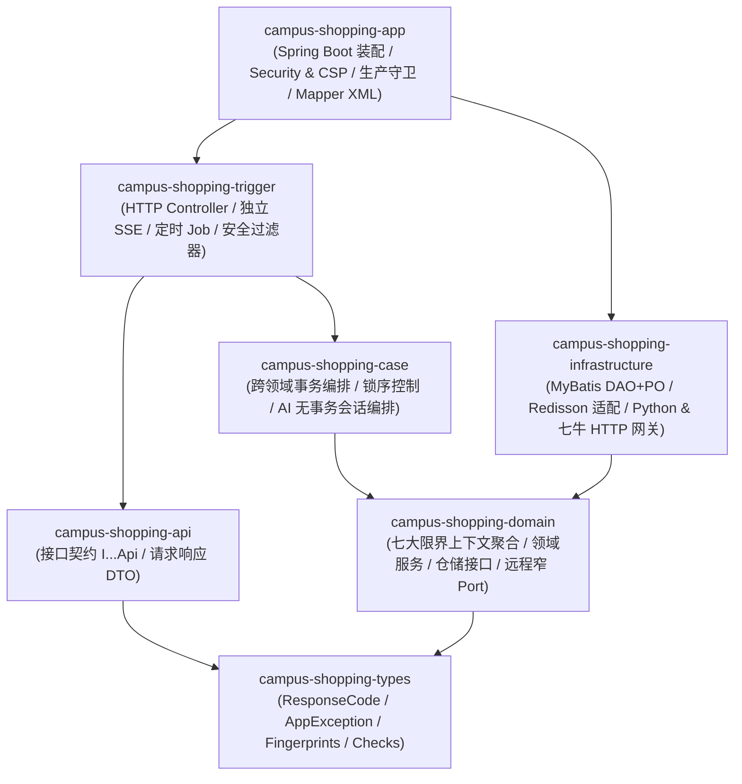
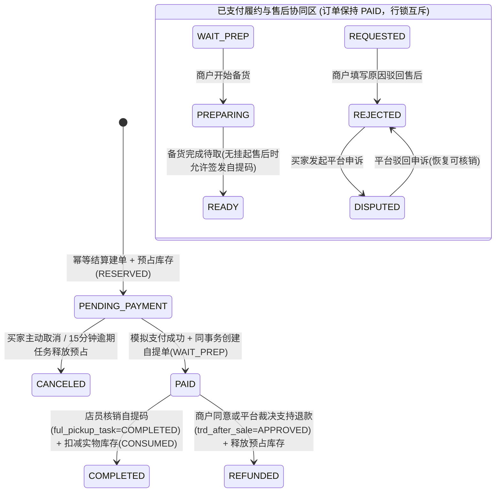
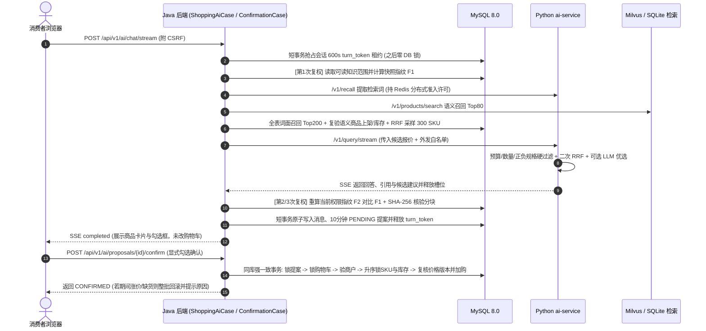

# 论文图表、代码规模、44张数据表与102路由权威速查手册

> 本手册中的所有表名、路由数量、模块行数与状态转换均直接提取自当前仓库源码（[schema.sql](../../campus-shopping-app/src/main/resources/schema.sql)、[route-manifest.json](../api/route-manifest.json) 与各模块源码），撰写论文第 3 章、第 4 章时可直接引用，保证与代码 100% 一致。

---

## 一、全栈工程源码规模统计（Git 追踪核心源码）

| 子系统 / 模块 | 文件数 | 核心代码/配置行数 | 职责定位 |
|---|---:|---:|---|
| `campus-shopping-domain` | 164 | ~5,460 | 7 大限界上下文领域聚合、实体、值对象、领域服务、仓储接口与窄 Port |
| `campus-shopping-infrastructure` | 95 | ~4,910 | MyBatis DAO/PO、仓储实现、Redisson 缓存/锁/配额、AI/Agent/七牛网关 |
| `campus-shopping-case` | 55 | ~3,590 | 跨领域本地事务编排、确定性锁序控制、AI 无事务会话与提案确认编排 |
| `campus-shopping-trigger` | 31 | ~3,440 | 12 个 REST Controller、独立 SSE 与媒体端点、安全限流过滤器、逾期关单与向量同步任务 |
| `campus-shopping-api` | 85 | ~1,385 | HTTP 契约接口（`I...Api`）、请求/响应 DTO 与通用 `Response<T>` 信封 |
| `campus-shopping-app`（主配置 + Mapper + SQL） | 12 | ~502 | Spring Boot 启动装配、Security/CSP/生产守卫；另有 Mapper XML、schema 与 20 份版本迁移 |
| `campus-shopping-types` | 7 | ~210 | 统一业务错误码枚举 `ResponseCode`、`AppException`、参数断言与指纹工具 |
| **Java 测试套件（`src/test`）** | **78** | **~13,200** | 领域/用例单测、协议边界、隔离 MySQL 并发事务竞争、Redis 双实例与评测桥接 |
| **Python 智能导购（`ai-service/app`）** | **25** | **~3,450** | FastAPI 接入、BM25/本地哈希/Qdrant/Milvus REST 混合检索、规格状态机、Runtime Bridge |
| **Python 测试与评测（`tests` + `evaluation`）** | **72** | **~8,100** | 414+ 项 pytest 回归套件 + Scorer v3 消融与硬约束评测框架 + 120 例数据集 |
| **Vue 3 三端前端（`frontend/src`）** | **54** | **~11,900** | 13 个三端业务页面、16 个组件、Epoch 状态隔离、有界 SSE 解析与主题样式系统 |
| **前端与工程化门禁（`frontend/tests` + `scripts`）** | **100** | **~15,900** | 39+ 项 Node 单测、32 个 Playwright 浏览器脚本、契约/DDL/Mapper/DDD 自动化门禁 |

---

## 二、Java 七模块 DDD 六边形依赖方向图（论文图 3-2 素材）

> **架构铁律**：`domain` 模块不依赖 MyBatis、Redisson、Servlet、HttpClient 或七牛 SDK，所有持久化与远程调用均通过接口倒置由 `infrastructure` 实现。

---

## 三、MySQL 44 张数据表完整分类字典（论文表 3-3 素材）

全库共 **44 张表**，严格按 **8 大领域表前缀**归属，由 `verify-ddd-boundaries.py` 静态门禁强制禁止跨领域越权写表：

### 1. 身份与访问上下文 `iam_`（6 张表）
| 表名 | 核心主键 / 唯一约束 | 业务职责说明 |
|---|---|---|
| `iam_user` | `id` (PK), `uk_iam_user_username` | 用户主账号表（仅存 BCrypt 密码哈希与启用状态，不含明文凭据） |
| `iam_platform_role` | `(user_id, role)` | 平台级角色授权表（如 `PLATFORM_ADMIN`） |
| `iam_merchant_membership` | `(merchant_id, user_id)` | 用户在特定商户内的成员身份、角色绑定与在职状态（`ACTIVE`/`REVOKED`） |
| `iam_invitation` | `id` (PK) | 商户店员入职邀请单及接受/撤销状态追踪 |
| `iam_merchant_role` | `(merchant_id, role_code)` (PK), `(merchant_id, name)` (UK) | 商户自定义 RBAC 角色定义表 |
| `iam_merchant_role_permission` | `(merchant_id, role_code, permission)` (PK) | 商户自定义角色关联的细粒度权限码集合（共 15 项受控权限码） |

### 2. 商户治理上下文 `mer_`（3 张表）
| 表名 | 核心主键 / 唯一约束 | 业务职责说明 |
|---|---|---|
| `mer_application` | `application_id` (PK), `(applicant_user_id, request_key)` (UK) | 商户入驻申请单（含经营类目、联系人、首店位置及审核状态流转） |
| `mer_merchant` | `id` (PK), `source_application_id` (UK) | 商户主体与营业资格状态（`ACTIVE`/`SUSPENDED`）及展示缓存版本号 `version` |
| `mer_store` | `id` (PK), `merchant_id` (UK) | 商户线下自提门店信息（店名、校内自提位置、营业时间、门店实拍图） |

### 3. 商品目录上下文 `cat_`（5 张表）
| 表名 | 核心主键 / 唯一约束 | 业务职责说明 |
|---|---|---|
| `cat_category` | `code` (PK) | 平台统一商品类目字典与启停状态 |
| `cat_product` | `id` (PK) | 商品 SPU 主表（标题、描述、类目、上下架状态 `DRAFT`/`PUBLISHED`/`UNPUBLISHED` 及聚合版本号 `version`） |
| `cat_sku` | `id` (PK), `(product_id, spec_key)` (UK) | 商品多规格 SKU 表（以“分”为单位的 `price_cent`、独立启停状态与版本号 `version`） |
| `cat_product_image` | `image_id` (PK), `(product_id, sort_order)` (UK), `(product_id, object_key)` (UK) | 商品多图相册有序引用表（最多 8 张，仅存稳定相对路径引用） |
| `cat_product_image_upload` | `(object_key, merchant_id)` (PK) | 商户已上传图片归属登记表（防止跨商户盗用未公开上传资产） |

### 4. 库存管理上下文 `inv_`（3 张表）
| 表名 | 核心主键 / 唯一约束 | 业务职责说明 |
|---|---|---|
| `inv_stock_balance` | `(store_id, sku_id)` (PK), `sku_id` (UK) | 实时库存余额表（实物库存 `on_hand` 与待履约预占库存 `reserved` 分离） |
| `inv_reservation` | `(order_id, sku_id)` (PK) | 订单级库存预占明细单（支撑幂等释放 `RELEASED` 与核销扣减 `CONSUMED`） |
| `inv_stock_movement` | `id` (PK) | 不可变库存变动审计流水（补货 `REPLENISH`、预占 `RESERVE`、释放 `RELEASE`、核销 `CONSUME`） |

### 5. 交易与售后上下文 `trd_`（9 张表）
| 表名 | 核心主键 / 唯一约束 | 业务职责说明 |
|---|---|---|
| `trd_cart_owner` | `user_id` (PK) | 买家购物车并发串行化专用锁行表（避免加购与结算互相覆盖） |
| `trd_cart_item` | `(user_id, sku_id)` (PK) | 买家按商户组织的购物车商品明细 |
| `trd_checkout_request` | `(user_id, request_key)` (PK) | 下单幂等闸门表（保存请求参数 SHA-256 指纹与关联 `order_id`） |
| `trd_order` | `id` (PK) | 交易订单主表（买家、商户、自提点快照、总金额分、状态、15分钟付款截止时间） |
| `trd_order_item` | `(order_id, sku_id)` (PK) | 订单成交商品快照表（锁定成交单价、规格名、标题与主图快照） |
| `trd_payment` | `order_id` (PK) | 模拟支付成功记账凭证表 |
| `trd_after_sale` | `id` (PK), `order_id` (UK) | 未提货售后退款与平台争议申诉单（`REQUESTED`/`REJECTED`/`DISPUTED`/`APPROVED`） |
| `trd_refund` | `order_id` (PK) | 退款完成记账凭证表 |
| `trd_order_event` | `id` (PK) | 订单与售后全生命周期事件时间线审计表 |

### 6. 自提履约上下文 `ful_`（2 张表）
| 表名 | 核心主键 / 唯一约束 | 业务职责说明 |
|---|---|---|
| `ful_pickup_task` | `id` (PK), `order_id` (UK) | 门店备货与自提任务单（`WAIT_PREP` → `PREPARING` → `READY` → `COMPLETED` / `CANCELED`；仅存核销码 SHA-256 摘要） |
| `ful_pickup_verification` | `id` (PK), `pickup_id` (UK) | 门店店员核销留痕记录表 |

### 7. 智能导购与知识库上下文 `ai_`（12 张表）
| 表名 | 核心主键 / 唯一约束 | 业务职责说明 |
|---|---|---|
| `ai_knowledge_base` | `id` (PK) | 知识库主表（区分 `PUBLIC`、`MERCHANT_INTERNAL`、`PLATFORM_INTERNAL` 三级可见性） |
| `ai_document_root` | `id` (PK) | 知识文档逻辑根实体（追踪当前已发布版本号） |
| `ai_document` | `id` (PK), `(root_id, version)` (UK) | 不可变知识文档版本表（含正文、索引状态、`index_attempt` 600s 租约令牌） |
| `ai_knowledge_quota` | `id` (PK) | 知识库全局配额计数表（固定行 `id='global'`） |
| `ai_knowledge_usage` | `owner_id` (PK) | 按归属主体统计的知识库文档数量、字节与索引频次表 |
| `ai_conversation` | `id` (PK) | 消费者导购会话表（含 `turn_token`、`turn_expires_at` 600s 租约及 `turn_status` 取消状态） |
| `ai_message` | `id` (PK), `seq_no` (UK) | 会话问答消息历史表（记录当时授权范围指纹 `access_fingerprint`） |
| `ai_message_citation` | `(message_id, ordinal)` (PK) | 历史回答关联的最小知识引用快照 |
| `ai_proposal` | `id` (PK) | AI 加购建议提案表（10 分钟有效期、商品报价快照 JSON、`selection_hash` 确认幂等校验） |
| `ai_sync_checkpoint` | `id` (PK) | 商品向量增量同步持久化游标表 |
| `ai_run` | `id` (PK), `(user_id, idempotency_key)` (UK) | Agent v1.1 受控运行实例表（绑定会话租约与能力令牌哈希） |
| `ai_run_invocation` | `id` (PK), `(run_id, invocation_key)` (UK) | Agent 工具调用幂等账本表 |

### 8. 系统审计与迁移治理 `sys_`（4 张表）
| 表名 | 核心主键 / 唯一约束 | 业务职责说明 |
|---|---|---|
| `sys_audit` | `id` (PK) | 关键管理、审核、核销与外发操作安全审计表 |
| `sys_schema_version` | `version` (PK) | 基础结构版本标识表 |
| `sys_schema_migration` | `version` (PK) | 20 个不可变数据库迁移脚本的版本号与 SHA-256 校验和登记表 |
| `sys_schema_migration_drift` | `id` (PK) | 历史库结构漂移人工准入责任人与原因审计表 |

---

## 四、HTTP API 路由分布与核心时序/状态机图（论文第 3、4 章直接可用）

### 4.1 102 条 JSON 契约路由 + 独立端点分布

| 控制器（`campus-shopping-trigger`） | 路由条数 | 覆盖领域能力 |
|---|---:|---|
| `CatalogController` | 17 | 公开商品搜索/全局排序分页、详情、类目、商户商品与 SKU 维护、图片上传、违规下架 |
| `MerchantApplicationController` | 14 | 入驻申请提交与分页、平台审核、商户启停、公开商户分页与详情、门店资料设置与门店图片上传 |
| `OrderController` | 14 | 幂等结算建单、买家/商户/平台订单分页与搜索、模拟支付、取消订单、经营看板与趋势统计 |
| `AfterSaleController` | 9 | 未提货退款申请、买家申诉、商户审核、平台争议裁决、售后处理时间线 |
| `ShoppingAiController` | 9 | 同步导购对话、只读 RAG 命中调试、会话列表与历史、轮次状态与取消、提案列表/确认/拒绝 |
| `KnowledgeController` | 9 | 商户/平台知识库创建、文档上传提取、新版本提交、索引重建、发布与撤回 |
| `WorkspaceController` | 6 | 当前登录人多商户工作台上下文、成员列表、店员邀请发送/接受与撤销 |
| `RoleController` | 6 | 商户自定义 RBAC 角色查询、新增/修改、删除与成员改派 |
| `AuthController` | 5 | CSRF 令牌获取、用户注册、会话登录、安全退出、当前身份查询 |
| `InventoryController` | 5 | 商户 SKU 补货、库存余额列表、低可售库存筛选、库存变动流水查询 |
| `CartController` | 4 | 购物车实时报价视图读取、新增商品、修改数量、移除单项 |
| `FulfillmentController` | 4 | 商户开始备货、标记待取货、买家签发动态自提码、店员核销完成交易 |
| *独立流式与媒体端点* | *+2 类* | `AiStreamEndpoint`（`POST /api/v1/ai/chat/stream` SSE 流式导购）、`MediaAssetEndpoint`（`GET /media/qiniu/{filename}` 七牛 302 受控重定向；本地 `/media/**` 由 `WebAssetsConfig` 提供） |

---

### 4.2 订单、履约与售后协同状态机图（论文图 4-3 素材）

> 说明：订单主状态（`trd_order.status`）仅包含 `PENDING_PAYMENT`、`PAID`、`COMPLETED`、`CANCELED`、`REFUNDED`；未提货退款/申诉期间订单保持 `PAID`，由 `trd_after_sale.status`（`REQUESTED`、`REJECTED`、`DISPUTED`、`APPROVED`）与 `ful_pickup_task.status`（`WAIT_PREP`、`PREPARING`、`READY`、`COMPLETED`、`CANCELED`）在订单行锁下协同推进。

---

### 4.3 AI 流式导购、三次权限复验与两阶段提案确认时序图（论文图 4-5 素材）

