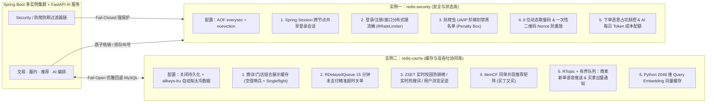

# 06 · 双 Redis 生产架构、防刷防爬风控与毕业答辩专题手册

> **用途**：本文档专为毕业论文撰写（第 3 章架构设计、第 4 章核心实现、第 5 章安全与高并发测试）与毕业答辩现场提问准备，集中阐述本系统 **为什么采用物理隔离的双 Redis 架构**、**7 大核心业务与 AI 协同场景**、**多层防刷防爬虫风控体系** 以及 **高频评委追问标准应答**。
>
> **关联规格与实现**：[SDD-REDIS-12](../specs/SDD-REDIS-12.md) · [Docker 编排配置](../../compose.yml)

---

## 一、核心架构亮点：为什么设计“物理隔离双 Redis”而不是单实例？

在真实的交易型电商与大模型导购混合系统中，Redis 同时承担着两类**生命周期截然不同、容忍度完全相反**的数据职责。如果把它们混放在同一个 Redis 实例（哪怕使用 `SELECT 0 / SELECT 1` 分库，底层依然共享同一块 `maxmemory` 内存池与同一个主线程事件循环），在高并发促销或爬虫扫描导致缓存暴涨时，会引发严重的**生产级级联事故**：

1. **误踢在线用户与风控失忆**：若开启 `allkeys-lru` 淘汰策略，商品/向量缓存暴涨会把正在付款的用户 `Spring Session`、防暴力破解限流计数器、6 位取餐核销短码直接淘汰，导致全站掉线、风控失效；
2. **整站写满雪崩**：若开启 `noeviction` 不淘汰策略，一旦商品展示缓存或用户足迹把内存占满，用户连**登录创建 Session** 都直接报错 `OOM command not allowed`，交易主链路瘫痪；
3. **持久化抖动互相拖累**：安全状态需要 `AOF everysec` 落盘保障重启不丢登录态；高频展示缓存与流式事件若一并写 AOF，会无谓放大磁盘 I/O 与重写阻塞。

### 本系统的双实例隔离方案

| 对比维度 | `redis-security`（安全与状态实例） | `redis-cache`（缓存与协同实例） |
| :--- | :--- | :--- |
| **持久化策略** | `appendonly yes`（`everysec`） | 关闭 RDB/AOF（纯内存高速吞吐） |
| **内存满策略** | `noeviction`（严禁静默驱逐安全状态） | `allkeys-lru`（自动淘汰冷门缓存） |
| **故障降级语义** | **Fail-Closed（失败关闭）**：故障返回 `HTTP 503`，绝不退回单机内存绕过全局风控 | **Fail-Open（优雅降级）**：短超时自动回退 MySQL 权威事实库，不阻断正常下单成交 |
| **生产部署校验** | `application-prod.yml` 开启 `require-separate-instances: true`，启动时解析 DNS/IP 与端口，若指向同一实例直接拒绝启动 | 独立连接池、独立故障域，`RedisServerFaultIsolationTest` 验证单边宕机互不传染 |

---

## 二、为什么必须做“防刷与防爬虫”？四层纵深风控设计

在原本的教学级原型中，只对 `POST /auth/login`、`POST /ai/chat` 做了简单的次数限流，而**公开商品库接口完全裸奔、下单与短码核销缺少业务级防刷**。一旦上线到真实校园公网环境，会面临四大真实攻击面：

### 1. 四大真实风险场景（之前为什么不够）

1. **竞品与脚本爬虫扫库（Scraping & Cache Penetration）**：
   - 公开接口 `/api/v1/products/page`、`/api/v1/products/{id}` 无需登录。爬虫如果用 `Python-requests / Scrapy / Headless` 高频翻页，或者随机伪造不存在的商品 UUID 扫描，没有空值缓存就会**100% 穿透 Redis 直击 MySQL**，瞬间拖垮数据库连接池。
2. **黄牛/恶作剧恶意锁库存（Inventory Hoarding / Order Brushing）**：
   - 本系统采用“下单预占库存（`reserve`）→ 15 分钟未付释放（`release`）”机制。如果恶意账号写脚本在 5 秒内连续下 30 单全部不付款，就能零成本把食堂限量水果杯/特价早餐库存全部锁死，真正想买的同学全部显示无货。
3. **6 位取餐短码暴力穷举（PIN Brute-Force）**：
   - 将反人类的 43 位加密串升级为人性化的 **6 位数字取件码（如 `682 914`）** 后，空间缩小为 $10^6$。如果不在商户核销口做连续错误锁定与单人高频核销限制，攻击者可能在门店低峰期脚本碰撞他人餐品。
4. **大模型算力与钱包刷爆（LLM Token Drain）**：
   - AI 导购每次调用外部 2048 维 Embedding 与大语言模型均产生真实 API 计费。仅限制每分钟请求次数不够，还需结合 Query 向量缓存、单用户单日预算配额与异常高频自动封禁。

### 2. 本系统落地的四层防爬防刷矩阵

| 防护层级 | 核心机制与 Redis 数据结构 | 拦截效果与响应契约 |
| :--- | :--- | :--- |
| **L1 · 公开接口防爬虫网关** (`PublicAntiCrawlerFilter`) | 1. **UA 特征与自动化探针识别**：拦截空 UA 或显式恶意抓取器特征（`sqlmap`、`nikto`、`masscan`、`scrapy` 等）； 2. **IP 突发速率令牌桶**（`redis-security` `RRateLimiter` `public-api-ip`）； 3. **深分页拦截**：拒绝超大 `page` 恶意扫尾页； 4. **阶梯惩罚封禁盒（Penalty Box）**：短时间内连续多次触发 `429` 的来源 IP 自动写入 `{ns}:sec:ban:ip:{fp}` 临时封禁并计入安全大盘。 | 返回标准 `HTTP 429` + 错误码 `A0007` + `Retry-After` 响应头；平台管理员可在后台实时查看防爬拦截计数与活跃封禁数。 |
| **L2 · 缓存防穿透 / 防击穿 / 防雪崩** (`DisplayCache`) | 1. **防穿透**：数据库查无此商品/门店时写入短 TTL `"__NULL__"` 空值哨兵（15s），随机 UUID 扫描 0 次落库； 2. **防击穿**：热点 Key 重建采用 Redisson 短锁 Singleflight 互斥回源； 3. **防雪崩**：基础 TTL 叠加 `0~20%` 随机抖动； 4. **防脏读**：版本号参与 Key（`product:{id}:{version}`）+ 事务 `afterCommit` 精准淘汰。 | 恶意扫库流量被挡在内存层，单次商详静态元数据读取零重复回源。 |
| **L3 · 交易防恶意占坑与核销防爆破** (`CheckoutCase` + `CampusRedisHub`) | 1. **未支付在途单上限**：单买家同时处于 `PENDING_PAYMENT` 状态的未付订单超过阈值（如 5 单）直接拒绝新下单，提示先完成支付或取消旧单； 2. **下单突发频控**：单用户高频刷单限流； 3. **6 位取餐码防重放与防爆破**：核销走 Lua 脚本原子读取校验，连续输错取件码触发短期冷却锁定。 | 彻底杜绝“零成本恶意锁空全店库存”与“穷举冒领他人自提餐品”。 |
| **L4 · AI 算力防刷与熔断降级** (`ProtectedQuotaFilter` + `ai-service`) | 1. **双级并发与频率门禁**：用户级 `10次/分` + 全局级 `120次/分` + Redisson 跨节点可过期信号量 `RPermitExpirableSemaphore`； 2. **单用户日度算力配额桶**（`{ns}:sec:ai-budget:{uid}:{day}`）； 3. **2048 维 Query Embedding 缓存 + 上游 5xx 熔断器**：相同问题直接命中 `redis-cache`，外部接口抖动毫秒级平滑切本地 BM25。 | 既防刷爆大模型账单，又消除重复向量计算带来的 2~4 秒额外延迟。 |

---

## 三、双 Redis 赋能的真实电商业务闭环（告别 Demo 感）

除了安全与缓存，本系统将双 Redis 深度织入了核心用户体验闭环：

1. **门店每日递增取餐叫号（`INCR`）+ 动态二维码/6 位短码核销**：
   - 买家付款成功瞬间，通过 `INCR {ns}:pickup:seq:{storeId}:{yyyyMMdd}` 原子签发人性化门店取餐号（如 `A-101`、`A-102`），落库快照保存；
   - 领码时同时生成前端纯 `<svg>` 矢量二维码与 **6 位数字口述码（如 `682 914`）**，店员在工作台输入 6 位短码即可一键定位订单完成核销。
2. **15 分钟未支付秒级自动关单（Redisson `RDelayedQueue`）**：
   - 下单事务 `afterCommit` 后立即向延迟队列投递精确到秒的到期任务，到点自动触发 `OrderLifecycleCase.expire(orderId)` 释放预占库存；同时保留降频后的数据库巡检任务作为极端宕机兜底（扫描游标同样持久化在 Redis）。
3. **实时热销榜、真实热搜词与个性化推荐（`ZSET`）**：
   - 搜索行为实时更新 `ZINCRBY {ns}:rank:hotwords`，订单成交实时更新 `ZINCRBY {ns}:rank:sales:campus` 与同单共现矩阵 `{ns}:rec:copurchase:{productId}`，商品浏览实时记录 `{ns}:footprint:{userId}`；
   - 结合协同过滤（ItemCF 共现）与用户近期品类偏好，为首页提供“猜你喜欢 / 校园实时热销榜”，为商详页提供“买了又买”，且所有推荐结果返回前均经 Java/MySQL 实时校验上架状态与可用库存。
4. **跨实例商家新单实时语音提醒与买家出餐推送（`RTopic` + SSE）**：
   - 支付成功、备餐完成等关键事件在事务提交后通过 Redis 广播至任意挂载了 `SseEmitter` 的 Java 节点，商家工作台无需刷新即可弹出新订单卡片并播放提示音。

---

## 四、毕业答辩高频评委追问 · 标准满分应答卡

### Q1：你的项目体量用单台 Redis 分 DB0 和 DB1 不就行了吗？为什么要搞两个独立 Redis 实例？
- **答**：单实例多 DB（`SELECT 0/1`）只是**命名空间隔离**，不是**资源与淘汰隔离**，且在 Redis Cluster 集群模式下已被官方废弃。在我们的系统里，Session/限流/核销码属于**不可驱逐的安全状态**（必须 `noeviction` + AOF），而商详缓存、热销 ZSET 和 AI Embedding 缓存属于**高吞吐可再生数据**（适合 `allkeys-lru` 无持久化）。物理拆成 `redis-security` 和 `redis-cache` 后，哪怕大促或爬虫导致缓存区打满淘汰，也绝不会把正常登录的学生踢下线，更不会清空防刷限流计数。我们在 `RedisServerFaultIsolationTest` 中还专门用混沌测试验证了缓存实例宕机不影响登录鉴权、安全实例故障不污染展示缓存。

### Q2：Redis 缓存和 MySQL 之间怎么保证数据一致性？商品改价后会不会用旧价格成交？
- **答**：我们从**架构职责切分**和**版本化缓存键**两层彻底根除了这个问题：
  1. **交易与报价绝不信缓存**：按项目铁律，Redis 只缓存标题、图文等公开展示投影；一旦进入加购、AI 提案复核、下单结算（`CheckoutCaseImpl`），100% 走 MySQL 悲观行锁与 `expectedPriceCent + expectedVersion` 乐观版本复验，所以**物理上不可能用旧缓存价格成交**。
  2. **展示层防脏读**：展示缓存 Key 编码了数据库版本号（如 `product:{id}:{version}`），商品或门店修改在同一数据库事务内递增 `version`，并在 Spring `TransactionSynchronization.afterCommit()` 钩子中异步删除旧缓存。即使极端并发下旧请求晚回填，写的也是旧版本号 Key，新读取查到新版本号会天然跳过旧缓存（由 `RedisCacheConcurrencyTest` 并发闩锁测试验证）。

### Q3：如果有人写 Python 脚本爬你们的商品库，或者恶意刷单把食堂库存占光，系统怎么防？
- **答**：我们做了四层联动防御：
  1. **入口层**（`PublicAntiCrawlerFilter`）基于 `redis-security` 对公开目录接口做 IP 突发限流、异常爬虫 UA 拦截、深分页阻断，对连续触发 `429` 的恶意 IP 自动关进临时封禁黑名单（Penalty Box）；
  2. **缓存层**（`DisplayCache`）加了 15 秒空值哨兵与 Singleflight 互斥锁，爬虫扫随机不存在的商品 ID 会被 Redis 0.3ms 直接拦住，0 次打到 MySQL；
  3. **交易层**（`CheckoutCaseImpl`）限制单个买家同时未付款的在途订单上限（防零成本恶意占坑锁库存），配合 Redisson `RDelayedQueue` 到期秒级自动关单释放预占库存；
  4. **AI 层**做用户+全局双级限流、每日算力预算桶和 Embedding 向量缓存，防止恶意请求刷爆大模型 API 账单。

### Q4：AI 导购既要速度快、回答自然，又要防止大模型胡编价格或越权泄露内部文档，怎么兼顾的？
- **答**：我们采用了**“前置确定性收窄 + 单次向量缓存复用 + 双通道校验流式输出”**架构：
  1. **降延迟**：单轮明确提问跳过多余的改写大模型调用，2048 维 Query Embedding 写入 `redis-cache` 跨商品检索与知识检索复用，配合连接池复用将首字响应（TTFT）压缩至秒级并逐字流式渲染；
  2. **防越权**：知识文档在召回前、送入外网模型前（`KnowledgeEgressPolicy` 仅放行 `PUBLIC` 文档）、流式返回前做三次权限指纹核验，商户私有文档绝不出域；
  3. **防幻觉**：大模型只能从 Java 实时核验过上架状态、可用库存和预算上限的候选 SKU 集合中挑选，回答正文经过安全策略清洗（禁止声称已自动扣款/下单），最终加购卡片的价格与库存 100% 由 Java 从 MySQL 事实库填充。
