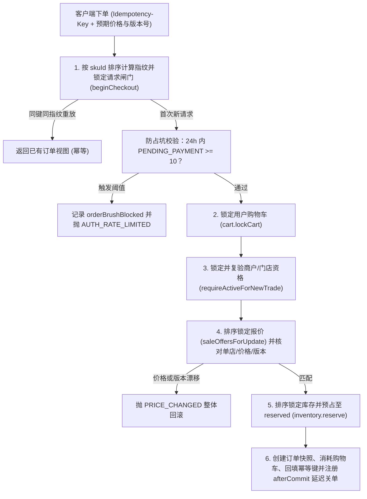
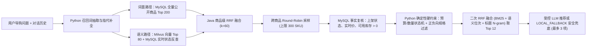
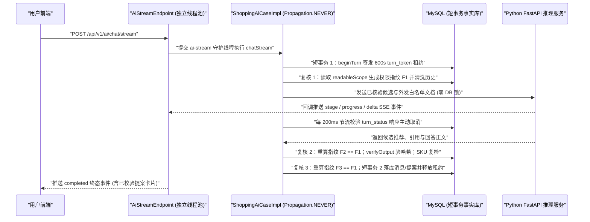

# 第 4 章 核心业务模块详细设计与实现

> **论文题名**：《基于 Spring Boot 的校园智能导购商品交易系统设计与实现》  
> **工程基线**：仓库主分支 `main`（Java 7 模块 DDD 单体共 554 个 `.java` 文件约 39,777 行，其中主源码 471 个文件约 25,386 行、测试 83 个文件约 14,391 行；MySQL 8.0 跨 8 大领域前缀共 46 张数据表、22 份不可变迁移脚本 `V20261028_01`–`V20261126_01`、结构指纹 `9233d6e7...`；13 个控制器 111 条 JSON 契约路由覆盖 102 个去重路径，加 3 个独立端点合计 114 个 Spring MVC 端点、分布于 16 个 `@RestController` 类；Vue 3 前端 `frontend/src` 共 59 个源文件 28,535 行，含 9 个零 `!important`、零内联样式 CSS 模块共 14,889 行；Python 3.11 + FastAPI 导购推理服务 `ai-service/app` 共 26 个模块 4,258 行，配套 432 项通过的 pytest 测试）  
> **关联论文手册**：[论文六章写作蓝图](./02-THESIS-CHAPTER-BLUEPRINT.md) · [系统架构、46 表与 114 端点速查手册](./03-ARCHITECTURE-AND-DATA-MANUAL.md) · [双 Redis 生产架构与四层防刷风控专题](./06-DUAL-REDIS-AND-ANTI-ABUSE-DEFENSE.md) · [双 Redis 协调规格 SDD-REDIS-12](../specs/SDD-REDIS-12.md)

本章严格遵循第 3 章确立的七大限界上下文与六边形端口适配器架构（`API → Trigger → Case → Domain ← Infrastructure`），结合仓库实际源码与数据库约束，依次论述身份认证与防爬虫风控、多规格商品目录与双物理 Redis 展示缓存自愈、强一致交易结算与精准超时关单、全量商品两级混合召回与口语规格硬约束、权限感知知识库检索与零锁流式会话提案，以及同源三端前端状态隔离、商业化界面体系与自动化契约工程门禁的详细设计与实现机制。需要明确边界的是，本系统微信支付、支付宝与校园一卡通渠道均为面向教学与原型验证的内部模拟实现，不涉及真实资金清结算与外部支付机构对账。

---

## 4.1 身份认证、多租户自定义 RBAC 与公开入口防爬虫风控实现

校园智能导购平台同时承载普通学生/教职工消费者、跨门店协作的商户成员与平台审核管理员三类角色，且校园网普遍存在宿舍楼出口 NAT 共享公网 IP、公开商品目录暴露于未登录流量等典型特征。为此，安全子系统在会话存储隔离、多租户权限裁决与公开入口防爬虫三个层面设计了协同纵深防护。

### 4.1.1 同源会话安全与 `redis-security`（`noeviction` + AOF）隔离机制

在涉及商户权限实时撤销与违规账号立即踢出的多租户交易场景中，无状态 JWT 令牌难以瞬时吊销，存入本地存储亦会扩大 XSS 窃取面。系统在 [SessionSecurityConfig.java](../../campus-shopping-app/src/main/java/cn/bugstack/ai/config/SessionSecurityConfig.java) 中统一采用同源 Cookie 会话认证，关闭 `formLogin`、`httpBasic` 及 URL 重写（`setDisableUrlRewriting(true)`）。会话 Cookie 在 [RedisSessionConfig.java](../../campus-shopping-app/src/main/java/cn/bugstack/ai/config/RedisSessionConfig.java) 中强制设为 `HttpOnly=true`、`SameSite=Lax`；登录瞬间由 `ChangeSessionIdAuthenticationStrategy` 与 `CsrfAuthenticationStrategy` 原子轮换 `JSESSIONID` 及 `HttpSessionCsrfTokenRepository` 令牌，同步抵御会话固定与跨站请求伪造。匿名入口 `/api/v1/auth/login` 与 `/api/v1/auth/register` 仍保留强制 CSRF 校验，并在 `CsrfFilter` 之前装配 `RequestBodyLimitFilter` 与 `AuthenticationRateFilter` 截断超大报文与认证爆破。

多实例水平部署下，Spring Session、分布式限流桶、IP 封禁黑名单与核销防爆破锁全部写入物理独立的 `redis-security` 实例。依据 [compose.yml](../../compose.yml)，该实例以 `--appendonly yes --appendfsync everysec --maxmemory 128mb --maxmemory-policy noeviction` 运行：`noeviction` 避免高并发缓存驱逐在线会话与风控计数，`AOF everysec` 保障重启不丢安全态；故障时认证与受保护写接口按 Fail-Closed 语义拒绝，绝不退回单机内存绕过全局风控。

### 4.1.2 商户 15 项细粒度自定义 RBAC 权限控制与停用拦截

校内自营档口与便利店普遍存在店主、库管员、备餐员、核销员及知识库维护员的细粒度分工。身份与访问上下文（`iam_` 前缀 6 张表）在领域值对象 [MerchantPermissionEnumVO.java](../../campus-shopping-domain/src/main/java/cn/bugstack/ai/domain/identity/model/valobj/MerchantPermissionEnumVO.java) 中固化了 15 项原子权限字典，商户自定义角色则作为权限编码集合动态维护，如表 4-1 所示。

**表 4-1 商户 15 项自定义 RBAC 细粒度权限字典与前置依赖约束**

| 权限分组 | 权限编码（`code`） | 业务含义 | 是否可授予自定义角色（`grantable`） | 前置依赖权限（`prerequisite`） |
| :--- | :--- | :--- | :---: | :--- |
| 经营与商品 | `dashboard.read` / `product.read` / `product.write` | 查看经营看板 / 查看商品 / 管理商品与价格 | 是 | `order.read` / 无 / `product.read` |
| 库存管理 | `stock.read` / `stock.replenish` | 查看库存流水 / 采购补货入库 | 是 | 无 / `stock.read` |
| 订单与自提 | `order.read` / `order.prepare` / `pickup.verify` | 查看订单 / 备货出餐 / 自提核销 | 是 | 无 / `order.read` / `order.read` |
| 售后与知识 | `aftersale.read` / `aftersale.review` / `knowledge.read` / `knowledge.manage` | 查看与审核售后 / 读取与管理知识库 | 是 | 无 / `aftersale.read` / 无 / `knowledge.read` |
| 店主保留项 | `team.manage` / `store.manage` / `role.manage` | 团队成员管理 / 门店资料维护 / 角色权限配置 | **否（Owner 独享）** | 无 |

在角色授权校验中，`validateGrant()` 刻意采用“先全量核查授予资格、再核查前置依赖闭环”的两阶段确定性判定：若入参混入 3 项店主保留权限之一，一律优先抛出 `AUTH_FORBIDDEN`；若授予写能力（如 `product.write`、`pickup.verify`）却遗漏对应前置读能力（如 `product.read`、`order.read`），则抛出 `ILLEGAL_PARAMETER`，避免因哈希集合遍历次序差异导致响应错误码不稳定。所有商户侧用例入口均调用 [AccessServiceImpl.java](../../campus-shopping-domain/src/main/java/cn/bugstack/ai/domain/identity/service/impl/AccessServiceImpl.java) 的 `requirePermission(actor, merchantId, permission)` 实时联查成员表、角色表与商户状态，杜绝跨商户水平越权与前端篡改 `merchantId` 绕过权限。

针对“账号已被管理员停用但原会话仍在有效期内”的权限回收滞后问题，安全链在 `AuthorizationFilter` 之前注册了 [AccountStatusFilter.java](../../campus-shopping-trigger/src/main/java/cn/bugstack/ai/trigger/http/AccountStatusFilter.java)。该过滤器对除主动退出（`POST /api/v1/auth/logout`）外的全部已认证请求实时调用 `accountService.requireActive(auth.getName())` 查库复核；一旦检出账号已停用或失效，立即执行 `logoutHandler.logout(...)` 清理会话与 `JSESSIONID` 并返回 `HTTP 403`（`AUTH_ACCOUNT_DISABLED`）或 `HTTP 401`；若数据库故障无法完成复核，则返回 `HTTP 503` 失败关闭，保证停用账号无法继续执行任何业务读或写操作。

### 4.1.3 公开商品接口四层防爬虫网关实现

面向未登录访客开放的商品列表、详情、公开门店与发现页 `GET` 接口（`/api/v1/products/**`、`/api/v1/merchants/public/**`、`/api/v1/discovery/**`）是自动化脚本扫库的高风险入口。系统在过滤器链中实现 [PublicAntiCrawlerFilter.java](../../campus-shopping-trigger/src/main/java/cn/bugstack/ai/trigger/http/PublicAntiCrawlerFilter.java)，依次执行四层防爬拦截：第一层通过正则 `MALICIOUS_UA`（覆盖 `sqlmap`、`nikto`、`masscan`、`zgrab`、`scrapy`、`python-urllib/bot`）与探测头 `X-Scraper-Bot: 1` 识别恶意抓取器，命中后记入安全审计计数并返回 `HTTP 429`（`Retry-After: 60`）；第二层限制查询参数 `page <= 100` 与 `size <= 100`，直接以 `HTTP 400` 阻断深分页拖库；第三层查询 `redis-security` 的 IP 临时封禁黑名单（Penalty Box）；第四层调用 `quotas.acquire("public-browse-ip", ip, 600, 60)` 施加每 60 秒 600 次的校园 NAT 友好配额——相较于过严的单 IP 低阈值，该配额既容许宿舍区同公网出口数十名学生同时浏览商品，又能快速捕获高频脚本。同一来源 IP 连续触发 3 次限流违规（`BAN_VIOLATION_THRESHOLD = 3`）时，[CampusRedisHub.java](../../campus-shopping-infrastructure/src/main/java/cn/bugstack/ai/infrastructure/redis/CampusRedisHub.java) 自动将其写入 300 秒 Penalty Box 封禁池（清单 4-1）。与写操作 Fail-Closed 不同，公开只读浏览在安全 Redis 瞬时不可达时降级放行，防止单边风控缓存抖动波及商品展示可用性。

```java
// 清单 4-1：PublicAntiCrawlerFilter.java（L68-L88）Penalty Box 拦截与 600次/60s 校园 NAT 限流
        if (redisHub != null && redisHub.isIpBanned(ip)) {
            response.setHeader("Retry-After", "300");
            ApiErrorWriter.write(mapper, response, 429, ResponseCode.AUTH_RATE_LIMITED);
            return;
        }
        if (quotas != null) {
            long retry;
            try {
                retry = quotas.acquire("public-browse-ip", ip, 600, 60);
            } catch (RuntimeException ignored) {
                // 公开只读浏览在安全 Redis 故障时降级放行，保障展示可用性。
                retry = 0;
            }
            if (retry > 0) {
                long banSeconds = redisHub == null ? 0L : redisHub.recordRateViolationAndMaybeBan(ip);
                response.setHeader("Retry-After", Long.toString(banSeconds > 0 ? banSeconds : retry));
                ApiErrorWriter.write(mapper, response, 429, ResponseCode.AUTH_RATE_LIMITED);
                return;
            }
        }
        chain.doFilter(request, response);
```

---

## 4.2 商品多规格目录、图片安全与双物理 Redis 展示缓存自愈实现

商品目录上下文（`cat_` 前缀 6 张表，包含商品主表、SKU 规格报价表、类目表、商品相册表、图片上传登记表及商品收藏表 `cat_product_favorite`）同时服务于高并发只读浏览与强一致交易报价，系统在数据写锁粒度、媒体存储边界与双 Redis 展示缓存三个层面构建了严密的一致性与容灾机制。

### 4.2.1 商品/SKU 乐观版本控制、空相册间隙锁规避与受控七牛媒体重定向

为防并发改价或编辑覆盖，[CatalogServiceImpl.java](../../campus-shopping-domain/src/main/java/cn/bugstack/ai/domain/catalog/service/impl/CatalogServiceImpl.java) 为商品及每条 SKU 维护单调递增乐观版本号 `version`。改价、上下架或编辑时均先经 `repository.find(id, true)` 锁定商品主行并核验归属，再断言 `expectedVersion` 一致；该版本号同步透传至购物车、AI 提案与结算接口。针对 MySQL InnoDB 可重复读下对空相册执行 `DELETE FROM cat_product_image WHERE product_id = ?` 触发二级索引间隙锁（Gap Lock）导致的并发死锁，`CatalogServiceImpl.edit()` 依据主图非空判定 `hadImages`：原本无图且不新增时跳过删除，仅新增时调用 `insertInitial`，原有相册才执行 `replace`。

图片上传与认领由 [ProductImageRepository.java](../../campus-shopping-infrastructure/src/main/java/cn/bugstack/ai/infrastructure/adapter/repository/ProductImageRepository.java) 实施三层防护：① 限制单图 $\le 2\text{ MB}$、像素 $\le 1.2\times 10^7$，经 `ImageIO` 解码并重编码为纯净 PNG；② 上传置于数据库事务与商品行锁外，按 `PRODUCT` / `STORE` 用途登记归属，多图认领按 `objectKey` 字典序排序加锁防死锁并阻断跨商户盗图；③ 七牛模式下仅落库站内稳定引用 `/media/qiniu/{uuid}.png`，经独立端点 [MediaAssetEndpoint.java](../../campus-shopping-trigger/src/main/java/cn/bugstack/ai/trigger/http/MediaAssetEndpoint.java)（`GET /media/qiniu/{filename}`）签发 30–3600 秒短时地址返回 `HTTP 302` 与 `Cache-Control: no-store`，同时由 [QiniuPublicHttpPolicy.java](../../campus-shopping-infrastructure/src/main/java/cn/bugstack/ai/infrastructure/config/QiniuPublicHttpPolicy.java) 动态联动 CSP `img-src`。

### 4.2.2 双物理 Redis 隔离策略与 `DisplayCache` 缓存防穿透/击穿/雪崩及 CAS 损坏自愈

单 Redis 实例分库（`SELECT 0/1`）仍共享同一内存池与主线程，无法隔离不同生命周期的数据负载。本系统在物理层面将缓存与安全状态拆分为 `redis-security` 与 `redis-cache` 两个独立实例（表 4-2），并在生产环境开启 `campus.redis.require-separate-instances: true`，由 [RedisInfrastructureConfig.java](../../campus-shopping-infrastructure/src/main/java/cn/bugstack/ai/infrastructure/redis/RedisInfrastructureConfig.java) 在启动阶段解析两者的主机地址与端口，一旦检测到指向同一物理实例则直接阻断应用启动。

**表 4-2 物理隔离双 Redis 实例核心策略对照**

| 对比维度 | `redis-security`（安全与状态库） | `redis-cache`（缓存与高吞吐协同库） |
| :--- | :--- | :--- |
| 持久化与淘汰策略 | `appendonly yes`（`everysec`），`128mb`，`noeviction` | 关闭 RDB/AOF（`--save ""`），`64mb`，`allkeys-lru` |
| 故障降级语义 | **Fail-Closed**：认证与受保护写拒绝降级 | **Fail-Open**：短超时无缝回退 MySQL 权威事实库 |
| 承载核心业务数据 | Spring Session、CSRF、分布式限流、IP Penalty Box、短码防爆破锁 | `DisplayCache` 展示投影、`RDelayedQueue` 延迟关单、热搜/热销 ZSET、ItemCF、`RTopic` 广播、向量缓存 |

按工程约束，`redis-cache` 严格只服务于非权威展示投影，任何交易价格、库存扣减与权限判定均须回源 MySQL 实时复验。在展示缓存工具 [DisplayCache.java](../../campus-shopping-infrastructure/src/main/java/cn/bugstack/ai/infrastructure/redis/DisplayCache.java) 中，系统完整闭环了五类缓存高并发问题：当数据库查无记录时写入 15 秒短周期 `"__NULL__"` 哨兵，将爬虫随机 UUID 扫库请求拦截在内存层；缓存未命中时通过 Redisson 单飞锁 `{ns}:sf:v1:{key}`（等待 150 ms、持有上限 3,000 ms）并在获锁后执行二次判空（Double-Check），抑制热点击穿；回填正常数据时在基础 TTL 上附加 `0..max(1, seconds / 5)` 的随机抖动以分散群体雪崩；遇到反序列化损坏载荷时通过 `bucket.compareAndSet(data, null)` 仅清理本次读到的损坏字符串而不误删并发线程刚修复的新值（清单 4-2）；数据变更路径统一调用 `evictAfterCommit(key)`，依托 `TransactionSynchronizationManager` 将缓存删除推迟至数据库事务提交后执行，杜绝事务回滚引发的缓存误删与未提交脏值回填（清单 4-3）。

```java
// 清单 4-2：DisplayCache.java（L79-L92）空值哨兵短路与 CAS 损坏自愈
        if ("__NULL__".equals(data)) return null;
        if (data != null) {
            try {
                T cached = mapper.readValue(data, type);
                if (cached != null) return cached;
            } catch (com.fasterxml.jackson.core.JsonProcessingException error) {
                diagnostic();
                try {
                    bucket.compareAndSet(data, null);
                } catch (RuntimeException ignored) {
                    diagnostic();
                }
            }
        }
```

```java
// 清单 4-3：DisplayCache.java（L140-L161）事务提交后精准淘汰展示缓存
    public void evictAfterCommit(String key) {
        Runnable action = () -> {
            RedisClients redis = clients.getIfAvailable();
            if (redis != null) try {
                redis
                    .cache()
                    .getBucket(redis.namespace() + ":display:v1:" + key)
                    .delete();
            } catch (RuntimeException error) {
                diagnostic();
            }
        };
        if (TransactionSynchronizationManager.isSynchronizationActive()) TransactionSynchronizationManager.registerSynchronization(
            new TransactionSynchronization() {
                @Override
                public void afterCommit() {
                    action.run();
                }
            }
        );
        else action.run();
    }
```

### 4.2.3 校园发现页热搜/热销 ZSET、ItemCF 协同过滤推荐与商品收藏/订单评价数据闭环

依托 `redis-cache` 的有序集合（`RScoredSortedSet`）与持久化的 `cat_product_favorite`、`trd_order_review` 两张业务表，[DiscoveryController.java](../../campus-shopping-trigger/src/main/java/cn/bugstack/ai/trigger/http/DiscoveryController.java) 与 [DiscoveryCaseImpl.java](../../campus-shopping-case/src/main/java/cn/bugstack/ai/cases/catalog/impl/DiscoveryCaseImpl.java) 形成了“搜索热度感知—交易共现推荐—收藏沉淀—成交评价反馈”的完整校园发现闭环：用户在公开目录检索时异步递增热搜词 ZSET（`topHotKeywords(10)`）；订单完成模拟支付时，[OrderLifecycleCaseImpl.java](../../campus-shopping-case/src/main/java/cn/bugstack/ai/cases/trading/impl/OrderLifecycleCaseImpl.java) 按商品维度累加校园实时热销榜 ZSET（`topSellingProductIds(8)`），并对同单内任意两件不同商品双向递增 ItemCF 共现权重 `{ns}:rec:copurchase:{productId}`。

发现首页接口 `GET /api/v1/discovery/home` 融合用户近期收藏夹（至多取前 4 个种子商品）与浏览足迹，通过 ItemCF 共现邻居生成个性化“猜你喜欢”列表；商详页 `GET /api/v1/products/{productId}/recommendations` 则组合输出“买了又买”与“同店热销”。所有经 Redis 召回的商品编号返回前端前均须经 `catalogQuery.publicByIds` 实时反查 MySQL 过滤已下架或停业门店商品，在冷启动推荐不足 6 件时自动以最新公开在售商品补齐至 8 件。消费者收藏夹通过 `POST/DELETE /api/v1/products/{productId}/favorite` 落库 `cat_product_favorite`；订单仅在自提核销进入 `COMPLETED` 终态后开放评价入口，且 `trading.hasOrderReviews(orderId)` 保证单笔订单限评一次，系统将 1–5 星评分、标签与正文按去重商品维度写入 `trd_order_review` 并登记 `ORDER_REVIEWED` 订单事件，杜绝刷评与无交易虚评。

---

## 4.3 强一致交易结算、精准延迟超时关单与自提售后裁决实现

交易结算、库存预占、自提核销与售后裁决横跨 `trd_`（10 张表）、`inv_`（3 张表）与 `ful_`（2 张表）三个限界上下文，所有跨聚合写操作均收敛于 Case 层声明式单库事务，确保资金金额（统一以整数“分”运算）零误差、库存零超卖与状态机不可逆单调演进。

### 4.3.1 六步确定性全局锁序防死锁、请求指纹幂等闸门与防恶意占坑

高并发抢购尾货、前端弱网重试引发重复建单，以及恶意脚本反复下单不付款锁死食堂库存，是交易入口最核心的并发与风控难题。[CheckoutCaseImpl.java](../../campus-shopping-case/src/main/java/cn/bugstack/ai/cases/trading/impl/CheckoutCaseImpl.java) 在单个 `@Transactional(rollbackFor = Exception.class)` 事务中首先校验买家活跃状态、单笔明细不超过 20 行且单 SKU 购买量处于 `1..99` 区间，随后将全部待购 SKU 按 `skuId` 字典序稳定排序，并把商户编号、买家备注、自提时段与排序后的 `(skuId, quantity, expectedPriceCent, expectedVersion)` 拼接计算 SHA-256 请求指纹（`Fingerprints.of(...)`），结合请求头 `Idempotency-Key` 写入幂等闸门 `trading.beginCheckout(...)`：若同键同指纹重放则直接加锁返回既有订单视图，若同键异指纹则拒绝重放。

通过幂等闸门后，用例立即执行防恶意占坑校验：实时统计该买家近 24 小时内处于 `PENDING_PAYMENT` 状态的待付款订单总数，一旦达到阈值 `MAX_PENDING_ORDERS_24H = 10`，即递增 `redisHub.recordOrderBrushBlocked()` 风控遥测计数并抛出 `AUTH_RATE_LIMITED`，在放行正常学生多店并单需求的同时，彻底阻断零成本锁空门店库存的恶意占坑行为。为从理论上消除并发事务间的 Coffman 循环等待条件，系统严格确立了**请求闸门 → 用户购物车 → 商户资格 → 排序商品/SKU 报价 → 排序库存预占（`on_hand / reserved` 分离模型）→ 订单落库与延迟关单注册**的六步确定性全局锁序（清单 4-4 与图 4-1）。

```java
// 清单 4-4：CheckoutCaseImpl.java（L123-L137）幂等指纹闸门、防占坑风控与确定性全局锁序
        String existing = trading.beginCheckout(buyer, key, Fingerprints.of(fp.toArray()));
        if (existing != null) return query.view(trading.orderForUpdate(existing));
        if (orderQuery != null) {
            long pending = orderQuery.countOrders(buyer, null, "PENDING_PAYMENT", "", clock.instant().minus(Duration.ofHours(24)));
            if (pending >= MAX_PENDING_ORDERS_24H) {
                if (redisHub != null) redisHub.recordOrderBrushBlocked();
                throw new AppException(ResponseCode.AUTH_RATE_LIMITED.getCode(), "未付款订单过多，请先完成支付或取消旧单");
            }
        }
        cart.lockCart(buyer);
        var m = merchants.requireActiveForNewTrade(merchant);
        Map<String, SkuOfferVO> offers = catalog
            .saleOffersForUpdate(sorted.stream().map(CheckoutItemEntity::skuId).toList())
            .stream()
            .collect(Collectors.toMap(SkuOfferVO::skuId, o -> o));
```

获取排序报价行锁后，用例逐条断言所有待购 SKU 归属同一商户与门店（`ORDER_MIXED_MERCHANT`），且数据库实时单价与乐观版本号与前端预期严格相等（`PRICE_CHANGED`）；随后按相同 SKU 序调用 `inventory.reserve` 仅递增 `reserved` 预占字段而不直接扣减物理现存 `on_hand`，创建订单及商品快照、原子消耗购物车对应条目、回填幂等键关联的 `orderId`，并登记事务提交后的延迟关单任务。任一环节异常均触发整笔事务原子回滚，不残留脏锁或悬空预占。



**图 4-1 下单结算六步确定性全局锁序与防恶意占坑事务流程图**

### 4.3.2 Redisson `RDelayedQueue` 精准超时关单与事务提交后双队列精准剔除

新建订单默认享有 15 分钟支付窗口（支持在 `1..60` 分钟区间配置），逾期未付必须准时释放预占库存。为兼顾秒级释放精度与低数据库轮询压力，系统在 [OrderDelayCoordinator.java](../../campus-shopping-infrastructure/src/main/java/cn/bugstack/ai/infrastructure/redis/OrderDelayCoordinator.java) 中采用“Redisson `RDelayedQueue` 精准主驱动 + 游标定时巡检兜底”双轨架构：下单事务通过 `scheduleOrderExpiryAfterCommit` 仅在数据库提交后才将 `orderId` 投递至 `redis-cache` 中的 `{ns}:delay:order-expire` 延时队列，防止回滚订单产生幽灵任务；后台守护线程 `order-delay-expiry` 阻塞消费关联 `RBlockingDeque` 并调用幂等关单处理器 `IOrderExpiryHandler.expire(orderId)`。

若订单在 15 分钟内已完成模拟支付、由买家主动取消或被兜底任务关闭，却未及时清理延时队列中的旧条目，不仅会在到期时触发无效回表空跑，还会造成平台监控大盘中的“延时关单队列深度”指标虚高失真。为此，协调器实现了 `cancelOrderExpiryAfterCommit`（清单 4-5）与 `cancelNow`（清单 4-6），在 `OrderLifecycleCaseImpl` 的 **`pay`（支付成功）、`cancel`（买家取消）与 `expire`（逾期关闭）三条脱离待付款状态的路径中统一接线**：仅当数据库事务确认提交后，同时从延时区 `RDelayedQueue` 与就绪区 `RBlockingDeque` 精准移除残留 `orderId`，彻底消除幽灵任务与队列虚高。

```java
// 清单 4-5：OrderDelayCoordinator.java（L113-L129）事务提交后撤销延时关单钩子
    @Override
    public void cancelOrderExpiryAfterCommit(String orderId) {
        if (orderId == null || orderId.isBlank()) return;
        Runnable cancelTask = () -> cancelNow(orderId);
        if (TransactionSynchronizationManager.isSynchronizationActive()) {
            TransactionSynchronizationManager.registerSynchronization(
                new TransactionSynchronization() {
                    @Override
                    public void afterCommit() {
                        cancelTask.run();
                    }
                }
            );
        } else {
            cancelTask.run();
        }
    }
```

```java
// 清单 4-6：OrderDelayCoordinator.java（L131-L145）延时队列与就绪双端队列双路径精准剔除
    /** 订单已支付、取消或关闭后立即移除延时队列与就绪队列中的残留任务，避免遥测虚高。 */
    public void cancelNow(String orderId) {
        if (orderId == null || orderId.isBlank()) return;
        RDelayedQueue<String> dq = ensureQueue();
        if (dq == null) return;
        try {
            dq.remove(orderId);
            RBlockingDeque<String> deque = blockingDeque;
            if (deque != null) {
                deque.remove(orderId);
            }
        } catch (RuntimeException error) {
            log.warn("order_delay_cancel_degraded orderId={} error={}", orderId, error.getClass().getSimpleName());
        }
    }
```

由于 `redis-cache` 关闭持久化，极端故障重启时内存中的延迟队列可能丢失。系统同步保留 [OrderExpiryJob.java](../../campus-shopping-trigger/src/main/java/cn/bugstack/ai/trigger/job/OrderExpiryJob.java) 作为低频兜底：每 15 秒经由分布式锁协调器（`IOrderExpiryCoordinator`）协调多实例执行权，单轮按主键游标分页扫描至多 20 批（每批 100 笔、上限 2,000 笔），并将推进游标持久化至 Redis，避免个别异常毒丸订单长期霸占扫描首页；每笔候选均在独立用例事务内重新加锁核查支付截止时间与状态，确保多实例并发重叠执行完全幂等安全。

### 4.3.3 双凭证 SHA-256 恒定时间核销、`RTopic` 实时出餐推送与三级售后争议裁决

订单模拟支付成功瞬间，系统在同事务内经 Redis 原子自增签发门店当日叫号并创建自提任务。备货就绪（`READY`）后，买家领码由 [FulfillmentServiceImpl.java](../../campus-shopping-domain/src/main/java/cn/bugstack/ai/domain/fulfillment/service/impl/FulfillmentServiceImpl.java) 用 `SecureRandom` 同步签发 **256-bit 随机令牌**（二维码载荷 `CS1|{orderId}|{token}`）与 **6 位数字短码**（`100000`–`999999`）；明文仅返本人一次，库内仅存 SHA-256 摘要，短码哈希映射同步缓存于 `redis-security`（1,200 秒）。店员核销时，[PickupAggregate.java](../../campus-shopping-domain/src/main/java/cn/bugstack/ai/domain/fulfillment/model/aggregate/PickupAggregate.java) 采用 `MessageDigest.isEqual` 恒定时间比对抵御时序侧信道；`CampusRedisHub` 按 `(merchantId, actor)` 计数，**300 秒滑窗内累计失败 5 次即触发 180 秒冷却锁定**防爆破。核销成功同事务执行 `inventory.consume`、置单为 `COMPLETED` 并写入审计。

支付、备餐、出餐与核销四类状态变更均在事务提交后发布至 `redis-cache` 的 Redisson `RTopic`（`{ns}:topic:rt`），由独立端点 [RealtimeEventEndpoint.java](../../campus-shopping-trigger/src/main/java/cn/bugstack/ai/trigger/http/RealtimeEventEndpoint.java)（`GET /api/v1/events/stream`）按 `user:{userId}` 与活跃 `merchant:{merchantId}` 频道跨实例推送。售后方面，`OrderLifecycleCaseImpl` 落地“买家申请退款（可附凭证图）→ 商户审核（`aftersale.review`）→ 买家申诉争议（`DISPUTED`，硬上限 `MAX_APPEAL_ROUNDS = 3` 轮）→ 平台终审”三级闭环：存在未决售后时禁止领码或核销（`requireNoPendingRefund`），退款批准则同事务取消自提、释放库存并迁移至 `REFUNDED`。

---

## 4.4 全量商品两级混合召回与口语规格硬约束引擎实现

早期原型若仅按时间倒序无条件预截断“最新 100 件商品”送入大模型，在商品规模扩大后必然引发严重的长尾漏召；而直接依赖大模型理解口语预算、数量与排除性规格又极易触发算术幻觉与推荐违约。为此，系统设计了跨 Java 事实库与 Python 推理服务的全量商品两级混合召回及确定性硬约束管道。

### 4.4.1 Java 事实库词面 Top 200 与 Milvus 语义 Top 80 两级 RRF 融合及 Round-Robin 300 SKU 采样

商品语义向量由后台增量任务 [ProductVectorSyncJob.java](../../campus-shopping-trigger/src/main/java/cn/bugstack/ai/trigger/job/ProductVectorSyncJob.java) 按游标同步至 Milvus 向量集合，并遵循“同步失败绝不更新成功水位线”不变量以保证漏同步条目可自动重试。导购问答触发后，[CandidateResolver.java](../../campus-shopping-case/src/main/java/cn/bugstack/ai/cases/shoppingai/impl/CandidateResolver.java) 执行无预截断的全量商品两级召回流程（图 4-2）：第一路依据 Python 抽取的检索词在 MySQL 全量上架活跃商品中执行词面打分召回 Top 200；第二路利用上下文改写后的查询向 Milvus 检索语义最相近的 Top 80 商品编号，并立即调用 `catalog.candidateRecallByIds(semanticIds)` 回查 MySQL，实时剔除已在向量同步延迟窗口内下架或停业的商品；若向量库短暂不可用（`AI_UNAVAILABLE`），捕获异常记录摘要诊断并自动降级为纯词面召回，不阻断正常导购。

随后，[RecommendationPolicy.java](../../campus-shopping-domain/src/main/java/cn/bugstack/ai/domain/shoppingai/service/RecommendationPolicy.java) 以平滑常数 $k=60$ 对词面序数与语义序数执行商品级倒数秩融合（RRF），在不依赖异构打分尺度的前提下合并双路优势；再经 `sampleSkus()` 按跨商品轮询（Round-Robin）方式每轮从各融合商品中顺次抽取 1 个活跃 SKU 直至凑满 **300 SKU 上限**，彻底防止单个多规格爆品挤占候选配额。接着批量联查 MySQL 实时有效价与可用库存（过滤掉 `onHand - reserved <= 0` 的缺货规格），若识别到“换一个/换一款/还有别的”或“便宜点/更便宜”等追问语义，则自动排除上一轮已推荐 SKU 或保留严格低于前序最低价的候选集，并按商品轮询序输出 `semanticSkuIds` 传予 Python 端参与精排。



**图 4-2 全量商品两级 RRF 混合召回与口语规格硬约束过滤管道图**

### 4.4.2 Python 确定性中文预算/数量状态机与正负向规格硬约束

系统在 [engine.py](../../ai-service/app/engine.py) 与 [sku_constraints.py](../../ai-service/app/sku_constraints.py) 中坚持商业硬约束由确定性程序前置裁决：
- **确定性中文预算与数量状态机**：`chinese_integer` 支持完整中文数词与小数 `Decimal` 整数分换算，将意图分为 `VALID`、`UNSPECIFIED`、`AMBIGUOUS`、`INVALID` 四态；遇“二三十元”“十几个”等模糊区间（`UNCERTAIN`）或矛盾多金额立即判定 `AMBIGUOUS` 并要求澄清；严格上界（“低于 30 元”）自动减 1 分，数量硬限定 `1..99` 整数，追问语句经 `purchase_constraints` 逆向继承历史有效约束。
- **正负向规格硬约束与双重否定拦截**：基于候选真实 `specKey` 与结构化属性划分颜色、包装、容量、重量、长度、尺码等维度，经 NFKC 归一化解析 `required` 与 `forbidden` 集合，并用 `PRICE_CLAUSE`、`MERCHANT_SCOPE` 过滤非规格否定误判；遇“不是不要/并非不要”双重否定、正负交集冲突或未知排除属性（`forbidden - known_values`）统一置位 `ambiguous = True` 拦截澄清，绝不私自替代规格。
- **二次 RRF 精排与 `LOCAL_FALLBACK` 兜底**：仅合格候选参与本地 BM25、语义位次与标题 2/3-gram 融合取 Top 12；一旦模型输出池外 SKU、违背规格、编造“已下单/已付款”等虚假执行文案（`FAKE_EXEC_ANSWER`）或上游异常，立即切换 `LOCAL_FALLBACK` 输出已核验本地候选并附加“确认后只加入购物车，不会自动下单或付款”提示。

### 4.4.3 零依赖 RESP2 客户端与 24h Embedding 向量缓存

为消除单次问答中商品与知识检索重复调用 2048 维 Embedding 的计费与延迟，并避免引入重型第三方 Redis 库，[redis_cache.py](../../ai-service/app/redis_cache.py) 仅基于标准库 `socket`、`ssl` 与 `OrderedDict` 实现零依赖同步 RESP2 客户端 `RedisCache`，直连 `redis-cache` 默认以 24 小时 TTL（`86,400` 秒）缓存 Query Embedding。客户端内置 **0.25 秒快速失败超时**与线程安全 **512 项有界本地 LRU 降级缓存**（本地副本 TTL 3,600 秒），连接复用与断线重连异常均严格 Fail-Open，不拖慢推理主链路。

---

## 4.5 权限感知知识库检索与零数据库锁流式会话提案机制实现

校园导购同时承担平台规则、门店营业指引与商户内部运营手册的知识问答职责。在多租户架构下，该子域必须同时守住两条底线：其一，非公开内部文档绝不允许通过外部模型外发或越权检索泄漏；其二，耗时数秒至数十秒的文本提取、向量索引与流式大模型调用绝不能占有数据库连接或行锁，且须防范并发撤权/撤稿引发的 TOCTOU 竞争漏洞。

### 4.5.1 不可变文档版本、`index_attempt` 600s 租约与四重知识防泄漏

知识文档拆分为文档根（`ai_document_root`）与不可变版本快照（`ai_document`）；[KnowledgeRepository.java](../../campus-shopping-infrastructure/src/main/java/cn/bugstack/ai/infrastructure/adapter/repository/KnowledgeRepository.java) 发布与撤回均先锁根再重读目标版本，防旧版越权上线。[KnowledgeCaseImpl.java](../../campus-shopping-case/src/main/java/cn/bugstack/ai/cases/shoppingai/impl/KnowledgeCaseImpl.java) 的提取与建索引声明 `Propagation.NEVER` 脱离数据库事务；建索引前校验租户并发上限（4）与速率配额（60 次/分），并经 `iaidao_mapper.xml` 写入随机 `index_attempt`、绑定 `index_version = version` 与 **600 秒租约**。索引回写须同时匹配 `index_attempt`、`PENDING` 状态、版本号与有效租约，杜绝陈旧回调覆盖。

系统构筑了**四重知识防泄漏防线**：① [KnowledgeEgressPolicy.java](../../campus-shopping-domain/src/main/java/cn/bugstack/ai/domain/shoppingai/service/KnowledgeEgressPolicy.java) 默认仅放行 `PUBLIC` 文档外发，内部文档默认仅本地稀疏/哈希检索，须同时列入知识库与商户双白名单方可外发；② [egress.py](../../ai-service/app/egress.py) 外发前递归截断至 2,000 字符并将手机号、固话、身份证与邮箱替换为 `[已脱敏]`，审计日志仅记元数据；③ [EvidenceAssembler.java](../../campus-shopping-case/src/main/java/cn/bugstack/ai/cases/shoppingai/impl/EvidenceAssembler.java) 重算分块编号与原文 SHA-256 摘要校验完整性，内部文档强制屏蔽摘录原文；④ `sanitizeHistory()` 核对历史回复 `accessFingerprint`，撤权或撤稿后自动遮蔽旧回复，切断上下文残影泄漏。

### 4.5.2 `Propagation.NEVER` 零锁长调用、600s `turn_token` 会话租约与三次权限指纹复核防 TOCTOU

为根除 AI 慢推理耗尽数据库连接池的隐患，[ShoppingAiCaseImpl.java](../../campus-shopping-case/src/main/java/cn/bugstack/ai/cases/shoppingai/impl/ShoppingAiCaseImpl.java) 的同步问答 `chat()` 与流式问答 `chatStream()` 均以 `@Transactional(propagation = Propagation.NEVER)` 强制禁止外层持有事务与行锁。同一会话的并发串行化由 `ai_conversation` 表上的 `turn_token` 与 `turn_expires_at` **600 秒数据库租约**保证：短事务 `beginTurn` 仅当 `turn_token IS NULL` 或旧租约已过时才原子占位并置 `turn_status = 'RUNNING'`；推理成功时在末尾短事务中同提交消息、提案并核销租约，异常中断时则在 `catch` 块按 `turn_token` 条件释放租约，避免误清已合法接管会话的后继请求（清单 4-7）。

```java
// 清单 4-7：ShoppingAiCaseImpl.java（L176-L193）Propagation.NEVER 零锁长调用与 token 条件释放租约
    @Transactional(propagation = Propagation.NEVER)
    public ChatResult chat(String actor, String conversationId, String question) {
        accounts.requireActive(actor);
        String normalizedQuestion = text(question, "问题", 2000);
        var turn = conversations.beginTurn(actor, conversationId, normalizedQuestion);
        try {
            return answer(actor, turn, normalizedQuestion, null, null, null);
        } catch (RuntimeException failure) {
            // 成功提交已经在短事务中释放租约；失败才做 token 条件释放，不能误清除后继请求。
            try {
                conversations.releaseTurn(turn);
            } catch (RuntimeException releaseFailure) {
                failure.addSuppressed(releaseFailure);
                log.error("会话租约释放失败 conversationId={} diagnostic={}", turn.conversationId(), FailureDiagnostics.describe(releaseFailure));
            }
            throw failure;
        }
    }
```

针对“推理耗时窗口内商户撤稿或管理员撤权”引发的 TOCTOU（检查时间与使用时间差）越权风险，系统在单轮问答的三个关键切点实施**三次全量 `readableScope` 权限快照指纹复核**（清单 4-8 与图 4-3）：第一次在发起检索前生成基线指纹 `fingerprint` 并完成历史清洗；第二次在 Python 流式响应返回后、组装引用与推荐前重算当前权限指纹并断言相等，同时经 `RecommendationPolicy.select` 二次过滤模型推荐，严禁将未过检 SKU 输出给前端；第三次在开启末尾短事务 `turns.complete(...)` 写入问答消息与加购提案前再次复核指纹与取消标记（`CANCEL_REQUESTED`）。任意切点发生指纹漂移均立即中断并抛出 `KNOWLEDGE_NOT_READY`。

```java
// 清单 4-8：ShoppingAiCaseImpl.java（L300-L320）远程流式返回后的二次权限指纹复核与 SKU 二次筛选
        AiAnswerVO answer = progress == null ? engine.query(aiQuery) : engine.queryStream(aiQuery, guardedProgress, deltaListener);
        if (progress != null) ensureTurnActive(actor, conversation);
        if (stageListener != null) stageListener.accept("verifying");
        // 远程响应返回前重新校验整个知识授权快照，撤权/撤稿期间不输出已生成内容。
        var current = knowledge.readableScope(actor);
        require(fingerprint.equals(scope(current)), ResponseCode.KNOWLEDGE_NOT_READY);
        List<AiCitationVO> citations = evidenceAssembler.verifyOutput(actor, answer.citations(), current);
        boolean knowledgeOnly = ShoppingAnswerPolicy.knowledgeQuestion(question);
        List<ProposalItemVO> items = knowledgeOnly
            ? List.of()
            : RecommendationPolicy.select(
                  answer.recommendations(),
                  quotes,
                  available,
                  question,
                  history
                      .stream()
                      .filter(m -> "user".equals(m.role()))
                      .map(MessageVO::content)
                      .toList()
              );
```



**图 4-3 零数据库锁 AI 流式导购与三次权限指纹防 TOCTOU 时序图**

### 4.5.3 `AiStreamEndpoint` 独立线程池 SSE 流式输出与 `ProposalConfirmationCaseImpl` 两阶段事务复验加购

流式导购独立入口 [AiStreamEndpoint.java](../../campus-shopping-trigger/src/main/java/cn/bugstack/ai/trigger/http/AiStreamEndpoint.java)（`POST /api/v1/ai/chat/stream`）配置了专用 `ThreadPoolExecutor`（核心 2 线程、最大 32 线程、30 秒回收、`SynchronousQueue` + `AbortPolicy` 拒绝策略），将慢推理与 Tomcat 常规交易请求线程池彻底物理隔离；当流式并发满载时立即向客户端发送 `AI_STREAM_BUSY` 失败信封而不堆积请求队列。服务端依托 120 秒超时的 `SseEmitter` 依次输出 `started`、`stage`（`recall` / `generating` / `verifying`）、`progress`、`delta` 与 `completed` / `cancelled` / `failed` 终态事件，并在字节进度回调中以每 200 ms 节流轮询 `ensureTurnActive`，响应用户主动取消（`requestTurnCancel`）及时释放下游算力。

为了严格落实“AI 仅给建议、交易写权归 Java/MySQL”的双栈边界，导购推荐结果仅以最长有效 30 分钟的加购提案（`ProposalVO`）入库。待用户主动勾选并确认提案后，[ProposalConfirmationCaseImpl.java](../../campus-shopping-case/src/main/java/cn/bugstack/ai/cases/shoppingai/impl/ProposalConfirmationCaseImpl.java) 开启标准数据库短事务，严格按“幂等锁定提案 → 锁定买家购物车 → 排序核验商户营业资格 → 排序锁定在售报价（`saleOffersForUpdate`）与库存（`stocksForConfirmation`）”的次序复核每一所选 SKU：断言实时价格与版本号与提案快照完全一致（`PRICE_CHANGED`）且购物车累加总件数不超过当前可用库存（`STOCK_NOT_ENOUGH`），任一条件失效即连同提案状态与已处理明细一并回滚。

---

## 4.6 同源三端前端状态隔离、商业化界面体系与自动化契约工程门禁实现

系统将消费者商城、商户多门店工作台与平台治理后台统一托管于同源 Vue 3 单页应用（`frontend/src` 共 59 个源文件、28,535 行代码），既消除了跨域 Cookie 鉴权复杂度，又通过代次状态隔离、无内联样式架构与全链路 CI 门禁守住了前端工程质量底线。

### 4.6.1 五维代次隔离（Epoch Fencing）与跨标签页 CSRF/403 身份校验

为防同源三端快速切号、切店、搜索或跳转时晚到异步响应串号污染视图，[store.js](../../frontend/src/services/store.js)、[api.js](../../frontend/src/services/api.js) 与 [request-scope.js](../../frontend/src/services/request-scope.js) 协同实现**五维代次隔离**：全局维护 `identityVersion`、`sessionEpoch`、`baseEpoch`、`merchantEpoch` 与 `publicEpoch` 五个递增戳，上下文切换即递增代次并清空敏感态；页面级 `requestScope()` 结合 `AbortController` 与 `onBeforeUnmount`，丢弃一切过期代次或卸载后回写。写操作遇冷启动无 CSRF 或 `HTTP 403 / A0005` 时，`api.js` 必先调用 `verifySessionBeforeRetry` 请求 `/api/v1/auth/me` 校验实时会话主体，发现其他标签页已切号或掉线则重置本页会话并弹窗提示，阻断跨标签页静默越权。

### 4.6.2 零 `!important` 九模块 CSP 样式架构、桌面居中版心锁控与正式版大厂界面锁定

为兼容严格 CSP，前端彻底消除内联 `style`，将 14,889 行样式拆分为 `tokens`、`base`、`app`、`auth`、`consumer`、`backoffice`、`guide`、`responsive`、`themes` 共 **9 个独立 CSS 模块**且保持 **0 处 `!important`**。正式生产版严格锁定单品牌视觉体系：消费端锁定**淘宝 2025 PC 紧凑流**（桌面居中版心 `1240px`，1920/1440 px 呈 6 列、1280 px 呈 5 列、390 px 呈 2 列且全断点零横向溢出，见表 4-3）；商户与平台后台锁定**阿里 Ant Design Pro / 千牛工作台**（56 px `#001529` 深海蓝顶栏、220 px 左侧蓝色指示条侧栏、4 张 KPI `ChartCard`、65/35 趋势与 Top-6 榜单双拼卡及双 Redis 安全/缓存监控大盘）；登录入口 [AuthDialog.js](../../frontend/src/components/AuthDialog.js) 采用 400 px 极简纯白弹窗与 SVG 小眼睛密码切换。[design-theme.js](../../frontend/src/services/design-theme.js) 在正式环境忽略本地实验缓存强制锁定 `taobao` + `antd`（清单 4-9），[DesignVariantSwitcher.js](../../frontend/src/components/DesignVariantSwitcher.js) 默认隐藏，仅在展示入口开放多主题对比。

```javascript
// 清单 4-9：design-theme.js（L177-L197）正式版淘宝2025+AntD千牛锁定与演示模式分流
export function initDesignTheme() {
  const searchParams = new URLSearchParams(window.location.search || '');
  const hashParams = parseHashQuery();
  const showcase = detectShowcaseMode(searchParams, hashParams);
  designTheme.showcase = showcase;

  // 正式环境默认锁定为淘宝 2025 PC + 阿里 AntD/千牛，不读取历史实验缓存，保持单品牌视觉纯净；
  // 仅在 GitHub Pages 展示页或显式传入 ?showcase=1 / ?ct= / ?at= 时启用多套大厂复刻切换。
  const saved = showcase ? readStoredTheme() : null;

  const rawConsumer = showcase
    ? (hashParams.get('ct') ?? searchParams.get('ct') ?? saved?.consumer ?? DEFAULTS.consumer)
    : DEFAULTS.consumer;
  const rawAdmin = showcase
    ? (hashParams.get('at') ?? searchParams.get('at') ?? saved?.admin ?? DEFAULTS.admin)
    : DEFAULTS.admin;

  designTheme.consumer = normalizeConsumer(rawConsumer);
  designTheme.admin = normalizeAdmin(rawAdmin);

  applyDataset();
```

**表 4-3 正式版消费端（淘宝 2025 PC）多断点响应式布局实测像素与栅格参数表**

| 测试视口分辨率 | 典型使用终端 | 商品流网格列数 | 单张卡片实测尺寸（宽 × 高） | 水平溢出检查 |
| :--- | :--- | :---: | :---: | :---: |
| `1920 × 1080` | 桌面标准宽屏显示器 | 6 列 | `191 × 318 px` | `0 px`（零溢出） |
| `1440 × 900` | 笔记本高分宽屏 | 6 列 | `191 × 318 px` | `0 px`（零溢出） |
| `1280 × 800` | 便携笔记本 / 教室投影 | 5 列 | `231 × 344 px` | `0 px`（零溢出） |
| `390 × 844` | 移动端智能手机 | 2 列 | `173 × 300 px` | `0 px`（零溢出） |

在最终 Word/LaTeX 论文定稿排版时，建议于本节插入 4 张经真实浏览器无头截取的界面实拍图以直观呈现工程落地效果，图号、取景与图注规范建议如表 4-4 所示。

**表 4-4 正式论文第 4 章核心界面实拍插图取景与图注建议清单**

| 建议图号 | 推荐插图图注 | 推荐截取路由与视口 | 重点展示元素 |
| :--- | :--- | :--- | :--- |
| 图 4-4 | 消费端商城首页（淘宝 2025 PC 6 列紧致流）界面实现 | `/`（`1440 × 900`） | 橙色搜索栏、三栏好店、热搜词条与 6 列商品卡片流 |
| 图 4-5 | 极简登录弹窗与智能导购流式提案加购界面实现 | `#/guide`（`1440 × 900`） | SVG 小眼睛弹窗、流式阶段提示、脱敏引用与已核验提案卡 |
| 图 4-6 | 商户多店工作台（阿里 AntD / 千牛体系）与短码核销界面 | `#/merchant-ops`（`1440 × 900`） | `#001529` 顶栏、4 张 KPI 卡、65/35 趋势热销双拼卡与短码核销 |
| 图 4-7 | 平台治理后台双 Redis 安全与缓存实时监控大盘 | `#/platform`（`1440 × 900`） | 双实例运行态、防爬与占坑拦截计数、延时关单队列深度 |

### 4.6.3 零后端 `gh-pages` 4×3 大厂复刻交互演示站与 17 项全链路自动化工程门禁

为支持评审专家与外部读者无需本地部署 MySQL、Redis 及 Python 服务即可直观体验三端完整交互与多套设计体系对比，系统提供静态构建脚本 [scripts/build-demo-pages.py](../../scripts/build-demo-pages.py)，将内置确定性模拟数据的静态单页与 `gallery.html` 导览页一键输出至 `gh-pages` 分支（在线地址：`https://professorzjh.github.io/campus-shopping/gallery.html`），完整展示 4 套消费端（淘宝 2025 PC、京东 PC、小米有品 PC、小红书 Web）× 3 套后台端（阿里 AntD/千牛、字节 Arco Pro、美团商家版）的零后端交互体验，同时依托 `data-showcase-entry="1"` 属性与正式生产部署彻底隔离。

在全栈持续集成治理方面，为杜绝 Java、Python、Vue 与 SQL 跨栈迭代中的契约漂移、SQL 全表扫描隐患或 DDD 分层越界，CI 流水线 [.github/workflows/full-release.yml](../../.github/workflows/full-release.yml) 在 `Quick quality gates` 阶段串行执行 **17 项全链路自动化工程门禁**（表 4-5），涵盖代码格式与类型安全、静态打包一致性、46 表结构指纹防漂移、111 条 JSON 契约对齐、MyBatis 全表扫描零豁免检验及 432 项 Python 与核心 Java 确定性回归测试，任何破坏不变量的提交均在合并前被自动拦截。

**表 4-5 CI `Quick quality gates` 17 项全链路自动化工程门禁清单**

| 门禁类别 | 序号与执行命令 | 核心守护不变量 |
| :--- | :--- | :--- |
| 前端规范与产物 | 1. `npm run format:check --prefix frontend`<br>2. `npm run typecheck --prefix frontend`<br>3. `node --test frontend/tests/*.test.mjs`<br>4. `python scripts/build-ui-bundle.py --check` | Java/前端格式规范、TS 类型安全、前端单元回归、禁止手改打包静态副本 |
| 数据库与供应链 | 5. `python scripts/schema_contract.py --check`<br>6. `python scripts/verify-supply-chain.py` | 46 表/22 迁移不可变性与结构指纹 `9233d6e7...`、镜像与锁文件哈希校验 |
| 契约与源码架构 | 7. `python scripts/verify-api-contract.py`<br>8. `python scripts/verify-api-schemas.py`<br>9. `python scripts/verify-java-readability.py`<br>10. `python scripts/verify-release.py` | 111 条 JSON 路由与 OpenAPI 对齐、响应非空契约、Java 可读性与 DDD 分层边界 |
| SQL 与回归脚本 | 11. `python -m unittest discover -s scripts/tests -p "test_*.py"`<br>12. `python scripts/verify-mapper-scan.py`<br>13. `python scripts/verify-fix-regressions.py` | 门禁脚本自身单测、MyBatis 全表扫描清零检验、历史缺陷防回归护栏 |
| 跨栈确定性测试 | 14. `(cd ai-service && python -m pytest -q)`<br>15. `mvnw test -Dtest=SkuConstraintPolicyTest,...`（7 组关键单测）<br>16. `python scripts/verify-domain.py`<br>17. `python scripts/verify-http-body.py` | 432 项 pytest 回归、规格/预算/DDD/会话/安全护栏校验、领域与请求体边界检验 |

---

## 4.7 本章小结

本章依据六边形领域驱动架构与实际工程基线，系统论述了校园智能导购商品交易系统六大核心业务模块的详细设计与实现。在安全访问与风控方面，通过同源 `HttpOnly/SameSite` 会话与 `noeviction` + AOF 安全 Redis 隔离、15 项自定义 RBAC 权限依赖闭环、停用账号实时拦截以及 600 次/60 秒校园 NAT 友好防爬虫网关与 Penalty Box 封禁机制，建立了多租户纵深防线。在目录与缓存方面，结合乐观版本号、空相册间隙锁规避、受控七牛媒体重定向、`DisplayCache` 防穿透/击穿/雪崩与 CAS 损坏自愈，以及发现页热搜/热销 ZSET、ItemCF 推荐与收藏/成交评价闭环，兼顾了展示性能与交易事实纯净性。在交易与履约方面，落地了六步确定性全局锁序、指纹幂等与 `MAX_PENDING_ORDERS_24H=10` 防占坑、`RDelayedQueue` 三路径双队列精准剔除与 15 秒分布式游标兜底、双凭证 SHA-256 恒定时间核销、`RTopic` 实时出餐推送及三级售后裁决，保障了模拟交易与自提链路的强一致性。在智能导购方面，建成了全量两级 RRF 混合召回与 300 SKU 跨商品轮询采样、确定性中文预算/数量与正负向规格硬约束引擎、零依赖 RESP2 向量缓存、四重知识防泄漏以及 `Propagation.NEVER` 零锁 600 秒租约与三次权限指纹防 TOCTOU 流式提案链路。在前端与工程治理方面，实现了五维代次隔离、跨标签页身份复核、零 `!important` 九模块正式版大厂界面锁定、零后端 `gh-pages` 4×3 演示站与 17 项 CI 自动化门禁，为第 5 章的系统评测与实验分析奠定了坚实的工程基础。
