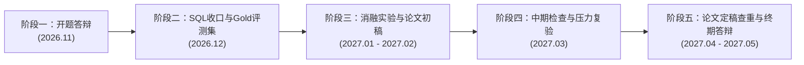

# 毕业设计全周期文档中心（开题 → 中期 → 论文撰写 → 终期答辩）

本目录基于仓库**真实已实现的源码、44 张数据库表、102 条 HTTP 契约路由与智能导购评测框架**整理而成，服务于《校园智能导购及商品交易平台的设计与实现》从**开题答辩**到**终期毕业答辩**的完整周期。

---

## 1. 文档矩阵与使用场景

| 阶段 / 用途 | 文档入口 | 核心内容说明 |
|---|---|---|
| **开题报告与开题答辩（当前阶段）** | [01 · 开题报告与开题答辩全攻略](01-OPENING-DEFENSE-GUIDE.md) | 选题背景与痛点、国内外研究现状切入角、4 大拟解决关键问题、技术路线图、12 页开题 PPT 逐页讲稿及评委 8 大必考追问应答 |
| **毕业论文正文撰写（第 1～6 章）** | [02 · 毕业论文六章蓝图与公式源码映射](02-THESIS-CHAPTER-BLUEPRINT.md) | 完整三级目录大纲、BM25 / 向量检索 / 两级 RRF 融合数学公式、评测指标公式，以及“每一小节直接对应哪几个真实源码文件”的映射表 |
| **论文系统设计图表与数据字典** | [03 · 系统规模、44表字典与架构状态图手册](03-ARCHITECTURE-AND-DATA-MANUAL.md) | 精确代码规模统计、Maven 七层依赖图、7 大限界上下文、44 张 MySQL 数据表分类字典、102 条 API 控制器分布、核心状态机与时序图（Mermaid） |
| **论文第 5 章实验与终期现场答辩** | [04 · 消融实验 SOP、现场演示脚本与终期题库](04-EXPERIMENT-AND-FINAL-DEFENSE-QA.md) | 120 例评测数据集去偏差与人工 Gold 冻结步骤、检索/召回消融实验表模板、8 分钟跨三端黄金演示剧本、断网兜底预案及 12 道硬核技术追问 Q&A |

---

## 2. 毕业设计全周期里程碑与工程注意事项

### 2.1 各阶段核心交付动作

1. **阶段一：开题答辩（2026 年 11 月）**
   - 使用 [01-OPENING-DEFENSE-GUIDE.md](01-OPENING-DEFENSE-GUIDE.md) 完成开题报告定稿与 10～12 页 PPT 制作。
   - **关键策略**：开题答辩重点讲清 **“为什么要做交易与 AI 读写物理隔离”、“如何解决通用大模型价格幻觉与内部知识越权泄漏”、“后续几个月在混合检索消融评测与并发性能优化上的研究增量”**，切忌在开题时说“我已经全部做完了没事干了”。

2. **阶段二：年底工程熔断收口与评测集定稿（2026 年 12 月，务必在 12 月 31 日前关注）**
   - **重要工程节点（`2026-12-31`）**：[verify-mapper-scan.py](../../scripts/verify-mapper-scan.py) 中登记了 4 条平台订单列表 SQL 豁免（`until: '2026-12-31'`）及 7 条搜索/管理列表豁免（`until: '2027-03-31'`）。在 12 月底前，为平台订单列表补齐默认时间窗过滤（或按校区数据量评审更新规则），这本身还能直接作为论文第 4 章“数据库查询优化与工程门禁治理”的真实案例！
   - 按照 [04-EXPERIMENT-AND-FINAL-DEFENSE-QA.md](04-EXPERIMENT-AND-FINAL-DEFENSE-QA.md) 完成 `campus-shopping-v1` 120 条样本的自然口语改写（消除商品全名直拼）与人工双审冻结（从 `DRAFT` 升为 `ACCEPTED`）。

3. **阶段三：消融实验采集与论文初稿（2027 年 1 月 ～ 2 月）**
   - 运行 `ai-service/evaluate.py` 获取 **BM25（`K-B`） vs 稠密向量（`K-D`） vs 混合 RRF（`K-H`）** 以及 **MySQL 词面召回（`P-L`） vs Milvus 语义召回（`P-D`） vs 两级融合（`P-H`）** 的真实实验数据表。
   - 对照 [02-THESIS-CHAPTER-BLUEPRINT.md](02-THESIS-CHAPTER-BLUEPRINT.md) 与 [03-ARCHITECTURE-AND-DATA-MANUAL.md](03-ARCHITECTURE-AND-DATA-MANUAL.md) 完成第 1～5 章初稿。

4. **阶段四：中期检查与全栈联调复验（2027 年 3 月）**
   - 运行隔离 MySQL + Redis + FastAPI + Chromium 全栈验收（`verify-mysql-isolated.py`、`smoke-full.py`、`live_ui.py`），截取高分辨率三端业务闭环图放入论文第 4、5 章。

5. **阶段五：论文查重、盲审修改与终期答辩（2027 年 4 月 ～ 5 月）**
   - 演练 [04-EXPERIMENT-AND-FINAL-DEFENSE-QA.md](04-EXPERIMENT-AND-FINAL-DEFENSE-QA.md) 中的 8 分钟演示剧本，提前准备本地离线演示兜底环境与答辩 Q&A 手卡。
