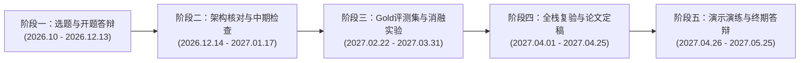

# 毕业设计全周期文档中心（开题 → 中期 → 论文撰写 → 终期答辩）

本目录基于仓库**真实已实现的源码、46 张数据库表、22 份不可变迁移、111 条 HTTP 契约路由与 3 类独立流式/媒体端点以及智能导购评测框架**整理而成，统一对齐开题报告题目《基于 Spring Boot 的校园智能导购商品交易系统设计与实现》，服务于从**开题答辩**到**终期毕业答辩**的完整周期。

---

## 1. 文档矩阵与使用场景

| 阶段 / 用途 | 文档入口 | 核心内容说明 |
|---|---|---|
| **开题报告纠偏与任务书口径对齐（优先阅读）** | [05 · 开题报告逐段修订指南与任务书口径对齐手册](05-OPENING-REPORT-REVISION-AND-ALIGNMENT.md) | 逐段对照《开题报告》与仓库源码差异，提供可直接复制的替换表述、任务书技术栈/协同过滤口径收口论证、进度表修正与 GB/T 7714 参考文献扩充方案 |
| **开题报告与开题答辩攻略** | [01 · 开题报告与开题答辩全攻略](01-OPENING-DEFENSE-GUIDE.md) | 选题背景与痛点、国内外研究现状切入角、4 大拟解决关键问题、技术路线图、12 页开题 PPT 逐页讲稿及评委 10 大必考追问应答 |
| **毕业论文正文撰写（第 1～6 章）** | [02 · 毕业论文六章蓝图与公式源码映射](02-THESIS-CHAPTER-BLUEPRINT.md) | 完整三级目录大纲、BM25 / 向量检索 / 两级 RRF 融合数学公式、评测指标公式，以及“每一小节直接对应哪几个真实源码文件”的映射表 |
| **论文系统设计图表与数据字典** | [03 · 系统规模、46表字典、111路由与架构状态图手册](03-ARCHITECTURE-AND-DATA-MANUAL.md) | 精确代码规模统计、Maven 七层依赖图、7 大限界上下文、46 张 MySQL 数据表分类字典、111 条 JSON 契约路由 + 3 类独立流式/媒体端点分布、核心状态机与时序图（Mermaid） |
| **论文第 5 章实验与终期现场答辩** | [04 · 消融实验 SOP、现场演示脚本与终期题库](04-EXPERIMENT-AND-FINAL-DEFENSE-QA.md) | 120 例评测数据集去偏差与人工 Gold 冻结步骤、检索/召回消融实验表模板、8 分钟跨三端黄金演示剧本、断网兜底预案及 12 道硬核技术追问 Q&A |
| **双 Redis 架构与风控专题（第 3/4/5 章与答辩亮点）** | [06 · 双 Redis 生产架构、防刷防爬风控与答辩专题](06-DUAL-REDIS-AND-ANTI-ABUSE-DEFENSE.md) | 物理隔离双 Redis（`redis-security` vs `redis-cache`）设计、四层防刷防爬风控矩阵、`RDelayedQueue` 提交后双队列精准驱逐、实时热销/ItemCF 推荐、`RTopic` 跨实例推送与高频评委追问应答卡 |
| **论文第 4 章正文定稿（6 节工程级完整实现）** | [07 · 第 4 章核心业务模块详细设计与实现正文定稿](07-CHAPTER-04-DETAILED-DESIGN-AND-IMPLEMENTATION.md) | 完整覆盖 4.1～4.6 六大核心业务模块的学术正文定稿，涵盖认证防爬、多规格商品/收藏/评价、交易/双队列精准关单/6 位核销码、两级混合召回与 24h 向量缓存、权限感知知识库与零锁提案、淘宝 2025 + 千牛三端前端与自动化门禁 |

---

## 2. 毕业设计全周期里程碑（对齐开题报告时间轴）

### 2.1 各阶段核心交付动作

1. **阶段一：开题报告定稿与开题答辩（2026 年 11 月 ～ 12 月 13 日）**
   - 先按 [05-OPENING-REPORT-REVISION-AND-ALIGNMENT.md](05-OPENING-REPORT-REVISION-AND-ALIGNMENT.md) 修订开题报告中的任务书口径差异、事实细节与参考文献，再结合 [01-OPENING-DEFENSE-GUIDE.md](01-OPENING-DEFENSE-GUIDE.md) 制作 10～12 页开题 PPT。
   - **关键策略**：开题答辩重点讲清 **“为什么要做交易与 AI 读写物理隔离”、“如何解决通用大模型价格幻觉与内部知识越权泄漏”、“后续在混合检索 Gold 评测集去偏差、消融实验与并发压测上的研究增量”**，切忌使用“在已有项目/已有工程上修改”的含糊表述。

2. **阶段二：架构核对、数据库治理与中期检查（2026 年 12 月 14 日 ～ 2027 年 1 月 17 日）**
   - **已完成前置清零**：原 [verify-mapper-scan.py](../../scripts/verify-mapper-scan.py) 中 4 条将于 `2026-12-31` 到期的 `trd_order` 全表扫描豁免已在 `V20261125_01` 阶段彻底收窄清零（平台订单 365 天单次截断时间窗 + 履约状态查询强制 `merchant_id`），并补齐 5 项高频锁/分页索引，可直接写入论文第 4 章作为数据库工程治理与索引优化的实证案例。
   - 核对第 1～4 章核心设计图表与中期检查材料。

3. **阶段三：Gold 评测集去偏差与消融实验（2027 年 2 月 22 日 ～ 3 月 31 日）**
   - 按照 [04-EXPERIMENT-AND-FINAL-DEFENSE-QA.md](04-EXPERIMENT-AND-FINAL-DEFENSE-QA.md) 修复 `campus-shopping-v1` 合成查询的标题词面泄漏、修正 `public-knowledge` 金标与 `runner.py` 300 SKU 截断并完成人工复核冻结（`DRAFT` → `ACCEPTED`）。
   - 运行 `ai-service/evaluate.py` 采集 **BM25（`K-B`） vs 稠密向量（`K-D`） vs 混合 RRF（`K-H`）** 以及 **MySQL 词面（`P-L`） vs Milvus 语义（`P-D`） vs 两级融合（`P-H`）** 与真实 LLM 对照数据。

4. **阶段四：全栈复验与论文定稿（2027 年 4 月 1 日 ～ 4 月 25 日）**
   - 对照 [02-THESIS-CHAPTER-BLUEPRINT.md](02-THESIS-CHAPTER-BLUEPRINT.md)、[03-ARCHITECTURE-AND-DATA-MANUAL.md](03-ARCHITECTURE-AND-DATA-MANUAL.md)、[06-DUAL-REDIS-AND-ANTI-ABUSE-DEFENSE.md](06-DUAL-REDIS-AND-ANTI-ABUSE-DEFENSE.md) 与 [07-CHAPTER-04-DETAILED-DESIGN-AND-IMPLEMENTATION.md](07-CHAPTER-04-DETAILED-DESIGN-AND-IMPLEMENTATION.md) 完成第 1～6 章撰写、查重与格式定稿；复跑隔离 MySQL + 双 Redis + FastAPI + Chromium 全栈验收并截取高分辨率三端业务闭环图。

5. **阶段五：演示演练与终期答辩（2027 年 4 月 26 日 ～ 5 月 25 日）**
   - 演练 [04-EXPERIMENT-AND-FINAL-DEFENSE-QA.md](04-EXPERIMENT-AND-FINAL-DEFENSE-QA.md) 中的 8 分钟黄金演示剧本，准备本地断网兜底环境、无剪辑录屏备份与终期答辩 Q&A 手卡，于 5 月 25 日前完成成果归档。
