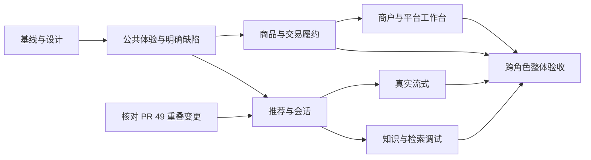

# Design

## Context

动机、业务范围和 M0～M6 交付目标见 [Proposal](proposal.md)。本文件是 2026-11-05 的整体技术方案，实施前按对应阶段刷新基线；当前核对 main 为 `c9cd43fbb19660f1112a7692fcdffdd619d4ca3b`，用户提供的静态审查标注 `27f4f6db`。静态观察不能替代运行验收。

### 已核对的实现与约束

| 事实与入口 | 对本方案的影响 |
| --- | --- |
| `frontend/src/pages/Orders.js` 的 `action()` 捕获异常，`submitRefund()` 随后关闭并清空表单 | 先修成功/失败返回语义，覆盖失败、重复提交和异步主体切换 |
| `Guide.js` 用 `store.products.find()` 关联推荐，`ProposalItemResponseDTO` 无 `productId`；`ai_proposal.items_json` 保存旧快照 | 新提案和旧提案分别处理；不能加载全目录替代可靠关联 |
| `CitationResponseDTO` 有 `documentId/title/snippet`，页面仅保留标题；`MessageResponseDTO` 无历史引用 | 实时引用可先利用已有字段，历史引用需要额外持久化与授权设计 |
| `ConversationResponseDTO` 仅有 `id/title/createdAt` | 最近活跃和摘要须有可追溯来源，不能把创建时间改名为更新时间 |
| `OrderResponseDTO` 有 `storeId`，无地点快照和事件列表；`trd_order` 亦无地点快照 | 新增快照与事件读模型需要相应持久化；不能仅连接可变 `mer_store` 冒充历史 |
| `trd_after_sale` 只有当前状态、原因、最后决定原因和创建时间；`ful_pickup_task` 无完整节点时间 | 售后与履约历史需要真实事件；历史缺口显式保留 |
| `CartResponseDTO` 已提供价格、报价版本、数量、可售状态；`Cart.js` 已提交预期价格/版本和幂等键 | 第一批确认层复用现有下单能力；保留服务端复验与同内容重试键 |
| 商品已有多图、SKU、描述；`MerchantResponseDTO` 有门店名/地点，无营业时段、介绍和门店图 | 商品展示先复用；门店新增资料需维护入口、权限和持久化 |
| `StatisticsResponseDTO` 只有总量、状态量及完成金额 | 趋势与排名使用专门的只读聚合；统计口径不能由图表自行决定 |
| `frontend/scripts/build.mjs` 使用自定义 JS 模板预编译与 IIFE；旧页面使用全局 `Vue` | `.vue` 接入需覆盖运行时、构建、开发、离线和生成副本，不能只改扩展名 |
| R1 与行为契约规定完整 JSON；SDD-12 规定 600 秒租约、短事务提交和实际执行期间的容量许可 | SSE 单独增量交付，现有 JSON、租约和执行约束必须兼容 |
| `schema.sql` 的 `uk_store_merchant` 限制一个商户一个门店 | 店铺装修与工作台不引入多门店经营语义 |

源码依据主要为上述页面、`frontend/src/services/`、Java API DTO、`ShoppingAiCaseImpl`、`campus-shopping-app/src/main/resources/schema.sql`；迁移、行为和权限依据为 [R1](../../../docs/specs/RELEASE-01.md)、[HTTP 行为契约](../../../docs/api/behavior-v1.1.md)、[SDD-05](../../../docs/specs/SDD-RBAC-05.md)、[SDD-12](../../../docs/specs/SDD-REDIS-12.md)及[已接受 ADR](../../../docs/architecture/decisions.md)。

### 原审查到交付任务的追踪

下表覆盖审查的 15 个产品化点及后文补充问题。A 表示已观察行为，B 表示目标所需数据/契约缺口，C 表示产品增强；类别与优先级不表示安全严重程度。具体实施任务见 [Tasks](tasks.md)。

| ID | 审查事项与本次判断 | 阶段 / 任务 | 主要交付 |
| --- | --- | --- | --- |
| R01 | SSE 缺失：审查标 A，本方案按新增 C 处理 | M3 / 4.6～4.9 | 兼容 JSON 的真实流式协议和生命周期 |
| R02 | AI 新对话入口：补充用户入口 | M1 / 2.6 | 账号/会话隔离的新对话 |
| R03 | 历史缺少最近活跃与摘要：B | M3 / 4.3 | 真实更新时间、受控摘要与稳定分页 |
| R04 | 提案详情关联依赖首屏缓存：A/B | M3 / 4.2、4.5 | 可靠商品 ID、旧快照兼容和失效反馈 |
| R05 | 商品详情展示不足：C | M2 / 3.2 | 多图、SKU、描述、状态和统一详情入口 |
| R06 | 店铺主页信息不足：C | M2 / 3.3 | 可维护、可信的营业与公开资料 |
| R07 | 首页筛选不足：C | M2 / 3.1 | 完整查询价格筛选、排序与重置 |
| R08 | 购物车缺少确认环节：C | M2 / 3.4 | 刷新后的确认页及变价/缺货恢复 |
| R09 | 订单时间线不足：B | M2 / 3.6、3.8 | 实际事件、稳定排序和历史缺失语义 |
| R10 | 售后过程不足：B | M2 / 3.7、3.9 | 申请、商户决定、介入和裁决历史 |
| R11 | 库存操作效率不足：C | M4 / 5.2 | 低库存条件、流水分页和单据定位 |
| R12 | 经营分析不足：B/C | M4 / 5.5 | 有口径的期间聚合与商品表现 |
| R13 | 平台审核记录不足：B/C | M4 / 5.6、5.7 | 授权的审核/监管历史和前序上下文 |
| R14 | RAG 检索测试缺失：C | M5 / 6.2～6.4 | 专用受控调试接口与界面 |
| R15 | 加载、空态、错误恢复不统一：A/C | M1 / 2.2、2.3 | 公共状态组件与表单失败规则 |
| R16 | 引用只保留标题：A；历史引用缺失：B | M1 / 2.7；M3 / 4.4 | 当前引用先恢复，历史引用另建可靠记录 |
| R17 | 订单地点依赖商户列表且可变化：B | M2 / 3.5、3.8 | 新订单快照、旧订单缺失标识 |
| R18 | 退款失败清空原因：A | M1 / 2.1 | 明确成功返回，失败保留输入 |
| R19 | 商户订单效率、人员和权限体验 | M4 / 5.1、5.3、5.4 | 待办筛选、位置保持、操作反馈与权限回归 |
| R20 | DTO/VO/数据库职责混淆风险 | 各阶段；D4、D5、D7 | 数据来源分级、领域事实与查询展示分离 |
| R21 | 多门店、真实资金、属性系统和盘点等商业化边界 | 后续需求池 | 明确不在本轮自动引入，见 D10 |
| R22 | 知识版本、索引诊断和引用预览 | M5 / 6.1、6.4 | 当前尝试的安全诊断与发布/撤回一致性 |

## Goals / Non-Goals

**Goals:** 用可逐批审查的改动贯通 UI→HTTP→Case→领域/查询→持久化；每批写清业务目标、影响范围、不变量和验收条件。接口展示缺口与业务事实缺口分开处理，旧数据保持可用，正常与失败路径同时设计。

**Non-Goals:** 不迁移整个商城的 SDD 权威归属，不一次重写前端，不新建第二套 DDD 标准。此次规划不编写生产 DDL、不改服务、不读私有配置、不产生业务测试结果。业务范围外能力见 Proposal；纯修复不因纳入总路线而强制单独写一份 SDD。

## Decisions

### D1. 一份总方案，按业务链路拆分交付

本变更保存整体目标、新增行为和实施任务；每个实现 PR 只选择一个可审查范围，并在任务中登记对应 PR/证据。M2 的订单与售后链路同步修改各角色写入和读取，不能只完成消费者时间线页面就宣告交付。

M1 与 PR #49 的核对可以独立推进；只在 AI 提案、引用、检索等实际重叠处建立依赖。实施相关阶段时检查 PR 的实际状态、当前差异和每条未解决意见，不能把旧 CI 或未解决线程数量直接等同于当前结论。

替代方案是把审查五批做成五个大 PR，或等待所有依赖都结束再做页面；这会增加审查难度并延迟独立修复。采用里程碑加小 PR，按最终差异选择验证，避免无变化的反复全量测试。

### D2. Vue 3 + Vite 渐进组件化

保留现有应用与路由。先选低风险公共卡片/状态组件接入与锁文件版本兼容的 Vue SFC 编译能力，再随业务任务迁移页面；旧 JS 组件与新 `.vue` 在过渡期共存。运行时统一为一个自托管 Vue 实例，兼容入口必须先于旧组件执行，避免同时加载全局与打包的两个实例。

开发、构建和离线入口都要覆盖。生产及离线页面继续预编译模板，不放宽 CSP；生成静态副本由现有脚本维护，要求新源码可重复构建且副本一致，不要求修改后的 bundle 与旧 bundle 字节相同。格式、文件发现、源码指纹和浏览器检查须覆盖 `.vue`/`.ts`。

TypeScript 先试点 API 类型和新增组件，配置 JS/TS 共存并加入独立 `vue-tsc --noEmit`；API 类型依据生成契约核对，视图状态类型与传输类型分开。试点检查通过后推广，不把全仓改写设为业务迭代前置。

参考图转为统一间距、字体、紫色强调色、卡片/表单/表格/时间线规范；公共组件负责加载、空态、错误、提交中、禁用、重试和键盘可操作性。保留现有图标和可复用能力。AI 页、订单页和后台列表作为三种代表页面，在手机窄屏及桌面验收。

替代方案是换框架或先迁完全部页面；当前缺口主要是链路和契约，没有支撑这类整体重写的收益证据。

### D3. 表单结果和请求生命周期统一

对已定位的退款问题，让动作明确返回成功结果或向调用者传递失败；只在业务成功且仍属于同一账号/订单时关闭表单与清空原因。将“写入成功但刷新失败”与“写入失败”区分，前者提示刷新问题，不诱导重复提交。

按具体发现检查登录、入驻、商品编辑、补货、审核等表单，保持请求期间的防重复操作与原幂等键语义。失效响应不能修改新页面或账号状态。现有正确逻辑直接复用，不为统一外观引入全局业务异常处理器或改写所有页面。

### D4. 商品、店铺与结算按数据来源推进

已有字段未展示的先补 UI；数据库已有但未映射的补授权查询；真正不存在的事实才新增维护与持久化。商品多图和 SKU 模型保留。价格区间采用“至少一个当前可售 SKU 命中”的语义，过滤在分页之前执行，卡片价格与匹配规格一致。

门店介绍、图片、营业时段由具备现有门店管理权限的主体维护。字段缺失显示未填写；营业展示不增加自动暂停交易规则。首版时区采用项目业务时区并在维护/展示中明确，不按浏览者设备时区悄悄改变营业含义。店铺图片复用上传归属能力前，补齐门店用途的授权/认领语义，不能仅因取得 URL 就跨商户引用。

结算确认先重新获取当前购物车与门店资料，使用现有 `POST /orders` 提交，并保留预期价格、版本及同内容重试幂等键。确认页不预占库存。变价、缺货、停用时刷新并要求重新确认；同一提交结果未知时恢复既有结果。只有未来增加权威促销报价等明确需求，才单独设计订单预览接口。

替代方案是把截图全部字段加进商品 VO、前端猜标签或立刻重建规格矩阵；这些不能保证数据可信且会扩大交易模型。

### D5. 订单快照和事件属于实际业务事实

新订单在创建事务内从受控门店数据保存名称、地点快照，客户端不能传入任意字符串作为可信快照。原 `storeId` 保留身份职责。历史订单保持缺失标识；如展示当前门店资料，单独标注其当前语义，不以当前值批量伪造历史快照。

履约和售后采用只追加的业务事件记录，至少保存稳定事件标识、对象、事件类型、发生时间、必要角色/原因及业务去重依据。消费者视图只投影必要信息；凭证明文、敏感诊断和额外个人信息不进入普通时间线。

事件与相应成功状态转换在原 Case 同库短事务内原子写入。沿用已有订单和 SKU 锁序；如快照读取或新增记录需要锁，先核对相关门店修改/履约路径的顺序，不引入倒置。幂等重放返回已有结果，失败回滚不能留下成功事件。事件只是审计事实，不创建第二套状态机，也不为时间线引入 Outbox 或远程事务。

读取按对象及稳定时间/标识排序，列表分页并批量组装；避免每张订单卡片逐条查事件。历史能从可靠原记录恢复的仅展示可证明节点，其余明确未知。售后保留原申请、各次商户/平台决定和介入记录，不能用 `decisionReason` 重建全部历史。

自提二维码若采用，浏览器本地编码服务端实际签发凭证，不发送到第三方生成站点；保留文本、有效期、重签与无障碍入口。退款处理中、已核销和过期状态继续由原服务端规则约束。

替代方案是实时连接门店表冒充快照、平铺大量时间字段或由前端猜事件；都无法可靠表达历史。新增持久化的具体迁移须与同阶段 API/领域修改一起评审，不能修改已发布迁移。

### D6. AI 先完成正常会话，再交付流式生命周期

推荐卡片直接使用提案快照；新提案从可信 SKU→商品关联保存/提供 `productId`。旧 `items_json` 可缺少新字段：通过批量授权只读关联恢复可访问的身份，缺失或不可访问时返回明确可用性，前端禁用详情入口并保留合法快照。不得伪造空 ID 满足非空契约，不逐项 N+1 查询，不把当前价格覆盖为历史报价。确认仍按现有价格、库存、经营资格、期限和幂等校验执行。

新对话先复用现有可空会话标识入口，通过账号与会话请求代次隔离异步结果。最近活跃时间从实际成功保存消息得到；会话页查询批量聚合或维护受控读模型，不每条会话查询一次消息。列表按时间和 ID 稳定排序。

实时引用直接保留现有结构。新历史引用保存必要的文档版本/证据定位和允许持久化的公开片段，在消息完成的短事务内提交；读取再次执行现有权限与撤回规则。旧消息缺引用时明确缺失，不重新检索冒充当时证据；内部或受保护内容继续遵守已有外发和持久化限制。

SSE 采用新增入口（拟为同源 `POST /ai/chat/stream`）与独立流式传输适配，现有完整 JSON 入口保持兼容。客户端用可携带同源 Cookie/CSRF 的请求读取事件，不通过 URL 传凭据。HTTP 错误在开始事件流之前遵循安全错误响应；流中错误使用约定的安全终态事件，不能直接抛出下游正文。

协议区分开始、实际进度、文本增量和最终成功/失败/取消。最终可确认提案与引用只在授权复验、消息/提案/租约完成原子提交后发布。首版不承诺逐事件续传：断线后读取原会话的保存结果与受控运行状态，不自动重发问题；必要状态查询不得暴露内部租约令牌。

取消请求绑定当前轮次并可被多 Java 实例读取，不能仅保存在某台 Java 的内存中。执行器请求下游停止；供应商无法即时取消时显示等待实际结束，保持资源许可，禁止把迟到结果当成功提交。继续使用 600 秒租约与过期轮次隔离，远程生成不持有数据库事务。流式发射使用有界缓冲与超时，慢客户端不能无限占用内存。具体取消状态与必要迁移在独立流式 PR 中一并实现。

实际供应商不支持流式时明确完整响应模式，保留普通导购能力；不得切割完整文本模拟流式或用替身结果宣称真实首字性能。SSE 的可选性仅指运行模式兼容，本路线仍要求单独完成其实现与列明范围验证。

### D7. 商户与平台使用专门的查询视图

待办和明细复用现有订单/审核分页与动作接口。状态、权限判断仍在领域和服务端；前端负责显示、保持筛选和反馈。库存低量以可售量和明确阈值筛选，流水分页并按现有业务键定位单据；不提供任意覆盖数量的“盘点”按钮。

统计使用授权的只读聚合查询与专用 DTO，不把图表数据塞进领域聚合，不在前端拉全量订单计算。首版默认提供近 7 天/30 天，区间为明确业务时区下的左闭右开时间范围，返回统计截至时间。选取该区间创建的订单群组：趋势为新增订单数量，状态分布与完成金额为查询时状态；商品表现为群组内当前已完成订单的 SKU 数量汇总，再按商品归集。

退款率分母为群组内具有成功模拟付款事实的订单数，分子为其中具有成功整单模拟退款事实的订单数，零分母不可计算。此口径能用现有事实定义，不冒充完成日/退款发生日现金流。若未来需要按完成时间统计，必须使用可靠事件时间，并独立说明旧数据覆盖。金额全部为整数分；注明模拟业务，不推算利润。

平台审核与监管历史优先复用可证明的已有记录，缺失动作记录按 D5 同样的原子、幂等与权限原则补齐。售后裁决历史直接复用售后能力，避免两套相互不一致的记录。公开视图裁剪内部操作身份和诊断信息。

替代方案是扩充一个万能统计 DTO 或前端遍历全部订单；会混淆口径、泄露范围并放大查询成本。查询上限、索引与执行计划随聚合 PR 验证，不先引入缓存或新分析数据库。

### D8. 知识调试复用正式权限和检索链路

知识页展示当前版本、发布状态、索引尝试和安全失败类别，重试沿用既有任务边界。`index_attempt` 不匹配的结果不能改变当前状态；错误摘要不得直接使用下游异常正文。

新增专用调试请求/响应与权限判定，主体必须具有对应知识维护/读取能力；平台权限不自动获得任意商户私有内容。服务端产生当前可见版本白名单，消费者预览使用消费者范围，内部视图也在主体授权内。调用正式检索 Port，结果返回前再复验撤回、版本和权限；不引入可绕权的生产 debug 开关。

输出文档/版本、可授权片段、排序与分数类型，区分 BM25、向量或融合结果，不把分数包装成正确率。回答预览按实际调用模式与当前配置明确展示，不默认启用真实外部模型；调试也占用真实容量并限流。新接口与 UI 不替代 [既有评测变更](../evaluate-shopping-retrieval-recommendations/proposal.md)的人工标注和真实实验。

### D9. 资料归属、测试和交付门禁

本变更的九份 delta 只维护新增体验/读模型行为；R1 的身份、权限、交易、召回与租约规则继续引用原文档。已有缺陷修复在 PR 写清触发条件与回归；涉及 API/数据/权限的任务同步相关 SDD/契约，有新增架构取舍才追加 ADR。归档/同步前核对首次能力边界并更新引用，禁止重复维护两份权威规则。

| 实际影响 | 必需的验证与交付内容 |
| --- | --- |
| 本次纯规划 | OpenSpec 严格校验、能力文件对应、任务未误勾选、Markdown 本地链接与 Git 差异检查；不记业务测试通过 |
| 页面与 SFC/TS | 格式、相关浏览器交互、`build-ui-bundle.py` 生成及 `--check`、开发/离线/Java 静态服务；引入 TS 后独立类型检查 |
| API/DTO | 生成 API 契约，验证契约/schema，响应规则同步；新旧响应和字段缺失边界用例 |
| 快照/事件/迁移 | schema 生成审查，新库/升级/重放/校验和拒绝；真实 MySQL 原子性、竞争、幂等及历史数据 |
| 交易/权限 | 真实 MySQL、所需隔离 Redis、HTTP 越权/CSRF/撤权、多 Java 共享状态；页面隐藏不能充当授权 |
| AI/流式/调试 | Python/Java 定向与适用全套、容量/超时/旧轮次/断线/取消/降级；区分替身与真实供应商 |
| PR 与最终整合 | 最新提交对应的必需 Actions、必要真实交付镜像；发生新修改或失败才补充对应复验 |

遵守本次会话约定：本地只执行所需定向测试/打包，全量 Maven/Compose 由隔离 CI 承担。业务验收使用新建隔离库和隔离 Redis；缺依赖记未运行。结果存 `docs/testing/`，不把流水追加到 `AGENTS.md`。实际命令以仓库开发流程和脚本帮助为准，不把本设计的计划命令写成已经执行。

### D10. 外部依赖与后续需求池

| 项目 | 当前处理方式 |
| --- | --- |
| 正式域名与七牛 HTTPS | 备案后独立复验；当前测试域名只沿用已授权的本机开发例外，不能推广到生产 |
| 七牛样本用于产品演示 | 云端已有样本不等于持久业务库已有商品；新验收须在隔离数据中通过真实上传/归属认领关联商品，不伪造归属 |
| 真实模型、Embedding、Milvus 与人工效果评审 | 沿用现有评测任务及安全/预算授权，独立报告；不能用本轮页面和替身验收代替 |
| 多门店、真实资金、已提货退货、营销与动态属性 | 独立产品需求，影响状态机和数据语义，本轮不实现 |
| 完整库存盘点 | 后续设计盘点单、差异确认、原因、审计和并发控制；本轮只做库存查询与现有补货体验 |
| 泛化批量操作 | 待具体场景证明收益后，单独定义权限、幂等和逐项失败语义，不一次新增通用批量写接口 |
| 会话删除/留存、生产 HA、性能与备份恢复 | 保持现有未交付边界，另行排期与验收 |

## Risks / Trade-offs

- [审查基线落后或 PR #49 发生变化] → 每批核对实际 main 和重叠差异，独立任务继续推进，不搬运旧实现或旧 CI 结论。
- [新旧 Vue 组件共存导致双运行时、CSP 或离线回退] → 单组件先验证唯一运行时及完整构建，再迁页面；生成文件由脚本维护。
- [旧提案/订单缺少新字段] → 只恢复可证明的关联，保持显式缺失和版本兼容，不放宽现有必填断言来掩盖错误。
- [事件写入扩大事务并引入死锁或重复] → 只追加必要事实，沿用稳定锁序和业务去重，真实 MySQL 验证回滚/竞争/重放。
- [统计口径与截图名称不一致] → 展示期间、群组、截至时间和模拟语义；不使用“利润”“实际到账”等无依据标签。
- [SSE 断线或取消先释放容量、迟到提交] → 以执行终态和当前轮次为准，有界输出，实际执行结束前保持许可。
- [调试入口泄露私有知识或制造外部调用] → 服务端白名单、返回前复验、专用权限、限流与安全模式说明。
- [多个阶段一次混合提交] → 每 PR 选择明确链路、验收和相应任务；规格存在不代表实现或合并完成。

## Migration Plan

1. 每批从当时最新 main 的 `codex/` 分支开始；保留其他工作树及 ignored 证据。规划分支只承载本目录和文档入口，现有业务基线不因文件落盘改变。
2. 前端先接入 SFC 兼容构建并验证，随后逐页迁移；回退使用对应源码/锁文件版本重新生成，不手改静态副本。
3. 新字段/事件表采用新增不可变迁移，旧字段兼容读取；先新库和隔离旧库升级/重放验证，再由明确授权的维护窗口升级既有库。旧历史缺失不以当日资料回填为事实。
4. 读写切换保持状态转换与事件写入原子。回退先停止新能力写入或回到兼容应用版本，保留已有事件和快照；如数据库版本门禁不允许旧应用启动，则采用兼容修复版前滚，不承诺旧二进制可任意回退，不删除记录或修改迁移历史。
5. JSON/SSE 分开交付并保留兼容入口。流式关闭或供应商不支持时恢复明确的完整响应模式，未完成任务不提前释放实际资源。
6. 每批记录实际提交、环境、命令、原始失败、修复及未运行范围；最终 M6 再核对各链路和该版本 CI。能力基线同步、归档、提交合并、部署与数据迁移按相应完成条件及授权办理。

## Open Questions

以下是不会改变当前业务边界的实施时核对项，均有明确默认方案，不作为拖延其他阶段的理由：

- 实施时 PR #49 是否已合并及剩余有效意见：M3 前重新读取，按真实交集整合；不会假定旧线程数等于缺陷数。
- 正式域名和可用证书何时就绪：待用户提供后安排独立 HTTPS 验收，其他阶段不等待。
- 实际配置供应商支持哪些流式/取消信号：用该供应商的受控契约验证；缺支持时按 D6 明确完整响应或取消处理中，不能伪报能力。
- 公共组件试点选哪个低风险组件、统计查询需哪些索引：分别由构建与查询验证决定，不更改行为规格、指标口径或任务范围。
